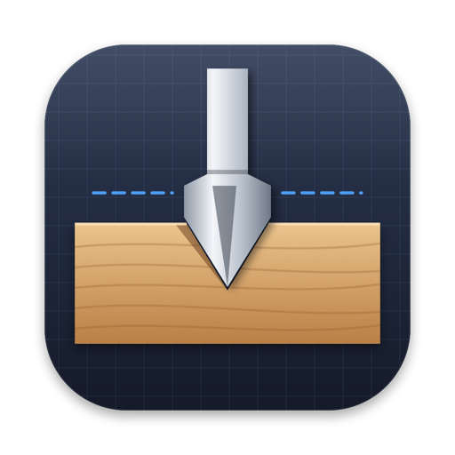
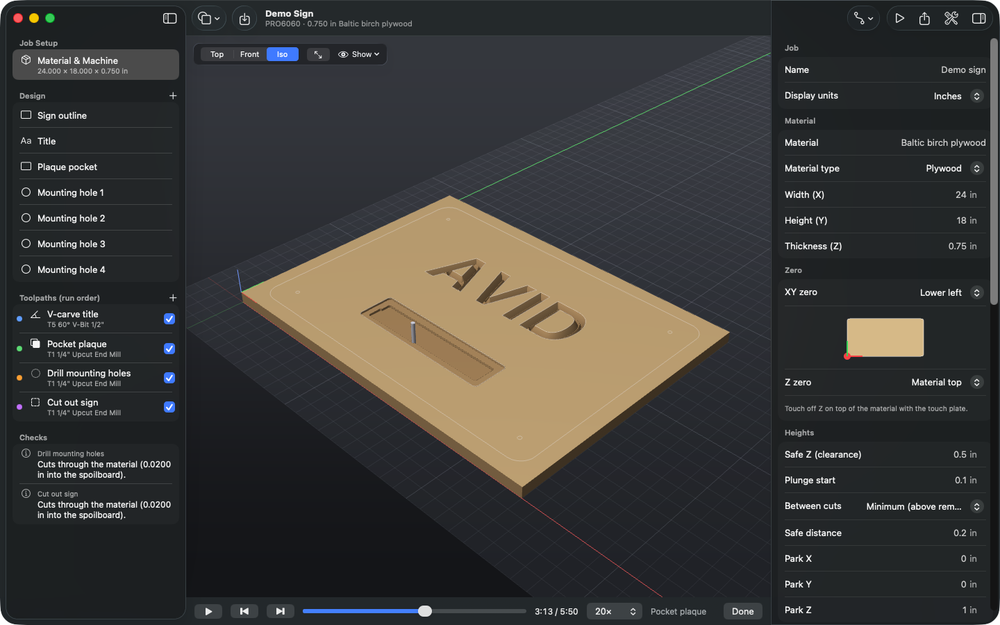
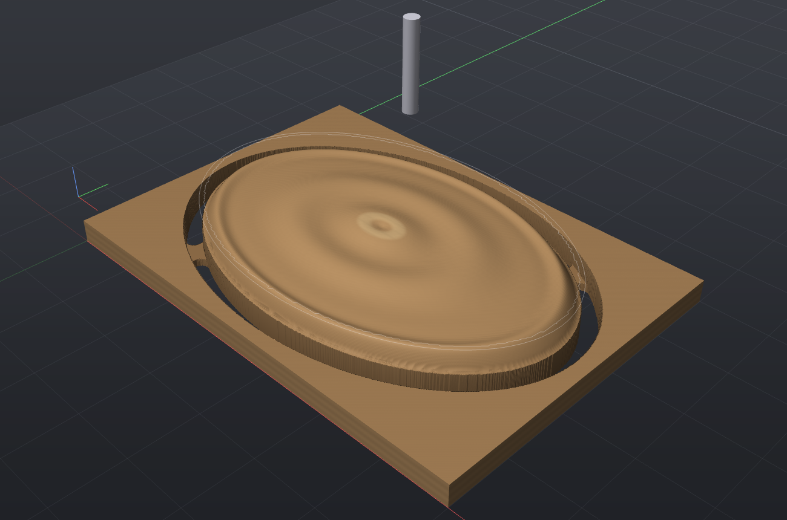

<p align="center">
  
</p>

<h1 align="center">NativeCAM</h1>

<p align="center"><b>A native Mac CAM app for Avid CNC routers.</b></p>

<p align="center">
  
  
  
  
  
  <a href="LICENSE"></a>
</p>

Design or import your artwork, set up the material and bits, generate 2.5D and 3D toolpaths, watch the material-removal simulation, and export Mach4 `.tap` G-code in the same dialect Avid's own posts produce.

Built in SwiftUI and Metal for Apple silicon. No Rosetta, no Electron, no Windows VM. Free and open source under the [GPL-3.0](#license).



> [!WARNING]
> NativeCAM is early and incomplete. It was written almost entirely by AI ([details](#how-nativecam-was-built)), and testing on actual machines is ongoing. Because it drives a machine with a spinning cutter, **air-cut every new program before running it on material**, and keep a hand near the E-stop. Default feeds and speeds are conservative starting points for plywood and hardwood, not recommendations for every bit and material.

---

## Highlights

<table>
  <tr>
    <td width="50%"></td>
    <td width="50%"></td>
  </tr>
  <tr>
    <td align="center"><sub>Toolpaths: V-carve (blue), pocket (green), drill, profile with tabs (purple)</sub></td>
    <td align="center"><sub>Simulated result, carved by each bit's true shape</sub></td>
  </tr>
  <tr>
    <td width="50%"></td>
    <td width="50%"></td>
  </tr>
  <tr>
    <td align="center"><sub>3D relief: roughing, ball-nose finishing, cut-out</sub></td>
    <td align="center"><sub>Tool library with real cutter geometry</sub></td>
  </tr>
</table>

- **Made for Avid machines.** PRO4848, PRO4896 and PRO6060 presets (PRO6060 with a VFD spindle, manual tool change and touch plate by default), or custom travel. Router or spindle, ATC, M6 or M0 tool changes, dust collector control.
- **Real stock setup.** Material size and thickness, XY zero at any corner or the centre, Z zero on the material top or the spoilboard, safe and plunge heights, park position. Work in inches or millimetres.
- **2.5D toolpaths.** Profile, pocket, drill and V-carve, with tabs, ramps, islands, multi-pass and climb or conventional cutting.
- **3D toolpaths.** Import STL, OBJ, 3MF, USDZ or PLY and carve it as a relief with layered roughing and drop-cutter finishing.
- **Simulator.** A Metal-rendered heightmap carved by each bit's actual profile, with play, pause, scrub and speed control, timed like the real job. It also simulates `.tap` files from other CAM programs.
- **Less time in the air.** Between cuts the tool lifts only as high as the material that's left, stays down across areas it has already cleared, and goes over clamps you mark. Cuts within a toolpath are ordered for short travel, and roughing passes round off corners so the machine keeps moving. **Optimize Run Order** groups toolpaths by tool to save manual tool changes, without ever cutting a part free before the work inside it is done.
- **Realistic run times.** Estimates account for your machine's acceleration, corner speeds, Mach4's look-ahead and tool-change time, not just distance divided by feed.
- **Job checks.** Before you post, NativeCAM warns about cuts into the spoilboard or a clamp, depth beyond flute length, toolpaths outside the work area, rapids through material, out-of-range feeds or RPM, chip loads too thin for the material (with a one-click recommended feed), a run order that cuts a part free too early, and two different bits sharing one tool number (which would skip a tool change and cut with the wrong bit). On export it also reads the G-code file back: every line is checked against the controller (units, accepted codes, arc radii, dwell format, the spindle on before cutting, a lift to safe Z after each tool change), every cutting move, arc, feed, dwell and tool is compared with the toolpaths it came from, and the whole program, retracts and park included, is measured against the machine's travel.
- **Feels like a Mac app.** Document windows, real menus and shortcuts, undo, drag-and-drop import, right-click menus, trackpad gestures, and Liquid Glass controls on macOS 26.

## Getting started

### Requirements

- A Mac with Apple silicon running **macOS 14 Sonoma or later** (macOS 26 for Liquid Glass)
- The **Swift 6 toolchain**. The Xcode Command Line Tools are enough (`xcode-select --install`); full Xcode is optional.

### Build and run

Clone the repository, then from its folder:

```bash
scripts/build-app.sh --open
```

This builds a release `build/NativeCAM.app` for arm64, ad-hoc signs it and launches it. Drag it to `/Applications` if you want to keep it. Leave off `--open` to build without launching.

### Your first job

1. Choose **File ▸ New Demo Sign Project** (2.5D) or **File ▸ New Demo Relief Project (3D)** to open a ready-made job. Both are also saved in [`examples/`](examples/) with their G-code.
2. Press **⌘R** to simulate, and scrub the timeline at the bottom of the window.
3. Press **⌘E** to export G-code for Mach4.

## Workflow

| Step | Where |
|---|---|
| **1. Set up the job** | Select **Material & Machine** in the sidebar. Set the material size and thickness, XY and Z zero, heights, and your Avid model. |
| **2. Add artwork** | Use the shape button in the toolbar for rectangles, circles, ellipses, polygons, stars and text (any installed macOS font), or import a file with **⌘I** or by dropping it on the canvas. |
| **3. Pick bits** | Open the **Tool Library** (**⇧⌘T**) to add or edit bits: flat, ball, bull nose, V-bit, engraving, surfacing and drill, with full geometry and feeds and speeds. |
| **4. Create toolpaths** | Select vectors, then use the toolpath button in the toolbar or right-click them. Toolpaths run in sidebar order; drag to reorder, or choose **Toolpaths ▸ Optimize Run Order** for the fewest tool changes (**⌘Z** puts the old order back). |
| **5. Review checks** | Warnings appear under **Checks** in the sidebar as you edit. |
| **6. Simulate** | **⌘R** plays the material-removal simulation; **⌘.** stops it. |
| **7. Export** | **⌘E** checks and saves a `.tap` file. **File ▸ Export Air Cut…** (**⌥⌘E**) saves the same program with every Z raised by a height you choose, to run above the material first. **File ▸ Export Setup Sheet…** saves a printable page with the material, zero, tools in loading order, run order and times. In Mach4, load the file, zero X/Y and touch off Z with your plate. |

### Supported files

| Kind | Formats | Notes |
|---|---|---|
| Vectors | **DXF** | Lines, arcs, circles, polylines with bulges, splines, ellipses, blocks and inserts, `$INSUNITS`. POINT entities become drill marks. Loose segments are chained into closed loops. |
| | **SVG** | Full path grammar, transforms, viewBox units |
| | **PDF**, **Illustrator `.ai`** | PDF-compatible `.ai` files. Handles nested groups, page rotation and the crop box. |
| 3D models | **STL** (binary/ASCII), **OBJ**, **3MF**, **USDZ/USD**, **PLY** | 3MF includes Bambu and Prusa multi-part files. Choose the up axis, flip, size, carve depth and how far below the surface the top sits. |
| G-code | **`.tap`**, **`.nc`** | Opened for simulation only (**File ▸ Simulate G-code File…**, or drop on the canvas) |
| Tool libraries | **Fusion 360** `.tools` / `.json`, **Vectric** `.vtdb`, NativeCAM `.json` | **Tool Library ▸ ⋯ ▸ Import Tools…** lists the bits by the library's folders. Search, filter by type and tick the ones you want. Vendors such as Amana Tool publish their bits in these formats. Values a library leaves out (Vectric files have no cutting or shank lengths) are read from the bit's name where possible, otherwise filled conservatively and marked ⚠ (details in the tool's notes). Tapered ball nose, form, dovetail, roundover and thread bits are listed as not imported. Vectric's older `.tool` files aren't supported. |
| Projects | **`.nativecam`** | JSON document |

### Keyboard and mouse

| Action | How |
|---|---|
| Select | Click a vector's line (for text, click inside a letter). Shift- or ⌘-click to add or remove. |
| Marquee select | Drag on empty canvas in Top view |
| Move | Drag selected vectors, or nudge with the arrow keys (Shift moves 10×) |
| Orbit | Drag empty canvas in 3D views, or Option-drag anywhere. Trackpad rotate spins the view. |
| Pan / zoom | Two-finger scroll or right-drag / pinch or scroll wheel |
| Context menu | Right-click or Control-click a vector to add toolpaths, duplicate, center on material or change views |

| Shortcut | Command | | Shortcut | Command |
|---|---|---|---|---|
| ⌘I | Import | | ⌘1 / ⌘2 / ⌘3 | Top / Front / Iso view |
| ⌘E | Export G-code | | ⌘0 | Zoom to fit |
| ⌥⌘E | Export air cut | | | |
| ⌘R | Simulate | | ⌥⌘I | Show or hide inspector |
| ⌘. | Stop simulation | | ⇧⌘T | Tool library |
| ⇧⌘R | Recalculate all toolpaths | | ⌘D | Duplicate |

## Command line

`nativecam-cli` runs the same engine without the UI. It is handy for scripting, CI, and checking G-code from other programs.

```bash
swift run -c release nativecam-cli demo demo.nativecam              # write the demo sign (demo3d: 3D relief, new: empty project)
swift run -c release nativecam-cli post demo.nativecam -o demo.tap  # generate toolpaths, run checks, write G-code
swift run -c release nativecam-cli post demo.nativecam --air-cut 1 --sheet demo.html  # air cut 1" up, plus a setup sheet
swift run -c release nativecam-cli sim demo.nativecam --png out.png # simulate, report, render the result as a heightmap
swift run -c release nativecam-cli sim other-cam-job.tap            # simulate G-code from any CAM program
swift run -c release nativecam-cli tools vendor.vtdb -o tools.json  # convert a Fusion 360 or Vectric tool library
swift run -c release nativecam-cli machine Machine.ini --apply job.nativecam  # read controller limits into a project
```

```text
$ nativecam-cli post demo.nativecam -o demo.tap
[info] Drill mounting holes: Cuts through the material (0.0200 in into the spoilboard).
[info] Cut out sign: Cuts through the material (0.0200 in into the spoilboard).
Generated 4 toolpaths in 0.01s, 893 lines -> demo.tap
Estimated run time: 0:06:54 (cutting 0:05:30, rapids 0:00:24, tool changes/pauses 0:01:00; distance/feed alone: 0:06:26)
  V-carve title: 0:01:26
  Pocket plaque: 0:02:18
  Drill mounting holes: 0:00:19
  Cut out sign: 0:01:48
```

`post` refuses to write a file that fails its checks unless you pass `--force`. `sim` also accepts `--cell <mm>` to set the simulation grid resolution.

## Avid Mach4 G-code

The post is modelled on Avid's own Vectric post (v3) and Fusion 360 post, so files behave like the ones Avid supports:

- `.tap` extension, CRLF line endings, parenthesised comments (nested parentheses become braces)
- Safety line `G00 G94 G20 G17 G90 G40 G49 G80` (or `G21` for metric), then `G91.1` for incremental I/J
- Tool changes retract, stop the spindle, then call `T#M6`, so Avid's M6 macro handles the manual change and touch plate. ATC machines also get `G43 H#`. An optional `M00` pause mode is available for setups without an M6 macro.
- `M07` turns the dust collector on after each tool change, then `S#### M03` and an optional `G04 P#` spin-up dwell
- Arcs as `G02`/`G03` with I/J, each under 180°, including helical arcs. 4 decimal places in inches, 3 in millimetres.
- Footer retracts, parks, then `M05`, `M09`, `M30`

<details>
<summary>Sample output (excerpt from posting the demo sign)</summary>

```gcode
(Demo sign)
(Post: Avid CNC Mach4 - NativeCAM 0.1)
(Created: 2026-11-19 07:38)
(Machine: PRO6060 {5 x 5 ft}, spindle, Manual {M6})
(Material: Baltic birch plywood X=24.0000 Y=18.0000 Z=0.7500 in)
(Z zero: Material top   XY zero: Lower left)
(Program extents: X0.8750 to X23.1250  Y0.8750 to Y17.1250  Z-0.7700 to Z0.1000)
(Safe Z = 0.5000)
(Tools used:)
(  T5 60deg V-Bit 1/2in - D0.5000 V-Bit)
(  T1 1/4in Upcut End Mill - D0.2500 End Mill)
G00 G94 G20 G17 G90 G40 G49 G80
G91.1
(Change to Tool: T5 60deg V-Bit 1/2in)
T5M6
M07
S18000 M03
(Toolpath: V-carve title  Tool: T5 60deg V-Bit 1/2in)
G00 Z0.5000
G00 X7.1025 Y9.7568
G00 Z0.1000
G01 Z-0.0117 F30.0
```

</details>

## Other controllers (experimental)

Besides Avid's Mach4 profile, NativeCAM writes G-code for **Grbl 1.1, grblHAL, FluidNC and Carbide Motion** (Shapeoko, X-Carve, LongMill, many DIY machines), for **LinuxCNC, Masso, Centroid CNC12** (including Avid's EX controller) **and Buildbotics** (Onefinity's original controller), **RichAuto DSP** controllers (Axiom and many full-sheet routers), and **ShopBot** part files in OpenSBP. None of these has been run on real hardware yet: they follow each controller's documentation, so treat the output as unverified, run the acceptance test below, then air-cut.

| Controller | What NativeCAM writes |
|---|---|
| LinuxCNC | `.ngc`; `G91.1` and `G64 P` blending at the arc tolerance; `T# M6` then `G43 H#` (LinuxCNC's M6 doesn't apply the tool length); `M8`; `G4 P` in seconds; checked strictly, as LinuxCNC rejects anything it doesn't know |
| Masso | `.nc`; `T# M06` (Masso applies the length itself); `G4 P` in whole **milliseconds**; no `G43`, `G64` or `G91.1`, which Masso's documentation doesn't list |
| Centroid CNC12 | `.cnc` with CRLF, as Avid's EX posts write; `T# M6` then `G43 H#` from CNC12's tool library (a tool with no length gets 0, so re-zeroing Z still works); `M7` |
| Buildbotics | `.nc`; `G91.1`; `T# M6`, which pauses for the change by default |
| ShopBot (OpenSBP) | `.sbp` part files, not G-code: a check of ShopBot's unit setting before any move, `SA`, `MS`/`JS` speeds in units per second, `M2`/`M3`/`MZ` and `J2`/`J3`/`JZ` moves, `CG` arcs (depth-changing arcs as short moves), `PAUSE n` dwells and `END`. Spindle `TR`/`C6`/`C7` and tool change `&Tool`/`C9` follow ShopBot's own posts. Without a tool changer each tool gets its own file. NativeCAM reads `.sbp` files back to check them, and **Simulate G-code File…** opens them too |
| RichAuto DSP | `.nc` in millimetres only, with no comments and arcs as short lines (their handling isn't documented), one file per tool |

### Grbl family

These parsers are strict, so the post only writes what each one accepts:

- `G90 G94 G17` and `G20`/`G21`; no `G64`, `G90.1`, `G43 H` or canned cycles. `.nc` files with LF line endings, every line within Grbl's 79-character limit (126 on FluidNC); long comments are shortened.
- `M8` for the dust collector (stock Grbl has no `M7`), `S#### M3`, and `G4 P` dwells in seconds.
- Arcs as `G2`/`G3` with incremental I/J, cut as lines where rounding would trip Grbl's arc check (error 33).
- **Tool changes.** Stock Grbl rejects `M6` but keeps running the lines after it, so the next tool's cuts would run with the old bit. NativeCAM writes `T# M6` only where something stops for it: Carbide Motion, a tool changer, or gSender or CNCjs named as the program that sends the file (the export check then reminds you to set it to pause). Otherwise each tool gets **its own file**, as Vectric does for Grbl, because many senders won't jog or probe during an `M0` pause. Choosing the pause (`M0`) tool change keeps one file for senders that handle it.
- Run-time estimates use Grbl's planner: 16 blocks of look-ahead, a 0.01 mm junction deviation (Grbl's `$11` default) and rapids blended like feeds.

Try a controller safely with the acceptance program, which has a square, circles from 1 to 50 mm radius in all four quadrants, a helix, a 3-second dwell and two tool changes: run it in check mode first (Grbl's `$C`), then as an air cut, then 0.5 mm deep in scrap, and measure the circles.

```bash
swift run -c release nativecam-cli acceptance --controller grbl --sender gSender --units mm
```

Pick the controller under **Job Setup ▸ Machine ▸ Controller** (and, for Grbl, the program that sends your files), or let the setup assistant do it. Projects for any controller other than Avid's Mach4 profile are saved as format 2, which older NativeCAM builds refuse to open rather than silently writing Mach4 code.

## Using your own Vectric post

For a controller NativeCAM has no post for, **Job Setup ▸ G-code Output ▸ Use a Vectric Post…** runs your own Vectric `.pp` file (the one your machine's maker publishes for VCarve or Aspire) as a template. NativeCAM fills its header, tool-change, spindle and move blocks and its variable formats; writes arcs it can't express as short lines; and saves a file per tool when the post has no tool-change block. It refuses posts that need rotary wrapping or inverse-time feeds and tells you why. Before you use it, the sheet compares the post's output with NativeCAM's own post on the acceptance test program. Every exported file still goes through the export checks, which use the controller's rules when NativeCAM knows them. The project keeps its own copy of the post (saved as format 2); NativeCAM never ships or shares anyone's posts.

## Setting up a machine

**Settings ▸ Machine ▸ Set Up a Machine…** (or the **Machine** menu in Job Setup) walks through what forum threads show people getting wrong:

1. **Machine.** Pick the vendor, model and size from the built-in catalogue of hobby and prosumer routers, start from a generic machine, or import your controller's settings.
2. **Controller.** When a machine can run more than one (an Avid PRO on Mach4 or the newer EX, which runs Centroid CNC12), choose yours. For Grbl, say which program sends the files, since that decides whether a tool change can stop the job.
3. **Setup.** The G-code units your controller runs in, how tools change, the spindle and the dust collector, and travel for a custom machine. Import `$$` or `Machine.ini` here for real speeds and accelerations.
4. **Summary.** A plain-language description of what NativeCAM will write ("Grbl can't stop for a tool change, so a job with several tools is saved as one file per tool…"), a preview of the acceptance test program, and a button to save it.

The machine goes into your machine library (`machines.json` beside `tools.json`). New documents start with the default machine; each document keeps its own copy, and Job Setup offers the library's newer settings when a saved machine changes.

Catalogue values come from each maker's published specs, with a source for every number. Makers almost never publish acceleration, so those values are labelled class defaults until you import your controller's settings. Only the developer's own Avid PRO6060 is marked as tested.

## Feature details

| Area | Details |
|---|---|
| Profile | Inside, outside or on the line; climb or conventional; multi-pass; ramp entry; tabs; allowance; holes cut before outside profiles |
| Pocket | Offset or raster clearing, islands, safe feed links between regions. Inner clearing rings get rounded corners (within a set tolerance, 0.25 mm by default); the wall pass stays exact. |
| Drill | Peck, chip-break and dwell. Canned cycles are expanded into plain moves. |
| V-carve | Maximal inscribed circles, flat-depth cap, optional flat-area clearing tool, multi-pass |
| 3D roughing | Layered clearing with an end mill, leaving an allowance for finishing. Layer outlines follow the surface between grid samples instead of stepping cell by cell, so the machine doesn't crawl through stair-step corners. Machine inside the model outline, inside **selected vectors** such as the cut-out outline (chosen automatically when a cut-out surrounds the model, so scrap isn't machined), or across the whole material. |
| 3D finishing | Raster passes with an exact triangle drop-cutter for ball and flat bits, so steep walls aren't gouged. Shows scallop height. Same boundary choices as roughing. |
| Arc fitting | Line segments are re-fitted to `G02`/`G03` arcs, helical ones included |
| Links between cuts | **Minimum** (default): rise just above the remaining material plus a safe distance, feed straight across short stretches already cleared to depth, and rapid down to just above floors this job already cut. **Full** always returns to safe Z. Shapes marked as clamps raise an error if a toolpath cuts into them, and links cross them above their height. Profiles skip depths an earlier toolpath already cleared. |
| Cut order | Holes, profile loops and V-carve strokes are ordered by nearest neighbour and then improved by local search (2-opt, Or-opt); closed loops are entered wherever they're nearest the tool. Across toolpaths, **Optimize Run Order** finds the order with the fewest tool changes that keeps the work inside each part before its cut-out, roughing before finishing, and your order wherever toolpaths overlap. |
| Run-time estimate | Times the posted moves with a look-ahead motion planner model: per-axis acceleration and rapid speeds, corner speeds from a junction tolerance, arc speed limits, the controller's look-ahead (20 lines on Mach4, 16 blocks on Grbl), and tool-change and spindle time. Drive tier, acceleration and these settings live under **Material & Machine ▸ Motion**. |
| Machine settings import | **Import Controller Settings…** reads travel, rapid and cutting speeds, accelerations, corner tolerance and spindle range from Mach4's `Machine.ini` (motor values converted from counts, the slower of a gantry's two motors), a Grbl or grblHAL `$$` dump (or **Paste Grbl $$…**), a LinuxCNC INI, a FluidNC `config.yaml` or a Fusion 360 `.mch`. You pick which values to apply, and each one records where it came from. |
| Tools | Flat, ball, bull nose, V-bit, engraving (tip diameter), surfacing and drill. Flute length, shank, stickout, flute count and direction, feeds and speeds, chip-load calculator checked against chart chip loads for the material type, compression bits whose first pass clears the upcut length, live profile drawing, import from Fusion 360 and Vectric libraries. Saved to `~/Library/Application Support/NativeCAM/tools.json`. |
| Simulator | Heightmap carved by the true tool shape (flat, ball, bull nose, V), through-cuts, tool marker, playback controls, cycle-time estimate, detection of rapids through material |

## Project layout

```text
Sources/
  CAMCore/        The engine, pure Swift with no UI: geometry, model, importers, toolpaths, simulation, post
  CClipper2/      Vendored Clipper2 2.0.1 (polygon offsetting) behind a small C bridge
  NativeCAM/      The SwiftUI app; Viewport/ is the Metal renderer (shaders compiled at runtime)
  nativecam-cli/  Command-line front end
Tests/CAMCoreTests/  Swift Testing suite and fixtures
examples/         Demo projects and the G-code they produce
scripts/          build-app.sh, test.sh, capture-window.sh, make-icon.swift, measure/ (toolpath timing and part comparison)
```

Conventions inside `CAMCore`: all lengths are millimetres, design XY is relative to the material's lower-left corner, and Z = 0 is the material top. The post converts to the chosen work origin and units.

## Development

Run the test suite (286 tests in 35 suites, using Swift Testing):

```bash
scripts/test.sh
```

The script adds the compiler and linker flags Swift Testing needs when only the Command Line Tools are installed, and builds the tests optimized in their own folder (`.build/tests`), because the geometry and simulation run about 100× slower unoptimized. Extra arguments pass through to `swift test`, for example `scripts/test.sh --filter PostTests`. For a debuggable, unoptimized run, use `NATIVECAM_TEST_DEBUG=1 scripts/test.sh`.

**Golden G-code.** `GoldenPostTests` compares the Avid Mach4 output byte for byte (CRLF included) with files in [`Tests/CAMCoreTests/Fixtures/golden/`](Tests/CAMCoreTests/Fixtures/golden/): a hand-written job that reaches every branch of the post under each machine setting, the two demo jobs end to end, and project files saved by an earlier build ([`Fixtures/projects/`](Tests/CAMCoreTests/Fixtures/projects/)), which must keep loading and posting the same bytes. When a test fails, the new output is saved to `.build/golden-actual/`. If the change is intended, accept it with `NATIVECAM_UPDATE_GOLDENS=1 scripts/test.sh --filter GoldenPostTests` and review `git diff Tests/CAMCoreTests/Fixtures` before committing. Saved project files are never regenerated: add a new one when the format changes.

Developer aids for checking UI changes without clicking through the app:

- **Offscreen snapshots.** `build/NativeCAM.app/Contents/MacOS/NativeCAM -NativeCAMSnapshotProject <project.nativecam> -NativeCAMSnapshotOut <dir>` renders the main window, the finished simulation and the toolpaths to PNGs, then quits. On the demo sign it also runs a canvas interaction self-check (select, drag, marquee, nudge, copy/paste, delete). Pass the paths as `-Key value` pairs; plain file arguments would be opened as documents.
- **Window captures.** With the app running, `scripts/capture-window.sh` saves PNGs of its windows exactly as composited on screen to `~/Library/Caches/NativeCAM/Captures/`. Arguments put the front window in a state first, for example `scripts/capture-window.sh tag=sim simulate=0.5`, `select=op:0` or `tools=1`.
- **Icon and logo.** `scripts/make-icon.swift` draws the app icon, the README logo and the GitHub social preview from one piece of artwork: `swift scripts/make-icon.swift <iconset-dir> docs/images`, then `iconutil -c icns <iconset-dir> -o Resources/AppIcon.icns`.

Measuring toolpath changes:

- **Timing.** `scripts/measure/analyze.py job.tap` breaks a posted job down per toolpath (cutting and rapid length, retracts, plunges, segment sizes) and times it at constant velocity and with an acceleration model (15 in/s² by default; pass `--accel 50` to match NativeCAM's own estimate).
- **Part comparison.** Simulate the before and after G-code with the same grid, `nativecam-cli sim job.tap --cell 0.25 --heights out.bin`, then `scripts/measure/compare_parts.py before.bin after.bin --ellipse cx cy rx ry` (or `--rect x0 y0 x1 y1`, in mm) reports how much of the finished part changed.

When adding test data from other open-source CAM projects, copy fixtures only from permissively licensed projects (MIT, BSD, Apache, Boost) and record the source in a `SOURCE.md` beside them. Tests for behaviour found in GPL or LGPL projects should be re-derived, not copied.

## Known limits and roadmap

- 3D finishing uses one raster direction per toolpath; add a second at 90° for cross-hatching. No waterline or pencil passes yet.
- V-bit and bull-nose 3D finishing use the height-grid drop-cutter; the exact triangle drop-cutter covers ball and flat bits only.
- PDF clipping masks and hidden layers aren't applied. EPS isn't supported.
- Clicking to select vectors in the 3D view isn't wired up yet; use the Design list in the sidebar.
- No lead-in/lead-out arcs, dogbones, nesting or plasma (THC) support yet.
- Run-time estimates come from a generic planner model with Mach4's default 20-line look-ahead and reported Avid acceleration; they haven't been timed against a real machine yet.
- Canned drill cycles (`G81`–`G83`) in imported G-code aren't simulated. NativeCAM's own output expands them, so its files simulate fully.

## How NativeCAM was built

NativeCAM was written almost entirely by an AI coding assistant (Anthropic's Claude, using Claude Code), working from my requirements and design decisions. I chose the scope, file formats, machine defaults and G-code conventions, and I checked the results with the test suite and the simulator. I haven't reviewed every line by hand.

**It's a work in progress.** Testing on actual machines is ongoing, and some features are incomplete (see [Known limits and roadmap](#known-limits-and-roadmap)). Until it has more hours on real routers, treat every program it makes as unproven: check the toolpaths in the simulator, read the G-code, and air-cut before cutting material. Bug reports, results from your own machine, and code reviews are all very welcome.

## Acknowledgements

- [**Clipper2**](https://github.com/AngusJohnson/Clipper2) 2.0.1 by Angus Johnson, under the Boost Software License 1.0 ([`Sources/CClipper2/clipper2/LICENSE`](Sources/CClipper2/clipper2/LICENSE)). Its `Polygons.txt` and `Lines.txt` regression fixtures run against NativeCAM's bridge.
- Test fixtures from [**dxf-parser**](https://github.com/gdsestimating/dxf-parser) (MIT) and [**resvg**](https://github.com/linebender/resvg) (MIT / Apache-2.0). See the `SOURCE.md` files under [`Tests/CAMCoreTests/Fixtures/`](Tests/CAMCoreTests/Fixtures/).

## License

Copyright © 2026 Daniel Smith.

NativeCAM is free software: you can redistribute it and/or modify it under the terms of the [GNU General Public License](LICENSE) as published by the Free Software Foundation, either version 3 of the License, or (at your option) any later version. It is distributed in the hope that it will be useful, but **without any warranty**; without even the implied warranty of merchantability or fitness for a particular purpose.

In plain terms (the [LICENSE](LICENSE) text is what actually applies):

- **Use it for anything.** That includes commercial work, like cutting parts you sell.
- **Share and modify it freely.** If you distribute NativeCAM or a modified version, free or paid, you must license it under the GPL too, provide the complete source code, and keep the copyright and licence notices, including those in the app's About window.
- **No closed-source or white-labelled copies.** Nobody can take NativeCAM, close the source and sell it as their own product.

Bundled third-party code keeps its own GPL-compatible licence: Clipper2 under the Boost Software License, and test fixtures under MIT or Apache-2.0 (see [Acknowledgements](#acknowledgements)).

## Disclaimer

NativeCAM is an independent project. It is not affiliated with or endorsed by Avid CNC, Vectric, Autodesk or Newfangled Solutions (Mach4). Product names are trademarks of their owners and are used only to describe compatibility.

You are responsible for checking every program before you run it. As the GPL states, NativeCAM comes with no warranty; CNC machines can damage material, tooling, the machine and people.
