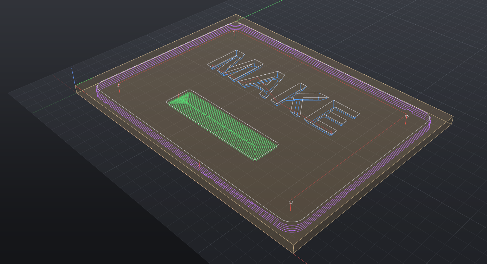
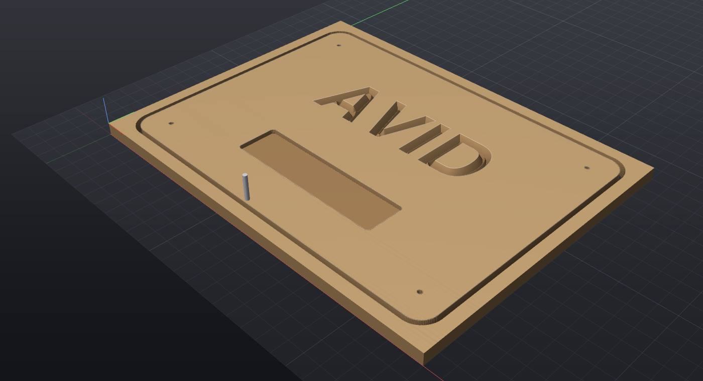

<p align="center">
  
</p>

<h1 align="center">NativeCAM</h1>

<p align="center"><b>A native Mac CAM app for hobby and prosumer CNC routers.</b></p>

<p align="center">
  
  
  
  
  
  <a href="LICENSE"></a>
  <a href="https://github.com/NativeCAM/NativeCAM/actions/workflows/tests.yml"></a>
</p>

Design or import your artwork, set up the material and bits, generate 2.5D and 3D toolpaths, watch the material-removal simulation, and export the file your controller reads: Avid's Mach4 profile, Grbl and its relatives (grblHAL, FluidNC, Carbide Motion), LinuxCNC, Masso, Centroid CNC12, Buildbotics, RichAuto or ShopBot, or any controller through your own Vectric post. Every file is checked against the controller and read back against the toolpaths before it's saved.

Built in SwiftUI and Metal for Apple silicon. No Rosetta, no Electron, no Windows VM. Free and open source under the [GPL-3.0](#license).


> [!WARNING]
> NativeCAM is early and incomplete. It was written almost entirely by AI ([details](#how-nativecam-was-built)), and testing on actual machines is ongoing: so far only Avid Mach4 output has run on a real machine, and every other controller's output follows its documentation until owners confirm it ([known limits](docs/known-limits.md)). Because it drives a machine with a spinning cutter, **air-cut every new program before running it on material**, and keep a hand near the E-stop. Default feeds and speeds are conservative starting points for plywood and hardwood, not recommendations for every bit and material.

---

## Highlights

<table>
  <tr>
    <td width="50%"></td>
    <td width="50%"></td>
  </tr>
  <tr>
    <td align="center"><sub>Toolpaths: V-carve (blue), pocket (green), drill, profile with tabs (purple)</sub></td>
    <td align="center"><sub>Simulated result, carved by each bit's true shape</sub></td>
  </tr>
  <tr>
    <td width="50%"></td>
    <td width="50%"></td>
  </tr>
  <tr>
    <td align="center"><sub>3D relief: roughing, ball-nose finishing, cut-out</sub></td>
    <td align="center"><sub>Tool library with real cutter geometry</sub></td>
  </tr>
</table>

- **Works with your machine.** A catalogue of 37 routers from 20 makers with a setup assistant, or any custom machine. Import your controller's own settings for real speeds and accelerations, and flatten the spoilboard with a checked [surfacing program](docs/using-nativecam.md#surfacing-the-spoilboard). [Machines →](docs/machines.md)
- **Writes your controller's dialect.** Avid Mach4, the Grbl family, LinuxCNC, Masso, Centroid CNC12, Buildbotics, ShopBot and RichAuto, or any controller through your own Vectric post. [Controllers →](docs/controllers.md)
- **Checks the file the machine will run.** Every export is checked against the controller and read back move by move against the toolpaths, and you can export an air cut, a printable setup sheet, and a [restart from partway through](docs/using-nativecam.md#restarting-a-job-partway-through) after a broken bit or an E-stop. Fold toolpaths into [groups](docs/using-nativecam.md#toolpath-groups), turn them on and off, hide them in the view and export one group, cut down from the whole job. [Export checks →](docs/controllers.md#export-checks-air-cuts-and-setup-sheets)
- **2.5D and 3D toolpaths.** Profile, pocket, drill (plunged, or helically bored to size for dowel, bolt and hinge-cup holes) and V-carve with tabs, ramps, leads, dogbones and islands, chamfers with sharp corners and an overcut (or a roundover bit), fluting that ramps in and out (round a column too, and following a 3D model's surface, flat or turned), prism carving, V-carve inlays (the pocket and a mirrored plug made in one step, the plug seating with a glue gap, checked before you cut), rest machining (clear with a big bit or after an earlier pocket, finish corners with a small one), adaptive clearing (a light, steady load at the full flute depth, in pockets and in 3D roughing's layers), feeds that slow only for full-width cuts, inside corners and tight inside arcs, a spindle speed picked per toolpath for the chip load on drive-capped machines, plus 3D relief roughing and finishing on an exact drop-cutter (raster, cross-hatch, waterline, steep and shallow, pencil cleanup of creases, constant scallop for an even finish over mixed slopes, spiral and radial for round work, and rest finishing that sends a fine tapered ball only where a larger ball couldn't reach) from STL, OBJ, 3MF, USDZ or PLY, mouldings swept from a profile vector along a rail (picture frames with mitred corners, curved trim), with ball, tapered ball and other bits, and roundover, cove, ogee and dovetail bits on profiles, with edge profiles that shape a part's edges and holes in light passes from the outside in, as on a router table. [Features →](docs/using-nativecam.md#toolpaths-and-features)
- **Rotary (4th axis).** Cut a blank face by face, wrap designs and spirals around it, turn it round, or rough and finish a 3D model all the way round as it turns (roughing layer by layer from a square bar or a round blank, finishing in a spiral, rings or passes along it, both from an exact rotary drop-cutter), fed in inverse time (`G93`) for Avid's rotary on Mach4, LinuxCNC and grblHAL, mounted along X or along Y. [Rotary jobs →](docs/using-nativecam.md#rotary-jobs)
- **Jobs bigger than the bed.** Cut a job longer than the machine's travel in tiles, fed through or in a grid, with cuts that run on past the tile lines, dowel holes drilled so every move registers exactly, and a setup sheet page for each tile. [Tiling →](docs/using-nativecam.md#jobs-bigger-than-the-bed)
- **True-shape nesting.** **Toolpaths ▸ Nest Parts…** packs parts onto the sheet by their real outlines, turned in 90° or finer steps (or kept along the grain), round clamps and parts that stay put, with a live preview of how much sheet they use. Parts that don't fit go onto more sheets, each with its own file and setup-sheet page, and small parts go in bigger parts' holes, cut out first. Their toolpaths follow them, and one ⌘Z puts them back. [Nesting →](docs/using-nativecam.md#nesting-parts)
- **Toolpath templates.** Save a job's toolpaths with their tools and settings, and add them to the next design: each finds its vectors by layer or kind (and by size, such as every 8 mm circle), depths through the material follow its thickness, and tools are matched to your library. [Templates →](docs/using-nativecam.md#templates)
- **Less time in the air.** Low links over material already cut, short travel between cuts, rounded roughing corners, and **Optimize Run Order** for the fewest tool changes.
- **Simulator and run times.** A Metal heightmap carved by each bit's true shape, timed with the controller's own planner model, not distance divided by feed.
- **Feels like a Mac app.** Document windows, real menus and shortcuts, undo, drag-and-drop import, trackpad gestures, and Liquid Glass controls on macOS 26.

## Getting started

You need a Mac with Apple silicon running **macOS 14 Sonoma or later** (macOS 26 for Liquid Glass) and the **Swift 6 toolchain**; the Xcode Command Line Tools are enough (`xcode-select --install`). Clone the repository, then from its folder:

```bash
scripts/build-app.sh --open
```

This builds a release `build/NativeCAM.app` for arm64, ad-hoc signs it and launches it. Drag it to `/Applications` to keep it; leave off `--open` to build without launching.

1. Choose **File ▸ New Demo Sign Project** (2.5D), **File ▸ New Demo Relief Project (3D)**, **File ▸ New Demo Rotary Project (3D)** (a chess pawn turned on the rotary), **File ▸ New Demo Table Leg (Rotary 3D)** (a leg roughed from a square bar and finished) or **File ▸ New Demo Shelf Parts (Nesting)** (a shelf's parts to try **Toolpaths ▸ Nest Parts…** on) to open a ready-made job. All five are also saved in [`examples/`](examples/) with their G-code. The two rotary demos leave the rotary axis's **Turn speed** unset, so they open with a chip-load warning near the axis; see [Rotary jobs](docs/using-nativecam.md#rotary-jobs).
2. Press **⌘R** to simulate, and scrub the timeline at the bottom of the window.
3. Set up your machine under **Settings ▸ Machine ▸ Set Up a Machine…** (new documents start on an Avid PRO6060 with Mach4), then press **⌘E** to export.

## Documentation

| Page | What's in it |
|---|---|
| [Using NativeCAM](docs/using-nativecam.md) | The workflow, supported files, keyboard and mouse, and what each toolpath does |
| [Machines](docs/machines.md) | Setting up a machine, the catalogue, importing controller settings, run-time estimates |
| [Controllers and G-code](docs/controllers.md) | What NativeCAM writes for each controller, using your own Vectric post, export checks, air cuts, setup sheets and the acceptance test |
| [Command line](docs/command-line.md) | `nativecam-cli` for scripting and checking files |
| [Development](docs/development.md) | Project layout, tests, golden G-code and developer tools |
| [AGENTS.md](AGENTS.md) | For AI agents: driving NativeCAM headlessly with the CLI and project files, and the safety rules |
| [Validation Handbook](docs/validation/NativeCAM-Validation-Handbook.pdf) (PDF) | Real-machine tests anyone can run to check NativeCAM's files on their own machine and controller, with the test projects ([source and kit](docs/validation/)) |
| [Known limits and roadmap](docs/known-limits.md) | What doesn't work yet |

## How NativeCAM was built

NativeCAM was written almost entirely by an AI coding assistant (Anthropic's Claude, using Claude Code), working from my requirements and design decisions. I chose the scope, file formats, machine defaults and G-code conventions, and I checked the results with the test suite and the simulator. I haven't reviewed every line by hand.

**It's a work in progress.** Testing on actual machines is ongoing, and some features are incomplete (see [Known limits and roadmap](docs/known-limits.md)). Until it has more hours on real routers, treat every program it makes as unproven: check the toolpaths in the simulator, read the G-code, and air-cut before cutting material. Bug reports, results from your own machine (the [Validation Handbook](docs/validation/NativeCAM-Validation-Handbook.pdf) lists the tests and how to report them), and code reviews are all very welcome.

## Acknowledgements

- [**Clipper2**](https://github.com/AngusJohnson/Clipper2) 2.0.1 by Angus Johnson, under the Boost Software License 1.0 ([`Sources/CClipper2/clipper2/LICENSE`](Sources/CClipper2/clipper2/LICENSE)). Its `Polygons.txt` and `Lines.txt` regression fixtures run against NativeCAM's bridge.
- Adaptive clearing follows the approach described for [**FreeCAD**](https://www.freecad.org)'s Adaptive operation by Kresimir Tusek (a walk that keeps the cleared area as polygons and searches headings for a target cut area). NativeCAM's is written from that description and contains none of its code.
- Nesting follows the method published with [**SVGnest**](https://github.com/Jack000/SVGnest) by Jack Qiao (MIT) and [**Deepnest**](https://github.com/deepnest-next/deepnest) (MIT, with a GPL-3 `deepnest.js`): no-fit polygons from Minkowski sums, bottom-left placement and a genetic search. NativeCAM's version is written from scratch in Swift; no code from either is included.
- Test fixtures from [**dxf-parser**](https://github.com/gdsestimating/dxf-parser) (MIT) and [**resvg**](https://github.com/linebender/resvg) (MIT / Apache-2.0). See the `SOURCE.md` files under [`Tests/CAMCoreTests/Fixtures/`](Tests/CAMCoreTests/Fixtures/).

## License

Copyright © 2026 Daniel Smith.

NativeCAM is free software: you can redistribute it and/or modify it under the terms of the [GNU General Public License](LICENSE) as published by the Free Software Foundation, either version 3 of the License, or (at your option) any later version. It is distributed in the hope that it will be useful, but **without any warranty**; without even the implied warranty of merchantability or fitness for a particular purpose.

In plain terms (the [LICENSE](LICENSE) text is what actually applies):

- **Use it for anything.** That includes commercial work, like cutting parts you sell.
- **Share and modify it freely.** If you distribute NativeCAM or a modified version, free or paid, you must license it under the GPL too, provide the complete source code, and keep the copyright and licence notices, including those in the app's About window.
- **No closed-source or white-labelled copies.** Nobody can take NativeCAM, close the source and sell it as their own product.

Bundled third-party code keeps its own GPL-compatible licence: Clipper2 under the Boost Software License, and test fixtures under MIT or Apache-2.0 (see [Acknowledgements](#acknowledgements)).

## Disclaimer

NativeCAM is an independent project. It is not affiliated with or endorsed by any machine or controller maker named here (including Avid CNC, Carbide 3D, Inventables, Sienci Labs, Onefinity, ShopBot Tools, Centroid and Masso), or by Vectric, Autodesk or Newfangled Solutions (Mach4). Product names are trademarks of their owners and are used only to describe compatibility.

You are responsible for checking every program before you run it. As the GPL states, NativeCAM comes with no warranty; CNC machines can damage material, tooling, the machine and people.
