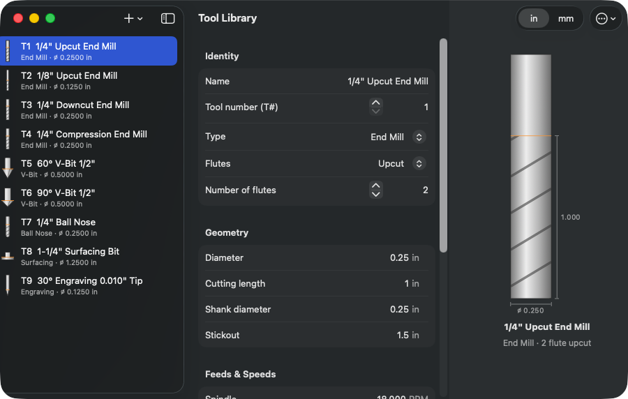

# NativeCAM

**A native Mac CAM app for Avid CNC routers.** Design or import your artwork, set up the material and bits, generate 2.5D and 3D toolpaths, watch the material-removal simulation, and export Mach4 `.tap` G-code in the same dialect Avid's own posts produce.

Built in SwiftUI and Metal for Apple silicon. No Rosetta, no Electron, no Windows VM. Free and open source under the [GPL-3.0](#license).


[](LICENSE)


> [!WARNING]
> NativeCAM is early software that drives a machine with a spinning cutter. **Air-cut every new program before running it on material**, and keep a hand near the E-stop. Default feeds and speeds are conservative starting points for plywood and hardwood, not recommendations for every bit and material.

---

## Highlights

<table>
  <tr>
    <td width="50%"></td>
    <td width="50%"></td>
  </tr>
  <tr>
    <td align="center"><sub>Toolpaths: V-carve (blue), pocket (green), drill, profile with tabs (purple)</sub></td>
    <td align="center"><sub>Simulated result, carved by each bit's true shape</sub></td>
  </tr>
  <tr>
    <td width="50%"></td>
    <td width="50%"></td>
  </tr>
  <tr>
    <td align="center"><sub>3D relief: roughing, ball-nose finishing, cut-out</sub></td>
    <td align="center"><sub>Tool library with real cutter geometry</sub></td>
  </tr>
</table>

- **Made for Avid machines.** PRO4848, PRO4896 and PRO6060 presets (PRO6060 with a VFD spindle, manual tool change and touch plate by default), or custom travel. Router or spindle, ATC, M6 or M0 tool changes, dust collector control.
- **Real stock setup.** Material size and thickness, XY zero at any corner or the centre, Z zero on the material top or the spoilboard, safe and plunge heights, park position. Work in inches or millimetres.
- **2.5D toolpaths.** Profile, pocket, drill and V-carve, with tabs, ramps, islands, multi-pass and climb or conventional cutting.
- **3D toolpaths.** Import STL, OBJ, 3MF, USDZ or PLY and carve it as a relief with layered roughing and drop-cutter finishing.
- **Simulator.** A Metal-rendered heightmap carved by each bit's actual profile, with play, pause, scrub, speed control and a cycle-time estimate. It also simulates `.tap` files from other CAM programs.
- **Job checks.** Before you post, NativeCAM warns about cuts into the spoilboard, depth beyond flute length, toolpaths outside the work area, rapids through material and out-of-range feeds or RPM.
- **Feels like a Mac app.** Document windows, real menus and shortcuts, undo, drag-and-drop import, right-click menus, trackpad gestures, and Liquid Glass controls on macOS 26.

## Getting started

### Requirements

- A Mac with Apple silicon running **macOS 14 Sonoma or later** (macOS 26 for Liquid Glass)
- The **Swift 6 toolchain**. The Xcode Command Line Tools are enough (`xcode-select --install`); full Xcode is optional.

### Build and run

Clone the repository, then from its folder:

```bash
scripts/build-app.sh --open
```

This builds a release `build/NativeCAM.app` for arm64, ad-hoc signs it and launches it. Drag it to `/Applications` if you want to keep it. Leave off `--open` to build without launching.

### Your first job

1. Choose **File ▸ New Demo Sign Project** (2.5D) or **File ▸ New Demo Relief Project (3D)** to open a ready-made job. Both are also saved in [`examples/`](examples/) with their G-code.
2. Press **⌘R** to simulate, and scrub the timeline at the bottom of the window.
3. Press **⌘E** to export G-code for Mach4.

## Workflow

| Step | Where |
|---|---|
| **1. Set up the job** | Select **Material & Machine** in the sidebar. Set the material size and thickness, XY and Z zero, heights, and your Avid model. |
| **2. Add artwork** | Use the shape button in the toolbar for rectangles, circles, ellipses, polygons, stars and text (any installed macOS font), or import a file with **⌘I** or by dropping it on the canvas. |
| **3. Pick bits** | Open the **Tool Library** (**⇧⌘T**) to add or edit bits: flat, ball, bull nose, V-bit, engraving, surfacing and drill, with full geometry and feeds and speeds. |
| **4. Create toolpaths** | Select vectors, then use the toolpath button in the toolbar or right-click them. Toolpaths run in sidebar order; drag to reorder. |
| **5. Review checks** | Warnings appear under **Checks** in the sidebar as you edit. |
| **6. Simulate** | **⌘R** plays the material-removal simulation; **⌘.** stops it. |
| **7. Export** | **⌘E** saves a `.tap` file. In Mach4, load it, zero X/Y, touch off Z with your plate, and air-cut first. |

### Supported files

| Kind | Formats | Notes |
|---|---|---|
| Vectors | **DXF** | Lines, arcs, circles, polylines with bulges, splines, ellipses, blocks and inserts, `$INSUNITS`. POINT entities become drill marks. Loose segments are chained into closed loops. |
| | **SVG** | Full path grammar, transforms, viewBox units |
| | **PDF**, **Illustrator `.ai`** | PDF-compatible `.ai` files. Handles nested groups, page rotation and the crop box. |
| 3D models | **STL** (binary/ASCII), **OBJ**, **3MF**, **USDZ/USD**, **PLY** | 3MF includes Bambu and Prusa multi-part files. Choose the up axis, flip, size, carve depth and how far below the surface the top sits. |
| G-code | **`.tap`**, **`.nc`** | Opened for simulation only (**File ▸ Simulate G-code File…**, or drop on the canvas) |
| Projects | **`.nativecam`** | JSON document |

### Keyboard and mouse

| Action | How |
|---|---|
| Select | Click a vector's line (for text, click inside a letter). Shift- or ⌘-click to add or remove. |
| Marquee select | Drag on empty canvas in Top view |
| Move | Drag selected vectors, or nudge with the arrow keys (Shift moves 10×) |
| Orbit | Drag empty canvas in 3D views, or Option-drag anywhere. Trackpad rotate spins the view. |
| Pan / zoom | Two-finger scroll or right-drag / pinch or scroll wheel |
| Context menu | Right-click or Control-click a vector to add toolpaths, duplicate, center on material or change views |

| Shortcut | Command | | Shortcut | Command |
|---|---|---|---|---|
| ⌘I | Import | | ⌘1 / ⌘2 / ⌘3 | Top / Front / Iso view |
| ⌘E | Export G-code for Mach4 | | ⌘0 | Zoom to fit |
| ⌘R | Simulate | | ⌥⌘I | Show or hide inspector |
| ⌘. | Stop simulation | | ⇧⌘T | Tool library |
| ⇧⌘R | Recalculate all toolpaths | | ⌘D | Duplicate |

## Command line

`nativecam-cli` runs the same engine without the UI. It is handy for scripting, CI, and checking G-code from other programs.

```bash
swift run -c release nativecam-cli demo demo.nativecam              # write the demo sign (demo3d: 3D relief, new: empty project)
swift run -c release nativecam-cli post demo.nativecam -o demo.tap  # generate toolpaths, run checks, write G-code
swift run -c release nativecam-cli sim demo.nativecam --png out.png # simulate, report, render the result as a heightmap
swift run -c release nativecam-cli sim other-cam-job.tap            # simulate G-code from any CAM program
```

```text
$ nativecam-cli post demo.nativecam -o demo.tap
[info] Drill mounting holes: Cuts through the material (0.0200 in into the spoilboard).
[info] Cut out sign: Cuts through the material (0.0200 in into the spoilboard).
Generated 4 toolpaths in 0.01s, 1015 lines -> demo.tap
Estimated run time: 0:10:03
```

`sim` also accepts `--cell <mm>` to set the simulation grid resolution.

## Avid Mach4 G-code

The post is modelled on Avid's own Vectric post (v3) and Fusion 360 post, so files behave like the ones Avid supports:

- `.tap` extension, CRLF line endings, parenthesised comments (nested parentheses become braces)
- Safety line `G00 G94 G20 G17 G90 G40 G49 G80` (or `G21` for metric), then `G91.1` for incremental I/J
- Tool changes retract, stop the spindle, then call `T#M6`, so Avid's M6 macro handles the manual change and touch plate. ATC machines also get `G43 H#`. An optional `M00` pause mode is available for setups without an M6 macro.
- `M07` turns the dust collector on after each tool change, then `S#### M03` and an optional `G04 P#` spin-up dwell
- Arcs as `G02`/`G03` with I/J, each under 180°, including helical arcs. 4 decimal places in inches, 3 in millimetres.
- Footer retracts, parks, then `M05`, `M09`, `M30`

<details>
<summary>Sample output (excerpt from posting the demo sign)</summary>

```gcode
(Demo sign)
(Post: Avid CNC Mach4 - NativeCAM 0.1)
(Created: 2026-11-19 07:38)
(Machine: PRO6060 {5 x 5 ft}, spindle, Manual {M6})
(Material: Baltic birch plywood X=24.0000 Y=18.0000 Z=0.7500 in)
(Z zero: Material top   XY zero: Lower left)
(Program extents: X0.8750 to X23.1250  Y0.8750 to Y17.1250  Z-0.7700 to Z0.1000)
(Safe Z = 0.5000)
(Tools used:)
(  T5 60deg V-Bit 1/2in - D0.5000 V-Bit)
(  T1 1/4in Upcut End Mill - D0.2500 End Mill)
G00 G94 G20 G17 G90 G40 G49 G80
G91.1
(Change to Tool: T5 60deg V-Bit 1/2in)
T5M6
M07
S18000 M03
(Toolpath: V-Carve title  Tool: T5 60deg V-Bit 1/2in)
G00 Z0.5000
G00 X7.1025 Y9.7568
G00 Z0.1000
G01 Z-0.0117 F30.0
```

</details>

## Feature details

| Area | Details |
|---|---|
| Profile | Inside, outside or on the line; climb or conventional; multi-pass; ramp entry; tabs; allowance; holes cut before outside profiles |
| Pocket | Offset or raster clearing, islands, safe feed links between regions |
| Drill | Peck, chip-break and dwell. Canned cycles are expanded into plain moves. |
| V-carve | Maximal inscribed circles, flat-depth cap, optional flat-area clearing tool, multi-pass |
| 3D roughing | Layered clearing with an end mill, leaving an allowance for finishing. Machine inside the model outline, inside **selected vectors** such as the cut-out outline (chosen automatically when a cut-out surrounds the model, so scrap isn't machined), or across the whole material. |
| 3D finishing | Raster passes with an exact triangle drop-cutter for ball and flat bits, so steep walls aren't gouged. Shows scallop height. Same boundary choices as roughing. |
| Arc fitting | Line segments are re-fitted to `G02`/`G03` arcs, helical ones included |
| Tools | Flat, ball, bull nose, V-bit, engraving (tip diameter), surfacing and drill. Flute length, shank, stickout, flute count and direction, feeds and speeds, chip-load calculator, live profile drawing. Saved to `~/Library/Application Support/NativeCAM/tools.json`. |
| Simulator | Heightmap carved by the true tool shape (flat, ball, bull nose, V), through-cuts, tool marker, playback controls, cycle-time estimate, detection of rapids through material |

## Project layout

```text
Sources/
  CAMCore/        The engine, pure Swift with no UI: geometry, model, importers, toolpaths, simulation, post
  CClipper2/      Vendored Clipper2 2.0.1 (polygon offsetting) behind a small C bridge
  NativeCAM/      The SwiftUI app; Viewport/ is the Metal renderer (shaders compiled at runtime)
  nativecam-cli/  Command-line front end
Tests/CAMCoreTests/  Swift Testing suite and fixtures
examples/         Demo projects and the G-code they produce
scripts/          build-app.sh, test.sh, capture-window.sh, make-icon.swift, measure/ (toolpath timing and part comparison)
```

Conventions inside `CAMCore`: all lengths are millimetres, design XY is relative to the material's lower-left corner, and Z = 0 is the material top. The post converts to the chosen work origin and units.

## Development

Run the test suite (165 tests in 17 suites, using Swift Testing):

```bash
scripts/test.sh
```

The script adds the compiler and linker flags Swift Testing needs when only the Command Line Tools are installed. Extra arguments pass through to `swift test`, for example `scripts/test.sh --filter PostTests`.

Developer aids for checking UI changes without clicking through the app:

- **Offscreen snapshots.** `build/NativeCAM.app/Contents/MacOS/NativeCAM -NativeCAMSnapshotProject <project.nativecam> -NativeCAMSnapshotOut <dir>` renders the main window, the finished simulation and the toolpaths to PNGs, then quits. On the demo sign it also runs a canvas interaction self-check (select, drag, marquee, nudge, copy/paste, delete). Pass the paths as `-Key value` pairs; plain file arguments would be opened as documents.
- **Window captures.** With the app running, `scripts/capture-window.sh` saves PNGs of its windows exactly as composited on screen to `~/Library/Caches/NativeCAM/Captures/`. Arguments put the front window in a state first, for example `scripts/capture-window.sh tag=sim simulate=0.5`, `select=op:0` or `tools=1`.

Measuring toolpath changes:

- **Timing.** `scripts/measure/analyze.py job.tap` breaks a posted job down per toolpath (cutting and rapid length, retracts, plunges, segment sizes) and times it at constant velocity and with an acceleration model (15 in/s² by default, editable at the top of the script).
- **Part comparison.** Simulate the before and after G-code with the same grid, `nativecam-cli sim job.tap --cell 0.25 --heights out.bin`, then `scripts/measure/compare_parts.py before.bin after.bin --ellipse cx cy rx ry` (or `--rect x0 y0 x1 y1`, in mm) reports how much of the finished part changed.

When adding test data from other open-source CAM projects, copy fixtures only from permissively licensed projects (MIT, BSD, Apache, Boost) and record the source in a `SOURCE.md` beside them. Tests for behaviour found in GPL or LGPL projects should be re-derived, not copied.

## Known limits and roadmap

- 3D finishing uses one raster direction per toolpath; add a second at 90° for cross-hatching. No waterline or pencil passes yet.
- V-bit and bull-nose 3D finishing use the height-grid drop-cutter; the exact triangle drop-cutter covers ball and flat bits only.
- PDF clipping masks and hidden layers aren't applied. EPS isn't supported.
- Clicking to select vectors in the 3D view isn't wired up yet; use the Design list in the sidebar.
- No lead-in/lead-out arcs, dogbones, nesting or plasma (THC) support yet.
- Canned drill cycles (`G81`–`G83`) in imported G-code aren't simulated. NativeCAM's own output expands them, so its files simulate fully.

## Acknowledgements

- [**Clipper2**](https://github.com/AngusJohnson/Clipper2) 2.0.1 by Angus Johnson, under the Boost Software License 1.0 ([`Sources/CClipper2/clipper2/LICENSE`](Sources/CClipper2/clipper2/LICENSE)). Its `Polygons.txt` and `Lines.txt` regression fixtures run against NativeCAM's bridge.
- Test fixtures from [**dxf-parser**](https://github.com/gdsestimating/dxf-parser) (MIT) and [**resvg**](https://github.com/linebender/resvg) (MIT / Apache-2.0). See the `SOURCE.md` files under [`Tests/CAMCoreTests/Fixtures/`](Tests/CAMCoreTests/Fixtures/).

## License

Copyright © 2026 Daniel Smith.

NativeCAM is free software: you can redistribute it and/or modify it under the terms of the [GNU General Public License](LICENSE) as published by the Free Software Foundation, either version 3 of the License, or (at your option) any later version. It is distributed in the hope that it will be useful, but **without any warranty**; without even the implied warranty of merchantability or fitness for a particular purpose.

In plain terms (the [LICENSE](LICENSE) text is what actually applies):

- **Use it for anything.** That includes commercial work, like cutting parts you sell.
- **Share and modify it freely.** If you distribute NativeCAM or a modified version, free or paid, you must license it under the GPL too, provide the complete source code, and keep the copyright and licence notices, including those in the app's About window.
- **No closed-source or white-labelled copies.** Nobody can take NativeCAM, close the source and sell it as their own product.

Bundled third-party code keeps its own GPL-compatible licence: Clipper2 under the Boost Software License, and test fixtures under MIT or Apache-2.0 (see [Acknowledgements](#acknowledgements)).

## Disclaimer

NativeCAM is an independent project. It is not affiliated with or endorsed by Avid CNC, Vectric, Autodesk or Newfangled Solutions (Mach4). Product names are trademarks of their owners and are used only to describe compatibility.

You are responsible for checking every program before you run it. As the GPL states, NativeCAM comes with no warranty; CNC machines can damage material, tooling, the machine and people.
