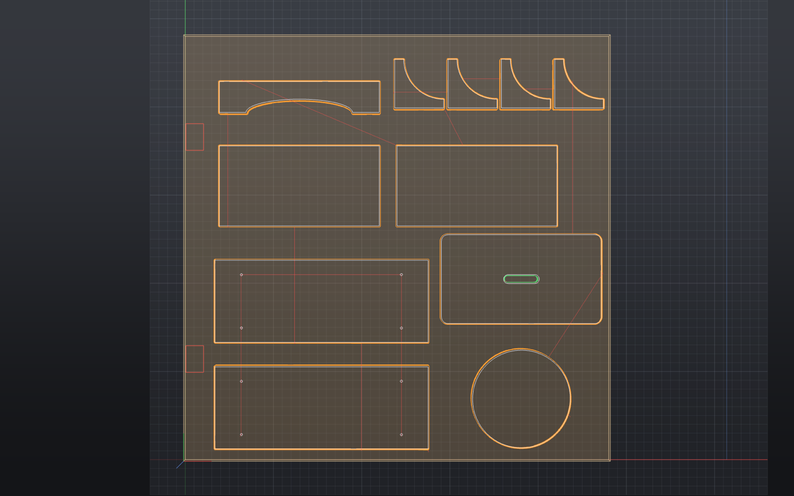
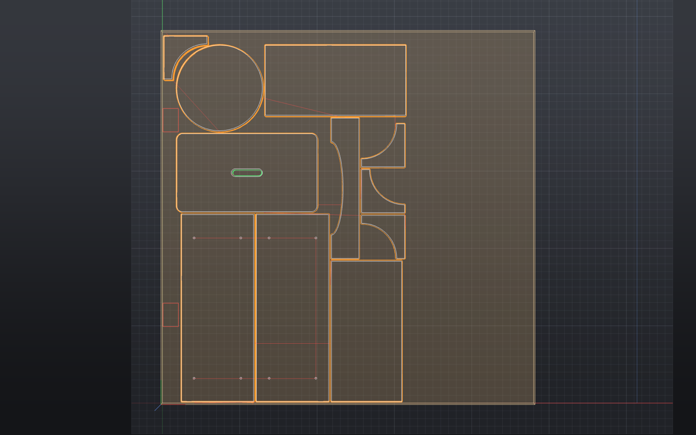
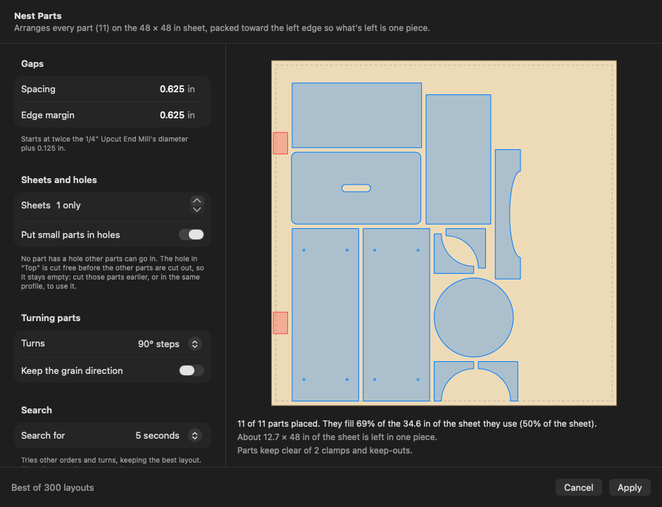
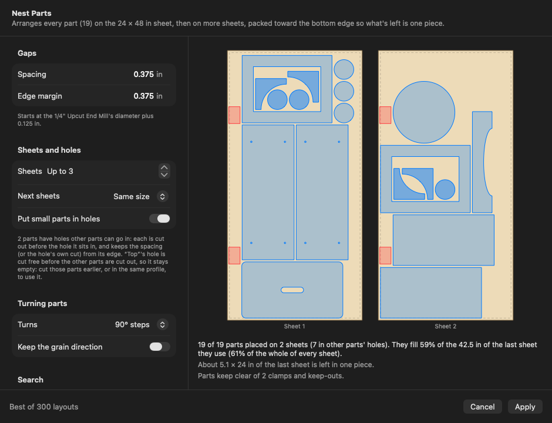
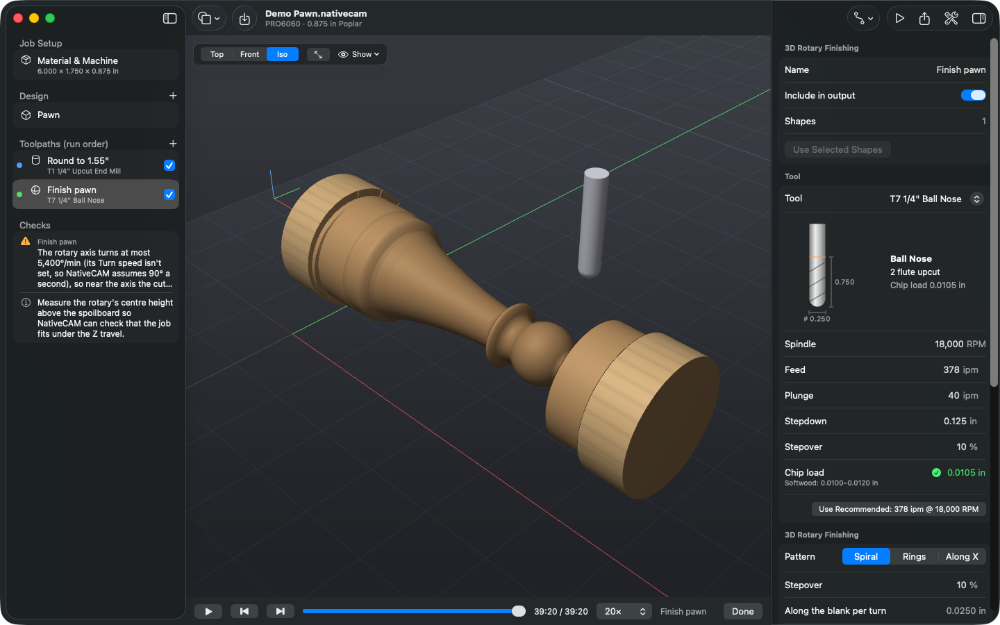
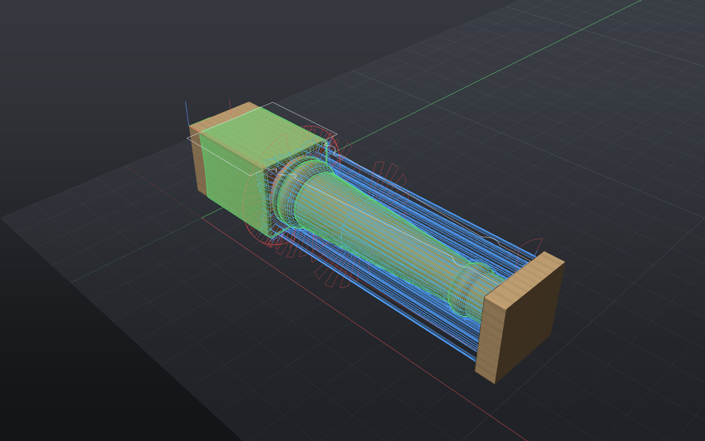
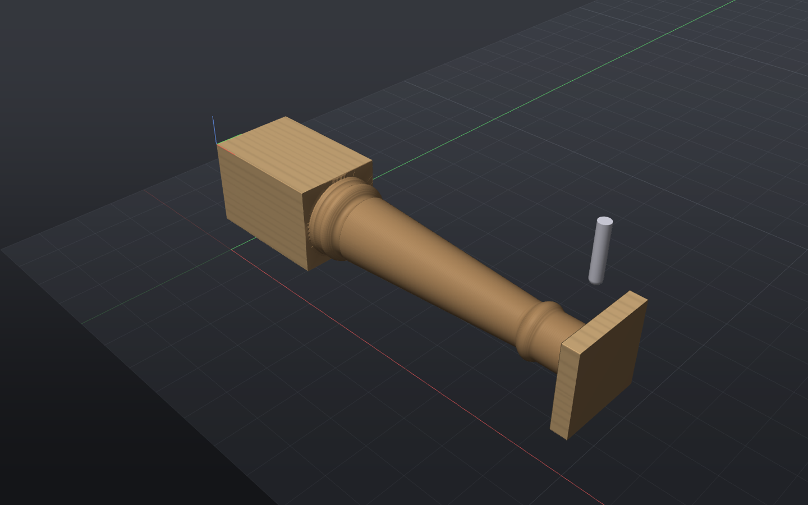

# Using NativeCAM

[← Back to the README](../README.md)

- [Workflow](#workflow)
- [Supported files](#supported-files)
- [Keyboard and mouse](#keyboard-and-mouse)
- [Toolpaths and features](#toolpaths-and-features)
- [Edge profiles](#edge-profiles)
- [Leads and corners](#leads-and-corners)
- [Adaptive clearing](#adaptive-clearing)
- [Rest machining](#rest-machining)
- [Feeds that follow the load](#feeds-that-follow-the-load)
- [V-carve inlays](#v-carve-inlays)
- [Chamfers, flutes and prisms](#chamfers-flutes-and-prisms)
- [Jobs bigger than the bed](#jobs-bigger-than-the-bed)
- [Nesting parts](#nesting-parts)
- [Rotary jobs](#rotary-jobs)
- [Templates](#templates)
- [Calibrating your machine](#calibrating-your-machine)

## Workflow

| Step | Where |
|---|---|
| **1. Set up the job** | Select **Material & Machine** in the sidebar. Set the material size and thickness, XY and Z zero, heights, and your machine (pick a saved one or [set up a new one](machines.md#setting-up-a-machine)). |
| **2. Add artwork** | Use the shape button in the toolbar for rectangles, circles, ellipses, polygons, stars and text (any installed macOS font), or import a file with **⌘I** or by dropping it on the canvas. |
| **3. Pick bits** | Open the **Tool Library** (**⇧⌘T**) to add or edit bits: flat, ball, bull nose, V-bit, engraving, surfacing and drill, with full geometry and feeds and speeds. |
| **4. Create toolpaths** | Select vectors, then use the toolpath button in the toolbar or right-click them. Toolpaths run in sidebar order; drag to reorder, or choose **Toolpaths ▸ Optimize Run Order** for the fewest tool changes (**⌘Z** puts the old order back). For a job you cut again and again, add a set you saved earlier with **Toolpaths ▸ Apply Template**, and save this one with **Toolpaths ▸ Save Toolpaths as Template…** (see [Templates](#templates)). |
| **5. Review checks** | Warnings appear under **Checks** in the sidebar as you edit. |
| **6. Simulate** | **⌘R** plays the material-removal simulation; **⌘.** stops it. |
| **7. Export** | **⌘E** checks and saves the file for your controller (`.tap` for Mach4, `.nc` for Grbl, `.sbp` for ShopBot, and so on; one file per tool where the controller can't stop for a tool change). **File ▸ Export Air Cut…** (**⌥⌘E**) saves the same program with every Z raised, to run above the material first. **File ▸ Export Setup Sheet…** saves a printable page for the person at the machine. See [Export checks, air cuts and setup sheets](controllers.md#export-checks-air-cuts-and-setup-sheets). |

Load the file on your controller, zero X/Y, touch off Z and air-cut it before cutting material.

## Supported files

| Kind | Formats | Notes |
|---|---|---|
| Vectors | **DXF** | Lines, arcs, circles, polylines with bulges, splines, ellipses, blocks and inserts, `$INSUNITS`. POINT entities become drill marks. Loose segments are chained into closed loops, layer by layer. Layers are kept: a file with several comes in as one shape per layer, named *file – layer* and on that layer (a block's entities on layer 0 take the insert's layer; layer 0 itself is **Default**). |
| | **SVG** | Full path grammar, transforms, viewBox units. Layers are kept, as for DXF: Inkscape layers by their names, and in files from Illustrator, Affinity and most other programs the named groups straight under the root (Illustrator's layers). |
| | **PDF**, **Illustrator `.ai`** | PDF-compatible `.ai` files. Handles nested groups, page rotation and the crop box. Clipping masks trim what they cover, and hidden layers are left out, as a PDF viewer shows them. Visible layers are kept, as for DXF (one shape per layer). |
| 3D models | **STL** (binary/ASCII), **OBJ**, **3MF**, **USDZ/USD**, **PLY** | 3MF includes Bambu and Prusa multi-part files. Choose the up axis, flip, size, carve depth and how far below the surface the top sits. |
| G-code | **`.tap`**, **`.nc`**, **`.gcode`**, **`.ngc`**, **`.cnc`**, ShopBot **`.sbp`** | Opened for simulation only (**File ▸ Simulate G-code File…**, or drop on the canvas). Drilling cycles (`G73`, `G81`–`G83`, `G85`, `G86`, `G89`) are expanded into the moves the controller makes. So are tapping and boring cycles, read the way the project's controller runs them: `G74` and `G84` tapping, `G76` fine boring, `G87` back boring and `G88` boring with a stop to retract by hand for Avid Mach4; `G74`, `G76` and `G84` for Centroid; `G74` and `G84` for LinuxCNC. |
| Machines | Mach4 **`Machine.ini`**, Grbl **`$$`** output, **LinuxCNC** INI, **FluidNC** `config.yaml`, **Fusion 360** `.mch` | Speeds, accelerations, travel and spindle range for a machine. See [Importing controller settings](machines.md#importing-controller-settings). |
| Posts | Your own **Vectric `.pp`** | Writes G-code for a controller NativeCAM has no post for. See [Using your own Vectric post](controllers.md#using-your-own-vectric-post). |
| Tool libraries | **Fusion 360** `.tools` / `.json`, **Vectric** `.vtdb`, NativeCAM `.json` | **Tool Library ▸ ⋯ ▸ Import Tools…** lists the bits by the library's folders. Search, filter by type and tick the ones you want. Vendors such as Amana Tool publish their bits in these formats. Values a library leaves out (Vectric files have no cutting or shank lengths) are read from the bit's name where possible, otherwise filled conservatively and marked ⚠ (details in the tool's notes). Tapered ball noses come across with their tip radius and taper per side (Fusion's taper angle, Vectric's side angle). Fusion's radius (roundover) and dovetail mills come across as [form and dovetail bits](#form-and-dovetail-bits), with a ⚠ note where the geometry is worked out (a roundover's pilot is its diameter less twice its radius). Vectric keeps a form tool's profile in a form NativeCAM doesn't read, so a Vectric form tool comes across only when its name says what it is ("1/4\" RADIUS ROUNDOVER", "COVE 3/8 R", "OGEE 5/32 R", "14° DOVETAIL"), shaped from the name and marked ⚠; other form tools, Fusion's form, slot and lollipop mills, and thread mills are listed as not imported. Vectric's older `.tool` files aren't supported. |
| Projects | **`.nativecam`** | JSON document. Projects for any controller other than Avid's Mach4 profile, or with an imported post, are saved as format 2, and projects with rotary stock as format 3, format 4 when the blank is turned by hand, or format 5 when designs wrap around it or it has a spiral or a rounding toolpath. Projects with a V-carve start depth or an inlay plug are saved as format 6 (an inlay pocket on its own stays at its earlier format), projects with a 3D model on a rotary blank or a 3D rotary finishing toolpath as format 7, projects with a chamfer, fluting or prism toolpath as format 8, tiled jobs as format 9, projects with waterline, steep-and-shallow or pencil 3D finishing, or a cross-hatched raster, as format 10, projects with a 3D rotary roughing toolpath as format 12, projects with an adaptive pocket as format 13, projects with a whole-board inlay plug as format 14, projects that use a tapered ball nose, form or dovetail bit as format 15, jobs nested onto more than one sheet as format 16, projects with a 3D rest finishing pass as format 17, projects with an edge profile as format 18, projects with a chamfer overcut or a round-nose chamfer as format 19, projects with constant scallop, spiral or radial 3D finishing as format 21, and projects with a moulding as format 22. Older builds refuse to open a format they don't know rather than silently writing the wrong G-code. |

## Keyboard and mouse

| Action | How |
|---|---|
| Select | Click a vector's line (for text, click inside a letter). Shift- or ⌘-click to add or remove. |
| Marquee select | Drag on empty canvas in Top view |
| Move | Drag selected vectors, or nudge with the arrow keys (Shift moves 10×) |
| Orbit | Drag empty canvas in 3D views, or Option-drag anywhere. Trackpad rotate spins the view. |
| Pan / zoom | Two-finger scroll or right-drag / pinch or scroll wheel |
| Context menu | Right-click or Control-click a vector to add toolpaths, duplicate, center on material or change views |

| Shortcut | Command | | Shortcut | Command |
|---|---|---|---|---|
| ⌘I | Import | | ⌘1 / ⌘2 / ⌘3 | Top / Front / Iso view |
| ⌘E | Export G-code | | ⌘0 | Zoom to fit |
| ⌥⌘E | Export air cut | | ⌥⌘I | Show or hide inspector |
| ⌘R | Simulate | | ⇧⌘T | Tool library |
| ⌘. | Stop simulation | | ⌘D | Duplicate |
| ⇧⌘R | Recalculate all toolpaths | | | |

## Toolpaths and features

| Area | Details |
|---|---|
| Stock | Material size and thickness, XY zero at any corner or the centre, Z zero on the material top or the spoilboard, safe and plunge heights, park position. Inches or millimetres. Or a round or square [rotary blank](#rotary-jobs). |
| Depths | A profile's or pocket's cut depth and a drill's hole depth are **From top** (a plain depth below the material top), **Through** (the material's thickness plus a set amount into the spoilboard) or **Thickness −** (leaving a set amount above the material's bottom). The last two follow the thickness when you change it in Job Setup, and in a [template](#templates) applied to other material; the inspector shows which a depth is and what it cuts on this material. New profiles and drills cut **Through**, 0.02 in into the spoilboard. Projects with them open in older builds, which cut the depth for the thickness the project was saved with. |
| Profile | Inside, outside or on the line; climb or conventional; multi-pass; ramp entry; arc or line leads in and out; dogbone or T-bone corners; tabs; allowance; holes cut before outside profiles; [feeds that follow the load](#feeds-that-follow-the-load). See [Leads and corners](#leads-and-corners). |
| Edge profile | A form bit's profile cut into the top edge of parts, round their outside, their holes or both, as on a router table: the pilot rides the edge, horizontal passes step in from the waste a band at a time (or vertical passes step down), then a light finishing pass. Profile depth (a step above a deeper cut), offset, rounded outside corners, leads in the waste, and each pass's feed from its own cross-section. Runs before the part's cut-out. See [Edge profiles](#edge-profiles). |
| Pocket | Offset, raster or [adaptive](#adaptive-clearing) clearing, islands, safe feed links between regions, dogbone or T-bone corners. Inner clearing rings get rounded corners (within a set tolerance, 0.25 mm by default); the wall pass stays exact. [Rest machining](#rest-machining): a larger end mill clears the pocket first, and the pocket's own bit cuts only the corners and narrow parts it can't reach, then the walls; or it [rests from earlier toolpaths](#rest-from-earlier-toolpaths), cutting only what a larger bit's pocket before it left. With [feeds that follow the load](#feeds-that-follow-the-load) on, the first pass and the corners slow down. |
| Drill | Peck, chip-break and dwell. Canned cycles are expanded into plain moves. |
| V-carve | Maximal inscribed circles. **Start depth** carves as if the material top were lower (to carve inside an existing pocket, or for an inlay plug). **Flat depth** caps the carve, measured down from the start depth as in Vectric VCarve, so the deepest cut is start depth + flat depth. The flat bottom is cleared by an end mill you choose (cut first, and skipping depths an earlier pocket cleared) or, without one, by the V-bit itself, in passes close enough to leave ridges of about 0.1 mm. Multi-pass, counted down from the start depth. [Inlay](#v-carve-inlays) pockets and plugs. |
| Chamfer | A V-bit or engraving bit bevels the edges of closed shapes at its own angle, as Vectric's Chamfer toolpath does. **Side**: outside the shapes, inside them or both. **Vector is the**: top edge of the bevel (it slopes down away from the vector, Vectric's *Down*) or its bottom edge (it rises from the vector to the surface, Vectric's *Up*: the wall a profile on the same vectors leaves). **Width** and **Depth** are linked through the bit's angle. **Sharp corners** (on by default) keeps the bevel's corners crisp: the bit runs to a mitre round the outside of a corner and rises along the bisector into a valley, as a V-carve does. Start depth, multi-pass, climb or conventional. **Overcut** runs the tip past the bevel's foot so it's left as a small flat, not a V-groove. With a roundover, cove or ogee bit it's a round-nose chamfer: the profile meets the surface at the width. See [Chamfers, flutes and prisms](#chamfers-flutes-and-prisms). |
| Fluting | A ball nose, core box (a ball nose in the tool library), tapered ball nose or V-bit cuts along open or closed vectors with its depth ramping in and out, as in Vectric's Fluting toolpath. **Ramp**: both ends, start, end or none; **ramp length** as a distance or a percentage of the longest it can be; **linear** or **smooth** (easing into full depth). Each pass follows the whole flute with its ramps scaled to its depth, so the last pass runs the full length. Works on wrapped rotary jobs: lines along the blank become flutes round a column. |
| Prism | A V-bit carves shapes as a raised bevel rising to a ridge along their middle, as Vectric's Prism Carving does. **Full prism** sets the depth from the widest part of the shapes and the bit's angle; a shallower depth leaves a flat top. Inside corners rise to the ridge along their valleys. |
| 3D roughing | Layered clearing with an end mill, leaving an allowance for finishing. Layer outlines follow the surface between grid samples instead of stepping cell by cell, so the machine doesn't crawl through stair-step corners. Machine inside the model outline, inside **selected vectors** such as the cut-out outline (chosen automatically when a cut-out surrounds the model, so scrap isn't machined), or across the whole material. |
| 3D finishing | Four strategies, all on an exact triangle drop-cutter, so steep walls aren't gouged, for every bit shape: ball, flat, bull nose, V-bit, engraving and drill (a V's point or tip flat, its flank and its shoulder, a bull nose's flat and corners). **Raster** passes follow the surface; **Cross-hatch** adds a second raster at the raster angle + 90° in the same toolpath, for slopes that run along the rows. **Waterline** cuts constant-Z loops round the model from the top down, a column of loops at a time; they lie flat, so they're fitted as arcs. **Steep and shallow** cuts waterline loops where the surface is steeper than the **Steep angle** (40° by default) and raster rows on the rest, each running an **Overlap** past the seam. The loops are stepover × tan(steep angle) apart in Z, so the scallop is the same either side of the seam (the inspector shows it). **Pencil** makes one pass along each concave crease, where the bit touches two faces at once (the foot of a wall, the bottom of a groove); run it with a smaller ball nose after the main finish. **[Rest](#3d-rest-finishing)** sends a smaller ball or tapered ball nose only where the larger bits of earlier finishes couldn't reach, worked out exactly. **[Constant scallop, Spiral and Radial](#constant-scallop-spiral-and-radial-finishing)** keep the scallop even over mixed slopes, or work out from a centre over round work. The waterline, steep-and-shallow and pencil passes work from a cutter-location height map of the exact drop-cutter, then find each loop point and crease exactly. **Smooth links** (on for new toolpaths) cut the raster in blocks, turn between rows on an arc and ramp into rows that start on the model, and bring each waterline loop in from its open side, so the bit comes down in the air instead of onto the model; links stay inside the boundary. Where the bit rolls over a wall's top edge and drops to the floor, the pass goes straight down at the foot of the wall rather than clipping the edge. Allowance is left square to the surface with every bit, so a flat end mill keeps it beside a wall as well as above it. Shows scallop height. Same boundary choices as roughing. |
| Moulding | An open profile vector swept along rail vectors, open or closed, into a 3D surface mitred at sharp corners (picture frames, curved trim), roughed in layers with an end mill and finished with any 3D finishing strategy. See [Mouldings](#mouldings). |
| Arc fitting | Line segments are re-fitted to arcs, helical ones included (for controllers that take arcs) |
| Links between cuts | **Minimum** (default): rise just above the remaining material plus a safe distance, feed straight across short stretches already cleared to depth, and rapid down to just above floors this job already cut. A rapid never moves sideways below the material top: over a floor cut deeper than the safe distance, the link goes over at the safe distance above the top and drops straight down. **Full** always returns to safe Z. Shapes marked as clamps raise an error if a toolpath cuts into them, and links cross them above their height. Profiles skip depths an earlier toolpath already cleared. |
| Cut order | Holes, profile loops and V-carve strokes are ordered by nearest neighbour and then improved by local search (2-opt, Or-opt); closed loops are entered wherever they're nearest the tool. Across toolpaths, **Optimize Run Order** finds the order with the fewest tool changes that keeps the work inside each part before its cut-out (a chamfer, flute, prism or edge profile on a part's own outline counts as inside it, however wide its bit; an edge profile that stays above the cut-out's tabs may run after it, where you put it), roughing before finishing, and your order wherever toolpaths overlap. Toolpaths next to each other that clear with the same bit first (rest-machined pockets, V-carve flat clearing) do all that clearing before any of them changes to its own bit. |
| Job checks | Cuts into the spoilboard or a clamp, depth beyond flute length, toolpaths outside the work area, rapids through material, out-of-range feeds or RPM, a form or dovetail bit set faster than the [speed limit for its diameter](#feeds-and-speeds-for-form-and-dovetail-bits), chip loads too thin for the material (with a one-click recommended feed, naming the chart it read), judged by the feeds the toolpath actually cuts at: where it slows itself for a stretch at least four bit diameters long (near a rotary axis, or with [feeds that follow the load](#feeds-that-follow-the-load)), Checks says where, how slow, and the spindle speed that keeps the chip in range at that feed, a run order that cuts a part free too early, two different bits sharing one tool number (which would skip a tool change and cut with the wrong bit), a pocket's clearance tool that's no larger than its own or that reaches the whole pocket anyway, a V-carve inlay plug that won't seat in its pocket, a chamfer that the profile cutting the same shapes would cut away (or leave as a sharp lip), a chamfer, flute or prism deeper than the bit's V, an edge profile that reaches a cut-out's tabs, a hole too small for an edge profile's bit, inside corners an edge profile's bit can't follow (as information), a chamfer or prism without a V-bit and a flute cut with a flat end mill, and corner reliefs that would cut into a part another toolpath cuts. The exported file is checked too; see [Export checks](controllers.md#export-checks-air-cuts-and-setup-sheets). |
| Run-time estimate | See [Run-time estimates](machines.md#run-time-estimates). |
| Tools | Flat, ball, bull nose, V-bit, engraving (tip diameter), surfacing, drill, **tapered ball nose** (tip radius, taper per side, cutting length and shank; its diameter at the top of the flutes follows from them), **form** (roundover, cove, Roman ogee with two radii, or a custom profile typed as radius and height points, each with its pilot diameter) and **dovetail** (diameter at the tip, angle per side, cutting height; the neck diameter follows, or sets the angle). Which toolpaths take the newer shapes is in [Form and dovetail bits](#form-and-dovetail-bits). Flute length, shank, stickout, flute count and direction, feeds and speeds, chip-load calculator checked against chart chip loads for the material type (an end-mill chart, and a router-bit chart with speed limits for form and dovetail bits: see [Feeds and speeds for form and dovetail bits](#feeds-and-speeds-for-form-and-dovetail-bits); read at the diameter that cuts at the toolpath's depth for a tapered ball nose, form or dovetail bit; a tapered ball nose's stepover is a share of its tip), compression bits whose first pass clears the upcut length, live profile drawing, import from Fusion 360 and Vectric libraries. A new library starts with ten starter bits: 1/8", 1/4" and 1/2" end mills, 1/4" downcut and compression end mills, two V-bits, a ball nose, an engraver and a surfacing bit. Their feeds and speeds put the chip load inside the chart for plywood and hardwood, getting the thicker chip from a slower spindle so the feeds stay within 250 in/min. For softwood, MDF and particleboard, take the chip-load row's recommendation. Saved to `~/Library/Application Support/NativeCAM/tools.json`. A library you've saved is never replaced, so it doesn't get new starter bits by itself: **Tool Library ▸ ⋯ ▸ Add Missing Starter Tools** adds the ones it doesn't have (keeping their T numbers where they're free, never changing a tool you have, and leaving out a starter bit you already have as your own tool) and says what it added. **Reset to Starter Library…** replaces the whole library, your own and imported tools included, after asking; the old library is kept as `tools.json.bak` beside `tools.json`. |
| Simulator | A Metal-rendered heightmap carved by the true tool shape (flat, ball, bull nose, V, tapered ball nose, form and dovetail, seen from below), with through-cuts, a tool marker, play, pause, scrub and speed control, timed like the real job, and detection of rapids through material. Rotary jobs are carved face by face on a turning blank. It also simulates G-code and ShopBot files from other programs. |

## Form and dovetail bits

A **tapered ball nose** carves 3D reliefs: 3D finishing (every strategy, including [rest finishing](#3d-rest-finishing) after a larger ball; pencil cleanup follows its tip ball) and 3D roughing drop it exactly onto the model, its stepover is a share of its tip, and the chip-load chart is read at the diameter it cuts with at the toolpath's depth. It also cuts flutes, rotary 3D finishes and profiles (inside and outside take its radius where it meets the material top, as a V-bit's).

**Form** bits (roundover, cove, ogee, custom) and **dovetails** cut edges: only a **Profile** toolpath takes them (and an **[Edge Profile](#edge-profiles)** takes form bits that widen going up), and the others refuse them, saying why, and cut nothing.

- The bit rides the line with its tip: a roundover's or cove's pilot (the diameter at the bottom of its profile) on the vector, a dovetail's widest point at the bottom of the cut. Set the depth to how much of the profile to cut: a 1/4" roundover cut 1/4" deep rounds the whole edge.
- A form bit whose profile only widens going up steps down as usual. A **dovetail** (or a custom profile that narrows going up) can't: each shallower pass would cut into the wall the deeper one leaves, so it cuts **once at full depth**, plunges instead of ramping, and leaves off tabs, each with a warning. It can't lift straight out of the cut either, so every loop comes in and goes out on a straight lead square to the wall, long enough to clear the undercut; a loop with no room for that is skipped, saying so. On the line, a dovetail only cuts an open vector whose ends are off the material by at least its radius (a sliding dovetail slot from edge to edge).
- Form and dovetail bits cut poorly plunging into wood, and a pilot or bearing doesn't cut at all. Checks warns when a loop starts in uncut material: clear the waste with an end mill first, or start off the material.
- Depths are measured to the bottom of the cutting edge. A bearing hangs below that: take it off, or keep it clear of the material and the spoilboard.

Projects that use a tapered ball nose, form or dovetail bit are saved as format 15, which older builds refuse to open.

### Feeds and speeds for form and dovetail bits

A form bit takes its whole profile in one pass, a dovetail's neck is thin, and both are usually bigger than the end mills chip-load charts are made for. So the toolpath's **Chip load** row and **Checks** read form and dovetail bits on a **router-bit chart** of their own rather than the end-mill chart. Each says which chart it read, how, and what limited the recommendation, for example "Router-bit chart, 1" roundover, 3/4" row" and "At most 24,000 RPM for a bit 1" across".

- **Chip loads.** The thick end of the range is Freud's chart for its carbide-tipped straight and profile bits, which has rows from 1/8" to 3/4" ([Freud's CNC feed and speed guide](https://www.freudtools.com/public/assets/freud/downloadables/freudtools-router-bit-feed-and-speed-for-cnc-20170822.pdf)). Makers disagree here: Amana Tool's CNC charts for its carbide-tipped bits give hardwood chips of about 0.003–0.007" a tooth at 18,000 RPM, about half of Freud's. So the thin end of the range is half Freud's thinnest. **Use Recommended** aims at that thin end, as Freud also advises for first cuts. A bit wider than 3/4" is read at the 3/4" row; chip loads are never extrapolated past the last row.
- **Speed limits.** Router-bit makers' safety guides limit bits by diameter: 24,000 RPM up to 1", 18,000 for 1-1/4" to 2", 16,000 for 2-1/4" to 2-1/2", and 12,000 for 2-3/4" to 3-1/2". NativeCAM steps down sooner and is never faster in between: **24,000 RPM up to 1", 18,000 to 1-1/2", 16,000 to 2-1/4", 14,000 to 2-1/2" and 12,000 to 3-1/2"**. Amana Tool rates its bits faster (28,000 RPM under 2"), and NativeCAM takes the slower figure. The limit is always for the bit's full diameter, because the whole head turns, cutting or not. **Use Recommended** never goes above it, even below the spindle's slowest speed, in which case it says the spindle can't turn that slowly. **Checks** warns when the spindle is set faster than the limit, and so does the Tool Library's **Feeds & Speeds** section. A bit's own rating, on its shank or packaging, comes first.
- **Where each bit is read.** A dovetail is read at its widest point, the tip, whatever the depth. A form bit is read at its widest at the toolpath's depth: a 1-1/2" roundover cut 1/8" deep is read at about 0.53", but it still keeps to the 18,000 RPM limit for its full 1-1/2".
- **Feed.** The recommended feed is chip × flutes × RPM, starting from the bit's own speed (lowered to its limit), and held within the machine's cutting cap by lowering the RPM, as for end mills.
- **Large cross-sections.** A form bit's cross-section is the area between its pilot line and its cutting edge, down to the toolpath's depth: what one full pass takes off a square edge. Freud's chip loads are for a straight bit cutting no deeper than its diameter. So when the cross-section is bigger than a slot as wide and as deep as the bit's shank, the feed is cut in proportion, and the bit removes no more material a minute than that slot would. The spindle slows to keep the chip, down to its slowest. A 1-1/2" cove (1/2" radius) on a 1/2" shank is under that limit. On a 1/4" shank its cut is three times the slot's, so its feed is held to 32%.
- **Outside every chart.** An end mill (or ball or bull nose) wider than 1", and a form or dovetail bit wider than 3-1/2", is outside every chart, and the row says so. Its recommendation takes the thin end of the chart's widest row and the speed limit (beyond 3-1/2", the RPM that keeps its rim no faster than a 3-1/2" bit's at 12,000). It also uses at most half the machine's cutting feed, rather than going to the cap.
- **End mills over 1/2".** Freud's end-mill chart stops at 1/2". NativeCAM holds its 1/2" row for end mills up to 1" (5/8", 3/4" and 1") rather than extrapolate. Makers that chart larger spirals run them at the same chip or a thicker one: Amana gives about 0.024–0.026" a tooth in wood for a 3/4" three-flute spiral. End mills up to 1/2", V-bits, ball noses and the other shapes recommend exactly as before.

In maple on the default PRO6060, a 1" roundover (1/4" radius, 2 flutes) set to 18,000 RPM gets **162 in/min at 18,000 RPM** (216 in/min at its 24,000 RPM limit). A 1/2" dovetail gets **144 in/min at 18,000 RPM**. A 1-1/2" cove gets at most 18,000 RPM. Before this chart, the 1" roundover and the 1/2" dovetail both got 400 in/min at about 10,667 RPM from the end-mill chart's 1/2" row. A new form or dovetail bit in the Tool Library starts at 16,000 RPM, 150 in/min for the 1" roundover and 120 in/min for the 1/2" dovetail. That's the thin end of the plywood chart, which is what **Use Recommended** gives. These are starting points: cut-test in scrap, and take a large profile in more than one pass.

## Edge profiles

**Add Toolpath ▸ Edge Profile** shapes the top edge of parts with a form bit (roundover, cove, ogee or custom), the job a bearing-guided bit does on a router table, while the part is still held in the sheet. Select a part's shapes (shapes inside shapes are its holes) and add it: it takes the first form bit in your Tool Library that it can use (a 1/4" roundover kept in the project if there's none) and goes just before the Profile that cuts the part out.

**Round over a sign's edge.** Draw the sign, add the Profile that cuts it out, then select the sign and add an **Edge Profile** with a 1/2" roundover (1/2" radius on a 1/2" pilot). Leave **Profile depth** empty for the bit's whole profile. With the defaults it cuts three horizontal passes and a 0.02" finishing pass round the outline, before the cut-out, and the inspector lists each pass. Simulate to see the rounded edge.

- **Edges.** **Outside**, **Holes** or **Both**.
- **Where the bit sits.** The bit's pilot (its radius at the tip, where a roundover or cove has its pilot or bearing) rides the edge, and its tip runs at the **Profile depth** below the top. So a roundover rounds the edge rather than cutting a groove beside it. Empty, the depth is the bit's whole profile. Deeper than the profile leaves a step above it (a reveal), as raising the bit on a router table does, and the inspector says how big. **Offset** stands the bit off the edge to cut only the inner part of its profile, for a smaller roundover with a big bit. **Profile width** is how far into the part the profile reaches at the top.
- **Horizontal passes** (the default). The bit starts stood off the edge and steps in toward it, each pass at full depth taking a band of the cross-section, as moving a router table's fence back between passes does. **Passes** sets how many, each taking an equal share of the cross-section. On a roundover the first band is the widest, because it only takes the corner off. **Widest band** steps in evenly instead, with as few passes as keep each step within it. A light **Finishing pass** takes the last band, at most 0.02" wide by default, and narrower where that would take more than a quarter of the heaviest pass before it: a profile that's upright at the edge, as a roundover's is, packs a lot of its cross-section into a narrow band there, so the finish stays the lightest cut. 0 leaves it off. No pass reaches past the final profile: each pass's cut is the final one, moved out by its standoff.
- **Vertical passes.** These step down at the finishing pass's standoff, as a Profile toolpath does, then the finishing pass takes the rest. They're for profiles that only widen going up, which is all an edge profile takes.
- **Feeds.** Each pass is read on the [router-bit chart](#feeds-and-speeds-for-form-and-dovetail-bits) at its own cross-section. The inspector lists each pass's band and cross-section, and the feed the chart's cross-section rule gives it. Every pass cuts at the tool's feed. The **Chip load** row and **Checks** recommend the heaviest pass's feed, so light passes can run faster than one full pass. A 1-1/2" cove (1/2" radius) on a 1/4" shank is held to 32% of the chart's feed in one pass. In three passes of equal cross-section, none is bigger than the shank's slot, and the chart's feed stands.
- **Corners.** Outside corners roll round, as a bearing does, so the profile turns the corner rounded. An inside corner sharper than the bit can follow keeps the bit's own round there: its pilot's radius at the bottom of the cut, its full radius at the top. **Checks** notes how many, as information. Round those corners to at least the pilot's radius to carry the profile round them.
- **Holes.** A hole too small for the pilot is skipped, with a warning. A hole too narrow for the first passes gets the passes that fit, and the first of them takes a heavier cut, which is warned about too.
- **Entry and leads.** Each edge's first pass ramps in (over 2" by default), down the lead-in and on along the wall; shallower, the bit cuts less than the profile. Later passes link to the next at full depth through the waste. Leads come in and go out in the waste, as Profile leads do (see [Leads and corners](#leads-and-corners)), and keep clear of the parts other toolpaths cut. A plunge entry is warned about where it lands on uncut wood: form bits cut poorly on a plunge.
- **Order and tabs.** An edge profile runs before the cut-out of its part, so the part is still held, and **Optimize Run Order** keeps it there. Tabs are at the bottom of the cut, so a top-edge profile normally clears them. Moved after a cut-out, a profile that stays above the tabs' tops is fine, because the tabs still hold the part. A profile deep enough to reach them is warned about, because it would cut into them and can free the part, and Optimize Run Order puts it first. Before the cut-out, one that deep is warned about too: it takes the tops off the tabs along the edge, leaving them thinner.
- **Bits.** Roundover, cove, ogee and custom form bits whose profile only widens going up. A dovetail, an end mill, a V-bit or another shape is refused, saying why, and so is a custom profile that narrows going up. Cut dovetails and profiles that narrow with a Profile toolpath, which takes them in one pass at full depth.
- **Simulation.** The simulator carves the bit's profile into the edge. These bits have no undercut, so its view of them from below is exact.

The setup sheet lists each edge profile's edges, depth, bit and passes. Projects with an edge profile are saved as format 18, which older builds refuse to open.

## Leads and corners

**Leads** (Profile ▸ Leads) start and end each closed loop of an inside or outside profile with a short move in the waste, so the bit never plunges or stops against the finished edge.

- **Arc** comes onto the cut on a tangent arc (**Radius** and **Sweep**). **Line** comes in straight at an **Angle** to the cut (90° comes in square).
- **Lead out** leaves the loop the same way. **Overlap** runs the last lap a little past its start first, to hide the seam.
- With a plunge entry, the bit plunges at the far end of the lead, in the waste. With a ramp entry, the ramp runs down the lead and on along the wall. Between passes the tool feeds straight back to the lead's start at the depth it just cut, so a ramped cut never plunges.
- Each loop is entered where it's nearest the tool and a lead fits. Leads stay on the waste side, on the material, clear of clamps and clear of the parts other toolpaths cut (see below). They shrink, down to a quarter of the bit's radius, to fit small holes and tight gaps. A loop with no room for one is entered without a lead, and **Checks** says how many.
- When a profile starts below the top because an earlier toolpath cleared it (a finishing pass after roughing), leads only go where that toolpath cleared, so they may come out short.
- **Other toolpaths' parts.** Leads and corner reliefs keep clear of what every other toolpath leaves: the part inside an outside profile and the material round an inside one (each with its allowance), both walls of an **On** cut, a pocket's walls and islands, a V-carve's outline and the material round drilled holes. So parts nested close together can be cut by separate toolpaths (different depths or bits) in any order. Toolpaths turned off count too, since they're usually cut in another run. Material a toolpath cuts away itself doesn't count, so a finishing pass still leads in through its roughing pass's allowance.

**Corner reliefs** (Profile and Pocket ▸ Corners) cut just past each inside corner the bit can't reach, so square tenons, tabs and finger joints fit.

- **Dogbone** cuts into the corner along its bisector until the bit's edge touches the drawn corner. On a square corner that goes about 0.29 × the bit's radius past each wall.
- **T-bone** cuts past the corner along one wall, so the notch is only in the other wall. **T-bone side** puts it in the **Longer side** (the default), the **Shorter side**, or the sides along X or Y. T-bones suit slots about as wide as the bit, where dogbones would overlap.
- **Corners up to** is the widest corner that's relieved, measured across the cut-away area: a square corner is 90°. The default, 120°, includes hexagons. Flatter corners and faceted curves are left alone.
- Profiles relieve the inside corners on either side of the line: the corners of an inside cut, and the inside corners of an outside cut (finger joints, notches, the holes in a part). Pockets relieve the corners of the wall and the inside corners of islands. Corners rounded at least as much as the bit, and the pinch where an island comes closer to a wall than the bit is wide, are left alone.
- Allowance is left in the corner too. Very sharp corners get long reliefs that reach well into both walls, so check the preview.
- **Leave off reliefs that cut into other parts** (on by default): a relief whose bit would cut into a part another toolpath cuts, such as through a thin wall between two mortises in separate toolpaths, is left off, and **Checks** says how many and which toolpath. Turned off, the relief is cut anyway and Checks still warns. A relief that would cut into the toolpath's own nearby geometry is always left off.
- **Corner by corner:** with the toolpath selected, each relieved corner is circled on the canvas, at the bit's position at the end of the relief. Click a circle to step that corner through dogbone, T-bone into one side, T-bone into the other, and no relief. Right-click it to pick one, or **Use Toolpath Setting** to go back. Corners you've changed are drawn in the accent colour. A relief left off because it would cut into nearby geometry or another toolpath's part gets an orange cross, and one cut into another toolpath's part anyway an orange circle; right-click either to see why. The choice belongs to the corner of its shape, so it follows the shape when you move, turn or scale it. **Corners ▸ Reset** clears them all.

## Adaptive clearing

**Pocket ▸ Strategy ▸ Adaptive** holds the bit's load steady instead of its stepover. Offset rings cut a full-width slot where they start and up to the bit's whole width in every inside corner, so they need shallow passes. Adaptive clearing cuts a thin, constant sliver of the bit's width everywhere, so it can cut the full length of its flutes at once: one deep pass with a light side load, rather than several shallow ones with a heavy one.

- **Optimal load** is that sliver, as a share of the bit's diameter: 12% unless you change it (3–50%). The inspector shows the width it comes to.
- **Pass depth** defaults to the bit's flute length. A pocket deeper than that is cut in as few full-depth levels as fit.
- **Entry.** Each area starts on a 2° helix at its deepest point, as wide as the bit's radius allows, or ramps back and forth along a chord where no helix fits. The pocket's Entry settings don't apply.
- **The walk.** Each step tries headings within 45° of the last until the material it would cut per millimetre is within 5% of the optimal load. It never takes more than 25% over it. Passes start at the near end of each stretch where cleared area meets uncut material and run until the bit is in air.
- **Min loop radius.** Loops can only run as fast as the machine's acceleration allows, at √(a·r). The links between passes turn on arcs no tighter than this, and a cut never turns toward the material tighter than it. Automatic is the radius that lets the toolpath's feed run at full speed with the machine's X/Y acceleration (Machine Setup), kept between a quarter of the bit's diameter and twice it: 0.27 in for the starter 1/4" bit at 220 in/min on 50 in/s². Set it smaller and **Checks** says what feed the loops are held to. The inspector shows what loops that tight can run at.
- **Links** stay down through cleared area when the way there is at most 3× the direct distance: a smooth path at the loop radius where one fits, else a straight line or back along the cut just made. Otherwise the bit lifts, and comes down again in cleared area.
- **Walls.** The walk stays a tenth of the load off the walls and islands; one pass round them at the full depth then finishes them, as an offset pocket's last ring does. With **Corners** reliefs on, the walls and their reliefs are cut at the bit's stepdown instead: a relief swings the bit sideways into the corner, too heavy a cut at the full flute length.
- **Where its loops don't fit.** A slot or corner narrower than the walk can turn in is left to the end and cleared, with what else it left, in passes of the bit's stepdown, as an offset pocket would. **Checks** says when that happens.
- **Chip thinning.** Cutting a sliver of its width, the bit's chip is thinner than its feed per tooth: at 12% about 65% of it. The chip-load check and the Tool section's **Chip load** allow for that, so **Checks** warns when the thinner chip is below the chart's range for the bit in the job's material, and **Use Recommended** gives a feed for it. That feed is never more than the loops can run at with the machine's acceleration (at the minimum loop radius, or automatic, at twice the bit's diameter): where the chart would go faster, it slows the spindle instead to keep the chip in range, down to the spindle's slowest. On the default PRO6060 with the starter 1/4" bit in maple that's 300 in/min at about 11,100 RPM rather than the chart's 350 in/min. NativeCAM doesn't raise the feed for you.
- **With other features.** A pocket's [clearance tool](#rest-machining) clears adaptively too, at its own flute length, and the pocket's bit cuts the rest at its stepdown. [Feeds that follow the load](#feeds-that-follow-the-load) leave adaptive almost alone, since its load is already steady; only the entry and the odd corner slow down. On a wrapped rotary job adaptive isn't available yet: the pocket says so and cuts nothing.
- Projects with an adaptive pocket are saved as format 13, which older builds refuse to open.

**When to use it.** Adaptive wins in deep pockets (1.5–2× the bit's diameter or more), in hardwood or dense MDF, and with small bits that full-width slotting would break. It loops back through air between cuts, so at the same feed it's often slower than offset pocketing elsewhere. A 100 × 60 mm pocket 1 in deep in hardwood with the starter 1/4" bit is estimated at 2 min 47 s with offset rings (six passes) and 2 min 31 s adaptive (one), or 2 min 3 s with the feed raised for its thinner chip; a 60 × 40 mm pocket 12 mm deep takes about twice as long adaptive as offset. Generate both and compare the times in the inspector.

## Rest machining

**Pocket ▸ Rest machining ▸ Clear with a larger tool first** clears a pocket with a big end mill and sends the pocket's own, smaller bit only where the big one can't reach: the corners, slots narrower than the big bit and the gaps round islands. On a machine with manual tool changes that's one extra collet swap for much less time with the small bit, instead of pocketing everything with it.

- Turning it on picks the smallest end mill in the tool library at least half as big again as the pocket's bit (the 1/2" for a 1/4", the 1/4" for a 1/8"), or else the largest one that's still larger. With no larger end mill in the library the toggle stays off and says so; add one in the Tool Library.
- The **Larger tool** cuts first, with the pocket's strategy (offset or raster) and its own stepover, pass depth and feeds from the tool library. It leaves the allowance plus a tenth of the small bit's diameter (at most 0.01 in) on the walls, so the small bit cuts the whole wall and there's no step where the two bits meet.
- The pocket's own bit then clears what's left with offset rings, overlapping the big bit's cut a little so no slivers stay behind, and makes the final pass round the walls and islands, with any corner reliefs, at each of its pass depths. The result is the same pocket the small bit would cut on its own.
- The two bits are two toolpaths in the output, **Pocket – clearing** and **Pocket**, the clearing drawn in a paler shade of the toolpath's colour. The inspector's **Result** gives each one's time, and the setup sheet says what each bit cuts.
- Pockets next to each other in the toolpath list that clear with the same big bit clear all their pockets with it first, then finish them all with their own bits, so three pockets cleared with a 1/2" bit and finished with a 1/8" one load each bit once. **Optimize Run Order** brings such pockets together.
- **Checks** warns when the larger tool isn't larger than the pocket's, isn't a flat end mill, doesn't fit in the pocket (the small bit then clears it all), or reaches the whole pocket (a round pocket, say), where the big bit alone would do and save a tool change.
- Projects with rest machining open in older builds, which cut the pocket with its own bit alone.

### Rest from earlier toolpaths

**Pocket ▸ Rest machining ▸ Rest from earlier toolpaths** is for a pocket you've already cleared with a bigger bit in a toolpath of its own: a 1/4" end mill pocket, then a 1/8" one on the same shapes to clean up after it.

- It follows every enabled pocket toolpath before it in the list that cuts one of its shapes, from its start depth or higher down to its depth or deeper, with a larger bit. What each of those reached (its pocket, less its allowance, rounded by its bit) is taken as done; the small bit cuts only what's left: the corners, the slots and gaps the big bit was too wide for. The inspector says which toolpaths it follows and how much is left, and with the toolpath selected the left-over areas are shaded amber on the canvas.
- The small bit clears what's left with offset rings at its own pass depth, and makes the pass round the walls only where it reaches something left (round each corner, along a narrow slot), each piece starting and ending in the pocket the big bit already cleared. Where an earlier pocket left a wall allowance, there's material left on every wall, so the wall pass runs all the way round. Corner reliefs work as usual.
- It works with **Clear with a larger tool first** too: the clearance tool cuts first, and what it and the earlier pockets reached all count.
- **Checks** says when there's no earlier pocket to rest from (it then clears the whole pocket), when an earlier pocket on the same shapes is too shallow to count, and when nothing is left (a round pocket the big bit reaches all of): the toolpath is then empty and isn't written to the file. **Optimize Run Order** keeps it after the pockets it follows.
- Projects with it open in older builds, which clear the whole pocket with the small bit.

### 3D rest finishing

A relief finished with a 1/4" ball nose still has material in its crevices, letter serifs and tight valleys, where the ball is too big to reach. Finishing the whole relief again with a fine tapered ball nose takes hours; **3D Finishing ▸ Strategy ▸ Rest** sends the fine bit only where the big one couldn't reach.

- **Rest ▸ Follow earlier finishes automatically** (on for a new rest pass) follows every enabled 3D finishing toolpath before it on the same model whose bit is larger (by its tip: a ball nose's radius, a tapered ball nose's tip ball). When every earlier finish uses a smaller bit (a 1/4" ball after a tapered ball's finish, say), there's nothing to rest from, and **Checks** says so, as it does when you pick such a reference yourself. Turn it off to pick the references yourself from the 3D finishes of that model. A pencil pass only runs along creases and 3D roughing leaves steps, so neither counts. Another rest pass can be a reference: it counts only where it cut.
- What each reference left is worked out from where its bit could have touched the model, exactly, with its own drop-cutter, not from the passes it made, so the scallops between its passes don't count, only the places its bit couldn't get into. On a grid over the boundary, the rest bit is dropped onto the model, and the point it touches is checked against each reference's bit, put where it would touch that point square to the surface (and, where something holds it off, wherever round it comes closest). The floor cleared round the model (with a **Selected vectors** or **Whole material** boundary) counts too, so the corner where the model meets it is cleaned up.
- **Rest tolerance** (0.002 in, or 0.05 mm) is how thick the material left has to be, square to the surface, to count as left over; a reference's allowance counts as left. **Margin** (0.02 in, or 0.5 mm) grows each rest area so the passes run a little onto the finished surface round it. Areas smaller than a circle of half the tip's radius are left out.
- Inside the rest areas it cuts a raster at the **Raster angle** (cross-hatched if you like), clipped to the areas, with the usual smooth links; between areas it lifts above the model. **Pencil pass along creases** adds one pass along each concave crease inside them. The areas are shaded amber on the canvas when the toolpath is selected, with a thick edge and cross-hatching that stand out against the shaded model, and the inspector gives their number and size.
- It needs a ball nose or tapered ball nose smaller than every reference's bit, and refuses one that isn't, saying why. **Checks** warns when a reference you picked is turned off (the rest pass still assumes it was cut), runs after it (**Optimize Run Order** puts it first), has been deleted or doesn't finish the surface, when there's nothing to rest from, and when there's nothing left to cut: the toolpath is then empty and isn't written to the file.
- Projects with a rest pass are saved as format 17, which older builds refuse to open.

### Constant scallop, spiral and radial finishing

A raster's rows are a stepover apart in plan, so on a slope they're farther apart along the surface and leave taller scallops there: on a dome whose sides slope at 50°, twice as tall as on top. Waterline and steep and shallow help, but they split the surface by slope. Three more **3D Finishing ▸ Strategy** choices don't.

- **Constant scallop** (3D offset) works in from the boundary. Its passes are the lines a fixed distance from the boundary measured along the surface the bit's tip follows (the geodesic distance on the cutter-location surface, worked out by fast marching on its grid), so neighbouring passes are the same distance apart along the surface wherever it slopes, and the scallop between them stays even. Where the distance tops out between two passes (round a peak, along a ridge) a pass halfway fills in. The outermost pass is cut first; each pass is a closed loop climb milled (the higher ground on its right), joined to the next along the surface where they're close. With a boundary that has a hole, the passes run round the hole too. Slopes steeper than 75° count as 75°, so over a vertical wall the passes don't pile up where the bit can only reach the wall's top and its foot.
- **Spiral** is one continuous Archimedean spiral from a centre out to the boundary, turning counter-clockwise (climb milled, the uncut ground outside the turn on its right): for coins, domes, rosettes and clock faces. Its turns are a stepover apart in plan; **Hold scallop on slopes** closes them up where the surface slopes across them, so they're a stepover apart along it.
- **Radial** cuts spokes from a centre out to the boundary, alternately out and back in, at an **Angular step** (automatic: a stepover apart at the boundary's farthest point). Near the centre, where spokes crowd together, every other one stops short where it would come closer than the **Minimum spacing** (automatic: half the stepover) to its neighbours, then every other of those, and so on, so only one reaches the middle. Each spoke joins the next along the surface.
- **Spacing.** Constant scallop and spiral can be set by **Stepover** or by **Scallop height**: the height of the ridges to leave between passes, which sets the stepover from the bit's rounded tip (a ball nose's ball, a tapered ball nose's tip ball, a bull nose's corner beside its flat). A flat end mill has no rounded tip, so its stepover sets the spacing, and **Checks** says so.
- **Centre.** Spiral and radial work out from the boundary's centroid, or turn off **Centre on the boundary** to type the centre in. A centre outside the boundary moves to the nearest point on it, and **Checks** says where. A centre inside a hole in the boundary (a ring round a boss) stays put: the passes start at the hole's edge.
- Every pass is dropped onto the model with the exact drop-cutter, as raster rows are, and posted as straight moves: an arc fitted to a pass that curves in plan while following the surface could dip into it.
- **Checks** measures how far each point of the surface is from the nearest pass, and warns where passes are farther apart than the stepover (the scallop there over 1.5× what the stepover leaves on the flat: at sharp corners of a constant scallop's boundary, on slopes a plain spiral crosses, or between spokes far from a radial's centre), where they leave gaps the bit doesn't reach, and when they bunch up and take longer than they need. The run time comes from the planner, like any toolpath's. On the demo relief a 1/4" ball's constant scallop works out in about half a second and runs a little quicker than its raster at the same stepover.
- Projects with any of them are saved as format 21, which older builds refuse to open.

## Mouldings

Picture frames, trim, mouldings and raised panels are a profile swept along a path. **Add Toolpath ▸ Moulding** makes the 3D surface from two vectors and cuts it with the 3D toolpaths, so there's no model to build first.

- **The profile** is an open vector drawn as the cross-section: its width across along X, its height up along Y. Its start sits on the rail and its highest point at the material top, so a profile 0.5" tall cuts 0.5" deep at its lowest. When you add the toolpath, the smallest open vector selected is the profile and every other vector is a rail; **Profile** in the inspector picks another. **Flip upside down** turns its high points into low ones; **Mirror** puts its end on the rail instead of its start. A closed vector can't be a profile, and the toolpath says so.
- **The rail** is the path the profile follows, open or closed, and there can be several. **Profile lies** puts the profile inside or outside a closed rail (left or right of an open one, looking along it from its start). At a sharp corner the two sides meet in a mitre along the corner's bisector, as a picture frame's sides do; along a curve the surface sweeps round smoothly. An open rail's ends are cut square.
- **Tight inside curves.** Where the rail turns toward the profile more tightly than the profile is wide (an inside corner rounded smaller than the profile's width, or a ring smaller than it), the surface would fold over itself. The profile is cut back there to the width at which it would fold, the material beyond is left standing, and **Checks** warns with the width it was cut back to.
- **Roughing.** **Rough first** (on for a new moulding) clears the surface in layers with its own bit, an end mill from the library, leaving an **Allowance**, before the finish; it's a toolpath of its own in the run, with its own tool change, and toolpaths next to each other that rough with the same bit share it. Without it the finishing bit takes the whole depth in its first passes.
- **Finish.** Any 3D finishing strategy but rest finishing, with the same bits and the same refusals as **3D Finishing**; the boundary is always the swept surface. A new moulding on one open rail that runs roughly straight (turning no more than 20° from its general direction) finishes in raster rows along the rail; any other rail finishes at a constant scallop, whose passes follow the rail round its corners.
- The swept surface shows in the 3D view and, from above, as a shaded band along the rail, as a 3D model does; the simulator and the export checks treat the toolpaths like any 3D roughing and finish.
- Projects with a moulding are saved as format 22, which older builds refuse to open.

## Feeds that follow the load

One feed for a whole toolpath has to suit its hardest cut: a pocket's first pass, a full-width slot through solid wood, the material an offset ring meets in each inside corner, a tight inside arc. Lowering the feed for those slows everything else and thins the chip everywhere, which burns wood. **Profile and Pocket ▸ Tool ▸ Adjust feeds for load** slows only the hard cuts instead. It's off unless you turn it on, for each toolpath.

- **What it measures.** At points every eighth of a diameter along the toolpath it works out how much of the bit's edge is in the wood, from what is still uncut there: what earlier toolpaths left, less what this one has already cut at that depth. Half the bit's width cutting is 90° of its edge; a full-width slot is 180°.
- **The usual cut.** Your feed is taken to be right for the toolpath's usual cut, the middle of what it measures: a pocket's offset rings, or a finishing pass's light cut. Only cuts harder than that slow down. A profile cutting a part out of solid wood is a full-width slot all the way round, its usual cut, so it keeps its feed.
- **How much slower.** Where more of the edge cuts than usual, the feed is lowered to keep the chip as thick as in the usual cut (below half the bit's width a light cut makes a thinner chip than the feed suggests). Past half its width the chip stops growing but the force on the bit keeps rising, so the feed comes down with the square root of the extra force: a full-width slot in a pocket cleared at 40% stepover runs at 70%. It never goes below 55%, nor where the chip would be more than 10% thinner than the chart's least for the bit in the job's material (20% for ball and bull noses, the same allowance the chip-load check makes before it warns): thinner chips rub and burn. When that floor stops a slowdown, **Checks** says so and suggests a lower spindle speed. The chip-load check reads the scheduled feeds too.
- **Inside arcs.** On a profile, where the wood is on an arc's outside only (finishing a hole whose core is gone, or a recess's rounded corners), the edge on the outside travels faster than the bit's centre, so the centre's feed is lowered to F × (R − r) / R, R being the wall's radius and r the bit's. Outside arcs are left alone, and so is a slot round an arc, where the thinner chip on the inside makes up for the thicker one outside. Arcs tighter than half the bit's radius count as corners. A pocket's rings slow only for their engagement, which already rises on a concave ring.
- **Few F words.** Feeds come in steps of 100, 85, 70, 55, 45, 35 and 25% of yours, each cut rounded down to a step (or up to one within 10%). A slowdown starts just before the hard cut; the feed comes back up only once the cut is clearly easier again, and never within half a diameter of the last change, so a short slowdown runs on a little. An arc keeps one feed, the slowest any point of it needs: F never changes inside an arc. Straight moves are split where their feed changes.
- **What it never does.** It never feeds faster than you set (a slowed cut is also kept within the machine's maximum), never moves the path, and doesn't change the spindle speed. Plunges and ramps steeper than 45° keep their own feeds.
- **What uses it.** The run-time estimate, the simulation's timing, the inspector's **Result** (the range of feeds) and the setup sheet (which marks a feed that varies) all follow the scheduled feeds, as the posted file does.
- It works with end mills, bull noses and surfacing bits, whose side cuts straight. With a ball nose or a V-bit the toggle says it doesn't apply. On a wrapped rotary job the moves are fed in inverse time (`G93`), so they keep the programmed feed and **Checks** says so.
- Projects with it on open in older builds, which cut at the feed you set throughout.

## V-carve inlays

A V-carve inlay is a plug of contrasting wood glued into a V-carved pocket, then planed flush. Both sides come from one design and one V-bit: the **pocket** (female) is carved into the main board, and the **plug** (male) carves away the wood *around* the mirrored design on a second board, so the design stands proud. Turned over and pressed in, the plug's sloped walls meet the pocket's all the way round. The settings follow Vectric's VCarve Inlay toolpath, so its tutorials and recipes carry over.

**Make both sides in one step.** Select the design's closed vectors (with a rectangle round them, for a selected-vector boundary) and choose **Add Toolpath ▸ Inlay…** (in the toolbar's and the sidebar's menus, or the canvas's right-click menu). One dialog sets everything the two sides share:

- **V-bit**, and for each side the end mill that clears its flat areas first, under **Clear the pocket's flats with** and **Clear the plug's flats with** (or **None**: the V-bit clears them itself, in rings or raster lines; see below). Each side starts with the flat end mill in the library that the run-time estimate says clears it quickest, and each choice shows that side's whole run time. They're often different bits: lettering's narrow pocket flats suit a small end mill, while a whole-board plug's wide-open flat suits a large one. The dialog times them again when a setting they depend on changes, but leaves a side alone once you've picked its tool.
- **Pocket depth** (P): the pocket's flat depth and the plug's pocket depth. 0.2 in is a common start.
- **Glue gap** (G): the gap left between the plug's face and the pocket's floor. 0.02 in (0.5 mm) is typical.
- **Surface clearance** (C): how far the plug board's carved floor stays above the pocket board's surface when the walls meet. It leaves room to clamp the plug in and is the waste you saw or plane off. The default is 1/16 in.
- **Boundary**: where the plug's carving round the design stops (see below).

**Add Toolpaths** adds **Inlay pocket** and **Inlay plug** after the other toolpaths, as one step to undo. The plug starts with **Include in output** off, since the two are cut from separate boards: export the pocket, then swap them.

**Keeping the two in line.** Each side's inspector names the other (click the name to select it). When a setting the fit depends on differs, the pocket's flat depth and the plug's pocket depth or the V-bit, the inspector says what differs and offers **Update “Inlay plug”** (or “Inlay pocket”) to give the other side this one's settings, or **Match It** to take the other side's. Change the pocket depth on either side and the other is one click away. The end mill that clears the flats can differ between the sides, since it doesn't change the walls or the depths: the inspector notes which each side uses, and neither button changes it. The glue gap, surface clearance and boundary belong to the plug alone; the pocket's inspector shows them.

**Or set them up by hand,** as two V-carves on the *same* design with the same V-bit:

1. **Pocket.** Add a V-carve and set **Inlay** to **Pocket**. Give it a **Flat depth**, the pocket depth P, and an end mill under **Clear flat area with**. Narrow parts are carved as a plain V; wider parts get a flat floor at P.
2. **Plug.** Add a second V-carve, set **Inlay** to **Plug**: picking Plug copies the pocket's flat depth, V-bit and clearance tool. Set the glue gap, surface clearance and boundary as above.

The plug is mirrored left to right inside the toolpath, about the centre of the design, so leave the design as drawn: the shapes on the canvas don't change. It's carved from its **start depth** S = P − G down to S + C, both shown in the inspector. At depth S its walls lie exactly on the mirrored outline, and above that they lean in at the bit's angle, as the pocket's do. Flipped into the pocket, the walls meet when the plug's face is S deep, which leaves P − S = G under it.

**The plug's boundary:**

- **Margin** carves the **Boundary margin** past the design's outline: saw the plug free inside the carved band.
- **Selected vector** carves inside a closed vector selected with the design for the plug (a rectangle the size of the plug board, say): the one that goes round all the others, shown as the **Boundary vector**. It's a choice rather than a guess because a design can have a shape round the rest of it too, like a frame.
- **Whole board** carves the plug's whole board, right out to its edges and corners. The board is the material, set up as the pocket's board was, or **Another size** you enter, centred on the design; the inspector and the setup sheet give its lower-left corner in work coordinates. The V-bit runs along the board's edges at full depth, so its cone cuts a little air past them. **Checks** warns if the design runs off the board.

**Cut them on separate boards.** Turn off **Include in output** on one side and export the other, then swap. **Checks** warns if both would be cut in one file on top of each other. Glue the plug into the pocket face down, clamp, then plane or sand it flush.

**Clearing the flats with the V-bit.** Without a clearance tool the V-bit clears the flat areas itself (Vectric does the same). **V-bit clears flats in** offers:

- **Rings**: offset rings close enough that the ridges between them stay under the glue gap (the **Ring spacing** shows how close). In the middle of a flat, past the last ring, a ridge can be up to twice as tall.
- **Raster**: straight lines at the **Raster angle**, with a pass round each flat's edge. Its ridges are all the same height, so the automatic **Stepover** spaces the lines to leave ridges as tall as the tallest the rings leave: the same floor in about half the passes. Like the rings, it stays half a stepover off the V walls. Each flat is cleared on its own and its lines run in zig-zags linked at depth, so lettering doesn't cost a retract on every line. It gains most on large flats, a pocket's or a whole-board plug's, where it takes about half the time; round a plug with a margin, whose band is narrow and its lines short, it's only a little quicker than the rings. Enter your own **Stepover** to trade ridge height for time: the inspector shows the **Ridge height**, the toolpath warns when it's taller than the automatic stepover's, and **Checks** warns when an inlay pocket's ridges come within half the glue gap.

An end mill that fits the flats is usually the quickest way to clear them, but only one that fits: one too big for narrow flats leaves most of them to the V-bit, and one too small for a large flat takes many passes. The dialog's times show which suits each side. On an inlay with one, the V-bit also cleans up the corners and narrow places the end mill can't reach, in rings, so nothing stands proud of the pocket's floor or the plug's.

**Checks** warns when the plug won't seat: a different V-bit angle or tip from the pocket's, a pocket depth that doesn't match the pocket's flat depth (with the gap the plug would really get, or a warning that it bottoms out before its walls meet), no glue gap or one too small for the V-bit's clearing ridges, no surface clearance, a plug cut deeper than the bit's V is tall, a V-bit with a flat tip (narrow parts of the plug then come out taller than the pocket's grooves), or a pocket whose raster stepover leaves ridges too close to the glue gap. The setup sheet lists each inlay toolpath's side and depths, and for a whole-board plug, the board to cut it from.

**Start depth** on any V-carve carves as if the material top were lower. On a plug it's set by the pocket depth and glue gap. Elsewhere, use it to carve inside an existing pocket (enter the pocket's depth), or to drop an inlay pocket into a recess: **Flat depth** is then measured from the start depth, as in Vectric VCarve.

## Chamfers, flutes and prisms

Three toolpaths that follow the vectors with a shaped bit, in **Add Toolpath** with the shapes selected. Their settings follow Vectric's Chamfer, Fluting and Prism Carving toolpaths, so its tutorials carry over.

**Chamfer the top edge of a part you cut out.** Draw the part, add the **Profile** that cuts it out, then select the same shapes and add a **Chamfer**. Seeing the profile, the chamfer starts as **Side: Inside** with **Vector is the: Bottom edge**: the bevel rises from the part's outline, where the profile leaves its wall, into the part, so the part keeps the size you drew. Set the **Width** (or the **Depth**; with a 90° bit they're the same), keep **Sharp corners** on, and put the chamfer before the cut-out (**Optimize Run Order** does, and **Checks** warns otherwise). A hole the profile cuts gets its rim bevelled the same way, on the part's side.

- **Side** and **Vector is the** together give the four kinds Vectric offers. Top edge, outside: a raised part's top outline, the bevel sloping down outside it (cut the part out at least the bevel's width further out). Top edge, inside: a countersink round the top of a hole. Bottom edge, outside: the rim of a hole or pocket cut on the vector. Bottom edge, inside: a part's top edge, as above. **Both** bevels either side of the vector: a V-groove along a bottom edge, a sharp ridge along a top edge. The inspector says in a line what the choice does.
- **Checks** warns when the profile cutting the same shapes would cut the bevel away (it lies on the profile's waste side) or leave a sharp lip along the wall (a top-edge bevel on the part's side), and says what to set instead.
- Without **Sharp corners** the bit stays at depth all the way round: corners come out rounded, as a bearing-guided chamfer bit leaves them.
- **Overcut** (V-bits and engraving bits, Vectric's Overcut) runs the tip on past the bevel's foot, in more laps at the bevel's depth, stepped so the ridges between them stay under 0.1 mm as V-carve flat clearing's do. The bevel keeps its width and angle; its foot comes out as a small flat rather than the bottom of a V-groove, so the tip doesn't drag a groove along it. The laps are cut after the bevel, one round at a time out from it, so each only shaves a thin strip off the last one's cone: they run once at full depth, even when the bevel itself takes several passes, unless that strip is bigger than the bevel's first pass takes (a very small stepdown), when they take only as many passes as keep each strip within it. The inspector shows the flat's width (the overcut plus the tip's own width). A top-edge bevel's overcut runs away from the vector; a bottom-edge one's runs into the waste on the other side of it. **Checks** warns where the overcut reaches the next shape, or the shape's own other side, so the flat comes out narrower there. 0 (the default) cuts exactly as before. A bottom-edge chamfer on both sides has no foot to run past, so it ignores the overcut and says so.
- **Round-nose chamfers.** Pick a roundover, cove, ogee or custom form bit instead of a V-bit and the chamfer rounds the edge instead of bevelling it. The bit is placed as an [edge profile](#edge-profiles) places it, with its pilot on the bevel's foot: the vector for a bottom edge, the **Width** out from it for a top edge. Its tip runs just deep enough for the profile to meet the surface at the **Width**, and the inspector shows that depth. A 1/4" roundover at 3/16" wide runs about 0.242" deep and meets the top 3/16" from the edge. A width beyond the bit's profile is refused, saying how far the profile reaches. It cuts in one pass unless the router-bit chart's cross-section rule asks for more (a cut bigger than a slot as wide and as deep as the shank), as edge profiles do, entering on a ramp. Corners roll round as a bearing would. A form bit can't rise on both sides of one vector, so a bottom-edge chamfer on both sides is refused. Dovetails, and form bits that are wider low down than higher up, are refused with the reason; cut them with a Profile toolpath.

**Fluting.** Draw lines (or closed shapes) where the flutes go, select them and add **Fluting** with a ball nose or V-bit. Set the **Flute depth**, the **Ramp** (both ends, start, end or none), its length as a **Distance** or a **Percent** (100% ramps the whole flute with one ramp, or to its middle with two), and its shape. A flute ramped at one end starts at its vector's start point; one that's the same both ways is cut from whichever end is nearer. On a wrapped rotary job, lines drawn along X on the sheet become flutes along a column, cut round the blank with the A axis turning between them.

**Prism.** Select closed shapes (lettering, a star, a diamond) and add **Prism** with a V-bit. With **Full prism** on, the depth is just enough for the slopes to meet in a ridge at the widest part; turn it off to set a shallower depth and leave flat tops. The bit's tip runs round the outline, so its far side cuts past it too: clear round the prism with a pocket, or cut it out with a profile, as you would in Vectric.

The setup sheet lists each chamfer's width, depth and side (and its overcut's flat), each fluting toolpath's depth and ramps, and each prism's depth. A chamfer with an overcut, or cut with a form bit, is saved as format 19, which older builds refuse to open.

## Jobs bigger than the bed

When the material is longer or wider than the machine reaches, NativeCAM cuts it in tiles: one file per tile, run one after another as the material moves. The settings follow Vectric's Toolpath Tiling Manager, so its tutorials carry over, and NativeCAM adds registration holes for dowels and a setup sheet page for each tile.

1. **Turn it on.** In **Job Setup ▸ Tiling**, turn on **Cut in tiles** and choose how the material moves:
   - **Feed-through in Y** (or **in X**), for a machine open at the front and back (or the sides): the board slides through one **tile length** at a time. Each tile is the board's full width, which has to fit the other axis's travel.
   - **Individual tiles**: tiles across and up, for separate boards, or a board moved both ways.

   **Tile length** (width and height for individual tiles) is how far the material moves between tiles. Automatic is the machine's travel less the overlap, the largest bit and a 1 in margin, rounded down to a whole inch (10 mm in millimetres). **Overlap** is how far each tile reaches past its tile lines; automatic is the largest bit's radius plus 1/8 in. **Short tile** puts the remainder tile last or first.
2. **Check the canvas.** Tile lines are yellow, with the overlap either side of each hatched in red. **Checks** says how many tiles and files the export makes, and flags a tile that reaches past the machine's travel or a board too wide to feed through.
3. **Registration holes** (feed-through only). Turn on **Registration holes** and NativeCAM drills dowel holes so each move lands exactly one tile on. Tile 1 drills two holes into the spoilboard just in front of the board, and two through the board exactly one tile length further on. Slide the board one tile and those holes sit over the spoilboard holes: drop a dowel through each, clamp, tap the dowels flush (or pull them), and run the next file. Each tile but the last drills the pair for the next.
   - **Dowel diameter** is the hole size, **In from the edges** how far the pair is in from each side of the board, and **Into the spoilboard** how deep they go below it.
   - **Bit**: automatic picks the job's largest straight bit that fits the hole, so there's usually no extra tool change. A bit the hole's size plunges in pecks; a smaller one bores the hole in rings, so no core is left standing in the spoilboard. The holes are drilled first in each tile.
   - Keep the holes in waste: **Checks** gives an error when one lands on the design, where a toolpath cuts, on a part or under a clamp, or too near the board's edge.
4. **Export.** **Export G-code** saves a file per tile, `Sign - tile 1 of 3.tap` and so on (and a file per tool in each tile when the controller can't stop for a tool change), with `Sign setup sheet.html` beside them. The setup sheet has a page for each tile: the file to run, how far to move the material and which way, where the dowels go and what the tile drills (in work coordinates), its share of the material, and a picture of it.
5. **Run it.** Each file is in its tile's own coordinates, so set the XY zero once, at the tile's corner (tile 1's is the material's corner unless the short tile comes first; the setup sheet says where), and keep it for every tile. Re-zero Z only if the board isn't flat.

**How cuts are split.** Each cut belongs to the tile whose share of the material it's in. A cut that crosses a tile line runs on into the overlap before it breaks, so it never breaks on the seam itself. Where a cut breaks, the tool lifts and the tile that cuts the rest comes back down onto the same point: straight down at the plunge rate, or ramping along the cut when the toolpath ramps in (and always for a surfacing bit). A toolpath that relies on another having cut first (a rest-machined pocket's larger bit, a V-carve's flat clearing, a 3D rough before its finish) runs on further at the tile lines, by both bits' radii, so the later bit never meets material the earlier one leaves for the next tile; Checks says if the overlap is too narrow for that. 3D and V-carve paths split the same way. The moves between cuts are worked out again from the material as the tiles really leave it.

**⌘R** simulates the tiles one after another with the material in place, so the finished part is the whole job. **Tiles** in the simulation bar jumps to the start of any tile. Rotary jobs can't be tiled.

## Nesting parts

**Toolpaths ▸ Nest Parts…** arranges parts on the material sheet by their true shapes, so they use as little of it as they can: what's left over is one strip across the sheet, ready for the next job. Parts that don't fit go on a second sheet, a third and so on, and small parts can go in bigger parts' holes. It's for sheet goods: cabinet sides and shelves, brackets, signs, flat-pack furniture. **File ▸ New Demo Shelf Parts (Nesting)** opens a shelf's parts laid out loosely on a 48" × 48" sheet to try it on, and **File ▸ New Demo Frames and Coasters (Nesting on Sheets)** the same parts with two picture frames and six coasters on a 24" × 48" sheet: too many for one sheet, with brackets and coasters that fit in the frames' windows. Its frames and coasters start off the sheet, so it opens with an error and warnings about toolpaths past the material's edges and the work area until you nest them; **Checks** says so.

<table>
  <tr>
    <td width="50%"></td>
    <td width="50%"></td>
  </tr>
  <tr>
    <td align="center">The demo's parts as drawn</td>
    <td align="center">After Nest Parts: a third of the sheet left in one piece</td>
  </tr>
</table>

1. **Choose the parts.** A part is a closed outline and everything inside or overlapping it: a cabinet side with its shelf-pin holes, a sign with its lettering. Select any shape of the parts you want to nest, or nothing to nest them all. An imported file with every part on one layer comes in as one shape, and each separate outline in it is a part of its own. Open vectors on their own (an engraved line nothing surrounds) aren't nested.
2. **Choose Toolpaths ▸ Nest Parts….** A sheet shows the parts on the material, and the search starts at once, trying other orders and turns for the time you choose and showing the best layout so far.
   - **Spacing** is the least gap between parts, and between a part and a clamp or a part that stays put. It starts at the diameter of the largest bit that cuts the parts out plus 1/8 in (3 mm in a metric job), so the bits cutting two neighbours never cut into each other's parts. **Edge margin** is the least gap to the sheet's edges and starts the same.
   - **Turns**: **Keep as drawn**, **90° steps** or **Finer steps** (2 to 72 evenly spaced turns). **Keep the grain direction** only turns parts end for end (0° or 180°), so the grain runs the way they're drawn.
   - **Sheets**: how many sheets the parts may use (10 to start with; the sheet remembers what you set). Parts that don't fit on the first go on the next, up to this many; **1 only** fills one sheet. **Next sheets** are the **Same size** as the first or **Another size** (a width and height for every sheet after the first, for offcuts or a different board).
   - **Put small parts in holes** (on to start with) lets a part go in another part's hole, keeping the spacing from the hole's edge all round (see [Parts in holes](#parts-in-holes)). The note under it says how many parts have holes that can take parts.
   - **Search for** 2, 5, 10 or 30 seconds. **Stop** keeps the best layout found so far. Changing a setting starts the search again.
3. **Check the layout.** The preview shows every sheet the layout uses, side by side, with the parts in holes a shade darker. Below it: how many parts fit, on how many sheets and how many in holes, how much of the strip of the last sheet they use they fill, and how big a piece of the last sheet is left.
4. **Apply.** The parts move to the layout shown, every shape in a part together, onto their sheets, and their toolpaths follow and are worked out again. **⌘Z** puts them all back.

**What parts keep clear of.** Parts that aren't nested stay where they are, and the nested ones keep the spacing from them, from clamps and keep-outs and from the sheet's edges. A part whose toolpaths cut further outside it than the spacing (a 3D roughing set to clear past its vectors, say) keeps that far from everything else; the sheet says which. Lead-ins don't count: near another part a profile's lead-ins are shortened or left off, as they always are, and **Checks** lists any left off. The sheet notes when lead-ins are longer than the spacing allows, so you can widen it.

**Parts that don't fit** are listed: there was no room on the sheets allowed, or a part is too big for a sheet. Each stays where it is, unless a nested part now takes its place, when it goes beside its sheet, past its right edge (its toolpaths are then off the material: nest again with more sheets, or turn them off).

### More than one sheet

A job nested onto several sheets keeps them all in one project: the toolpaths are shared, and each sheet cuts the parts on it. The canvas shows one sheet at a time, its size and its parts. **Sheet 1 of 2** at the right of the bar below the canvas, with the arrows either side, shows another; picking a shape on another sheet in the sidebar shows that one. Shapes you draw, import or paste go on the sheet shown. Clamps and keep-outs are on every sheet: each sheet is clamped the same way.

- **Each sheet is cut on its own.** Its XY zero is at its own corner (the one Job Setup sets) and its file starts by loading the first tool, so load the sheet, set the zero and run its file, then the next. **Simulate** cuts the sheet shown; the arrows step to the next sheet and simulate that.
- **Export G-code** saves a file for each sheet, named after the one you choose: `Shelf - sheet 1 of 2.tap`, `Shelf - sheet 2 of 2.tap` (and one per tool on each sheet where the controller can't stop for a tool change). A setup sheet is saved beside them: the job first (each sheet's size, parts, file and run time, every bit, the checks), then a page for each sheet, as its own setup sheet with a picture of its parts and cuts. **Checks** lists a sheet's own problems with its number, and the run time covers every sheet.
- The sidebar says which sheet each shape is on, and Job Setup gives the size of the sheets after the first (they share one size). Nesting again uses every sheet's parts and drops sheets left empty at the end. Projects with more than one sheet are saved as format 16, which older builds refuse to open; a job of one sheet is saved as before.

### Parts in holes

A part can go in another part's hole when the hole is cut right through, all the way round from inside: by the profile that cuts the part out (an outside profile on a shape with the hole inside it cuts the hole from inside, as it does any loop inside another) or an inside profile on the hole. A hole that's only engraved or pocketed part way, drilled, or cut from outside (a part drawn inside another part) isn't one. The part inside keeps the spacing from the hole's edge, or more where the hole's own cut or the part's reaches further.

The inner part has to be cut before the hole sets its piece of material free, so every toolpath on it must run before the hole is cut free: earlier in the run order, or in the same profile, which cuts loops inside others first. With one **Cut out** profile on every part, that's how it already is: the inner part is cut out, then the hole, then the outside of the part round it. A hole cut by a profile of its own before the cut-out (**Cut holes**, then **Cut out**) can't take the parts that **Cut out** cuts: put them in the same profile, or after it in the run order, and nest again.

A part sitting in a hole stays a part of its own: nest the job again and it can move out of the hole, or into another, and a frame nested on its own leaves what's in its window where it is. The setup sheet's cover counts it on its sheet too. Something inside a loop that isn't cut right through (a pocket's or an engraved ring's) still belongs to the part round it.

**Turns and toolpaths.** A part turns about its own centre; its shapes keep their own geometry and settings, corner choices made on the canvas included. A raster pocket or 3D raster keeps its angle on the sheet rather than turning with the part.

Rotary jobs can't be nested (nest the parts in a flat job, then copy them over). A tiled job is nested on the whole material. `nativecam-cli nest` does the same from the [command line](command-line.md#commands).

## Rotary jobs

NativeCAM cuts rotary work two ways. **On faces** (indexed, 3+1), the blank turns to a fixed angle, the router cuts the face on top, then the blank turns to the next angle. **Wrapped around**, the design sheet wraps around a round blank, and the blank turns while the router cuts: text and patterns around a rolling pin, flutes, spirals. On either layout, **3D rotary roughing and finishing** turn a 3D model (a table leg, a baluster, a chess piece) all the way round as the blank turns, from a square bar or a round blank. **File ▸ New Demo Rotary Project (3D)** opens a chess pawn ready to cut, and **File ▸ New Demo Table Leg (Rotary 3D)** a table leg roughed from a 2" square bar and finished.

<table>
  <tr>
    <td width="50%"></td>
    <td width="50%"></td>
  </tr>
  <tr>
    <td align="center">A model on the blank, with its toolpaths</td>
    <td align="center">Finished in the simulation</td>
  </tr>
  <tr>
    <td width="50%"></td>
    <td width="50%"></td>
  </tr>
  <tr>
    <td align="center">A table leg from a square bar: roughing and finishing</td>
    <td align="center">Roughed and finished in the simulation</td>
  </tr>
</table>

1. **Machine.** Turn on **Rotary axis** under **Material & Machine ▸ Rotary Axis**, or in the setup step of **Set Up a Machine…**. NativeCAM drives an A axis. **Runs along** says how it's mounted: **X** with the chuck at the left end of the table (Vectric's "Wrap Y2A"), or **Y** with the chuck at the front (Avid's front-mounted rotary, Vectric's "Wrap X2A"). Measure the **Centre height** (the chuck centre above the spoilboard) so the job can be checked against the Z travel. To check **Reversed**, jog A positive: along X, the top of the blank should roll toward −Y (toward you); along Y, toward +X (to your right as you face the machine). Both are the right-hand rule about the axis. Get this right before a wrapped job, or wrapped designs come out mirrored. Set the **Turn speed** (degrees per minute; on Mach4, Configure ▸ Control ▸ Motors, the A motor's velocity, or import your `Machine.ini` under **Motion**, which reads it from the A motor) and the run-time estimate and the simulation time each turn with it, and the cuts near the axis slow only as much as the axis needs; until then they assume 90° a second. The rotary demos (**File ▸ New Demo Rotary Project (3D)** and **New Demo Table Leg (Rotary 3D)**) leave it unset, so they open with a chip-load warning near the axis that says it comes from that assumed speed. Setting your axis's real speed keeps more of the feed there, but close to the axis the feed still drops however fast A turns, so on the pawn's finish and the table leg the warning stays even then; it gives the spindle speed that keeps the chip in range at that feed, or says when even the spindle's slowest won't.
   - **Turn by hand.** For a machine that can't drive the axis (Grbl, FluidNC, Carbide Motion and Masso have no A axis in NativeCAM), or a hand-cranked indexer, turn on **Turn by hand**. Before each new angle the program lifts to safe Z, stops the spindle and pauses (`M0`) with a comment such as "Turn the blank to 90°, then Cycle Start"; Cycle Start (or Resume in your sender) starts the spindle again and carries on. Every file starts with a pause that asks for its first angle, so a job split into one file per tool never assumes where the last file left the blank. Angles count up as the top of the blank rolls toward −Y (+X on an axis along Y); if your indexer counts the other way, turn on **Reversed** and each pause asks for your indexer's reading. Each turn by hand counts as 30 seconds in the run-time estimate. Wrapped jobs need a driven axis.
2. **Blank.** Turn on **Material ▸ Rotary blank**, then set the shape (round or square bar), the diameter or the size across the faces, and the length. Then choose how designs sit on it under **Designs**:
   - **On faces:** the design sheet becomes one face of the blank: as wide as the blank is long, as high as its diameter, with the axis under its middle and the thickness down to the axis.
   - **Wrapped around** (a round blank, or a square bar with a Rounding toolpath first): the design sheet becomes the blank unrolled: as wide as the blank is long and once round it high (π × the diameter). The line across the middle of the sheet is the top of the blank at A0, and the sheet's top and bottom edges meet at the seam. Shapes that run past the seam carry on round, so a line drawn longer than the sheet is high becomes a spiral. Designs come out true to size at the **Wrap diameter**: the blank's diameter, or the finished size if it's turned down first.

   Width, height and thickness follow the blank, and safe Z rises to clear a square bar's corners as it turns.
3. **Zero.** Z zero is on the rotation axis and Y zero on its centreline (on Avid, Rotary tab ▸ Z Axis Touch and Y Axis Touch). X zero is the left end, the middle or the right end of the blank. On a square bar, A zero must put a face square to the spindle. Rotary jobs park over the middle of the blank.
   - **On an axis along Y** the roles of X and Y swap: X zero is on the centreline and Y zero is the front end, the middle or the back end of the blank. You design exactly as for an axis along X (the sheet's X runs along the blank, its Y across or round it), and the posts turn the job a quarter turn on the machine: the moves along the blank are in Y, X stays on the centreline for wrapped cuts, and the A words are the same. Text reads the right way round seen from above, turned with the blank. The work-area checks measure the blank's length against the Y travel, and the 3D view and the setup sheet show the blank along Y. Avid Mach4, LinuxCNC and grblHAL write it; other controllers can still turn the blank by hand with **Turn by hand**.
4. **Toolpaths.**
   - **On faces:** profile, pocket, drill, V-carve, chamfer, fluting and prism toolpaths list the angles the blank turns to, in cutting order, under **Index Angles**, and cut the same shapes at each. **Spread evenly** fills in n faces 360°/n apart. A square bar only takes quarter turns (0°, 90°, 180° and 270°). The blank turns with the tool at safe Z. A V-carve with flat-area clearing clears every face first, then carves every face, so the job changes tools once rather than at each face. On a round blank, **Checks** warns when a cut reaches far enough from the top line of the face that the surface falls away under it; a V-carve there comes out shallower and narrower than drawn.
   - **Wrapped around:** profile (on the line for engraving), pocket, V-carve and drill toolpaths. Each shape is cut at the angle its height on the sheet gives, and holes are drilled straight in toward the axis. Pocket walls along the blank point at the axis rather than staying parallel, as with any wrapped pocket. Wrapped toolpaths go up to safe Z between cuts, and turns of more than 90° are split into pieces so a controller that takes the short way round still turns the right way. Where a cut round the blank would need it to turn faster than the rotary's **Turn speed**, its feed comes down to what the axis can keep, and **Checks** says how far.
   - **Spirals** (rope and barley twists): on a wrapped job, **Add Shape ▸ Spiral** adds lines that climb once around the blank per **Pitch** along it, with any number of **Starts** and a right- or left-hand **Twist**. They follow the sheet when the wrap diameter changes. Cut them on the line with a ball nose or V-bit.

   - **3D models** (either layout): an imported model (STL, OBJ, 3MF, USDZ) on a rotary blank lies along the rotation axis, centred on it, scaled to fit the blank and placed in its middle. Its outline on the sheet is the model seen from the side. In the inspector, **Along the blank** picks which of the model's own axes runs along the blank (its longest, to start with), **End for end** turns it round, **Turn** turns it about the axis (which side is on top at A0), and **Length**, **Diameter** and **Middle (X)** size and place it. **Fit to Blank** makes it as wide as the blank is round and no longer than the blank less half an inch at each end; **Actual Size** shows it as drawn. The 3D view shows the model on the blank.
   - **3D rotary roughing** (either layout): select the model, then **Add Toolpath ▸ 3D Rotary Roughing**, with a flat or bull-nose end mill. It clears the stock round the model in layers, each a **Stepdown** nearer the axis (the bit's stepdown unless set), from the farthest the stock reaches (a square bar's corners) in to the model's narrowest. Each layer is worked out in the blank unrolled at its own radius, so its lines are a true **Stepover** apart on it and the controller cuts it at exactly that radius. Where the tool can go comes from the same exact drop-cutter as the finish, with the bit grown by the **Allowance** all round, so it stays the allowance clear of the model beside a shoulder as well as above it; near the model it rides on it rather than leaving steps between layers. Each layer clears only where stock is left: over a square bar's faces it skips the air until the layers reach them, after a **Rounding** it starts from the rounded size, and a model's square part left at the bar's size (a leg's pommel) is left alone. **Pattern**: **Auto** clears each area in lines its longer way (along the blank at a square bar's corners, round it on a short band), **Around** in lines round the blank, **Along X** in lines along it (usually quickest, as it turns the blank least), **Offset** in rings in from each area's edge. **Start** and **End** default to the model's ends, with the cutter inside the blank's; **Sample spacing** sets the grid the tool is dropped on to find each layer's areas. A flat bottom meets a round surface only along its middle, so it leaves ridges up to about R²/2ρ beside its path (R the bit's radius, ρ the distance from the axis); the inspector shows them at the model's narrowest, and **Checks** warns when the allowance is less. **Checks** also warns when the collet could hit the blank, when the roughing goes deeper than the flutes (the shank then rubs the cut's walls), when a layer is deeper than the bit should take, and when the bit isn't an end mill. Rough before you finish: **Optimize Run Order** keeps Rounding, then roughing, then finishing, and the finish then starts from what the roughing left, needing no layers of its own. The setup sheet lists what each roughing roughs and how.
   - **3D rotary finishing** (either layout): select the model, then **Add Toolpath ▸ 3D Rotary Finishing**. A ball nose follows the model all the way round with an exact drop-cutter (the model turned to each angle and the tool dropped onto it), so it never cuts into the model at the points it's dropped at, and a move whose middle would dip into it is split. **Pattern**: **Spiral** (one continuous helix along the blank, a stepover per turn, with a full turn at each end, so there's no seam), **Rings** (a turn at one station, then a step along the blank) or **Along X** (passes along the blank, stepping round by the stepover at the model's largest radius; often quicker when the rotary is slow). The inspector shows the stepover in millimetres or inches and the scallop it leaves. **Allowance** leaves material on the model, square to its surface with every bit (beside a shoulder as well as on top of it). **Start** and **End** default to the model's ends, with the cutter kept inside the blank's. **Sample spacing** (along the blank) and **Angle step** (round it; by default the sample spacing at the model's largest radius) set how closely the tool is dropped. Where the model is deeper below the stock than the **Pass depth** (the bit's stepdown unless set), layers cut down to it first, each following the model no closer to the axis than its own radius and leaving out what would only cut air, at the **Layer stepover** (40% unless set), and each starts at the first angle on from where the one before ended, so the blank turns less than a turn at safe Z between them; a 3D rotary roughing first does that work much faster, and after one the finish needs no layers unless what it left is anywhere thicker than the pass depth. A Rounding first saves the layers from cutting a square bar's corners or a blank bigger than the model. The feed comes down where the rotary axis couldn't otherwise keep up: near the axis, a full-speed cut would need the blank to turn faster than its **Turn speed**, and **Checks** says how slow it gets (set the turn speed for a real figure). **Checks** also warns when the model doesn't fit the blank or is too close to its ends, when parts of it are hidden from a tool coming in toward the axis (undercuts) or the axis isn't inside it, when the collet could hit the blank (the bit's stickout against the deepest cut), when a pass is deeper than the flutes, and when it starts from a square bar with no Rounding or roughing first. Bull noses, V-bits, engraving bits and drills are followed just as exactly, each by its own shape; a flat end mill leaves material in hollows. A flat bottom can't roll up onto a shoulder the way a ball nose does, so with a flat end mill or surfacing bit, **Spiral** and **Rings** add a turn at the foot of each shoulder (wherever the tip jumps by more than the pass depth between one turn or ring and the next at the same angle), so no band is left standing beside it; **Along X** meets the shoulder along its passes and needs none. The setup sheet lists the model each finish follows and how. Keep a short stub at each end of the model (the demo pawn has one) so the part stays held between the chuck and the tailstock; part it off by hand.
   - **Rounding** (either layout): **Add Toolpath ▸ Rounding** turns a square bar round, or a round blank down to a smaller diameter, in layers no deeper than the **Layer depth**. **Finished diameter** is the wrap diameter on a wrapped job and the blank's own (across the faces) otherwise. **Around** cuts each layer as a spiral along the blank; **Along** makes passes parallel to the axis, stepping round between them, which is often quicker when the rotary is slow and skips the faces of a square bar until the layers reach them. **Start** and **End** set how much of the blank it rounds; by default the cutter stays just inside its ends. Rounding needs no shapes and always runs first (**Optimize Run Order** puts it there). Like every toolpath that turns the blank as it cuts, its feed comes down where the cut would otherwise need the blank to turn faster than the rotary's **Turn speed** (90° a second until it's set), and **Checks** says how slow it gets: rounding a small blank at an end mill's full feed often does. When that makes the chip too thin for the material, the chip-load check says so too, with the spindle speed that would fix it (or that even the spindle's slowest won't).

   On a wrapped sheet a dashed green line marks the top of the blank at A0, and dashed orange lines along the top and bottom edges mark the seam.

   A rotary program turns the blank back to A0 at the end. After more than ten turns (a long rounding pass), it stops on the nearest whole turn instead of winding them all back, and says so at the end of the file: zero A (on Avid, Rotary tab ▸ Zero A) before the next job.

**Checks** lists anything the job can't cut. A wrapped design is exact only at the wrap diameter: deeper in, the same angle spans less, so a cut deeper than a tenth of the radius gets a warning with how much narrower it comes out at the bottom.

**Feeds on wrapped toolpaths.** When the blank turns during a cut, the right feed depends on how far the tool is from the axis. NativeCAM writes those moves in inverse-time mode (`G93`): each line's F is one over its time in minutes, worked out from the length of the path the tool tip traces. That's what Avid's own wrap posts do. No move asks the blank to turn faster than the **Turn speed**: a move that turns with the tool tip on the axis, whose tip path has no length, takes as long as the turn does at that speed. Moves that don't turn the blank stay in `G94` with an ordinary feed, and `G94` is back on before every tool change and the program end. Controllers whose rotary feeds aren't documented and that don't take `G93` (Centroid and Buildbotics, so far) can't cut wrapped jobs. Mach4's `G93` hasn't been tested on a machine yet: before your first wrapped job, run the [rotary check](#calibrating-your-machine), whose first turn is `G93 G01 A360 F10` and should take exactly 6 seconds.

**⌘R** simulates the job on the blank itself. On faces it turns to each angle with the tool at safe Z, as the machine will, at the machine's turn speed, and slows down for each turn so you can follow it. Wrapped, the tool stays over the axis and the blank turns under it as it cuts, with the toolpaths wrapped round it; a wall cut straight along the blank (a flute's side) shows very slightly radial. The run-time estimate times wrapped moves by the path of the tool tip, as the `G93` feeds make them run, and the simulation plays at the estimate's pace, so it ends at the estimated time. Like the program, it turns the blank the short way to a toolpath that starts more than a turn from where the last one left it, and stops a long job on the nearest whole turn rather than winding back to A0. 3D rotary roughing and finishing simulate the same way, all the way round. Designs stay on the flat sheet. The setup sheet gives each angle in the run order, and on a blank turned by hand, a step for each pause. On a job that turns the blank as it cuts, its cutting extents are X along the blank, the range of A the program cuts at (as the Avid post's extents comment gives it) and Z from the axis, since Y stays on the axis centreline.

## Templates

A template is a set of toolpaths saved with their tools and every setting, to add to another design: the signs, boxes, cutting boards and inlays you cut again and again. It works like Vectric's toolpath templates.

1. **Put each part's vectors on a layer.** Draw them on layers in your CAD or drawing program (`Cut Out`, `Pocket`, `V-Carve`, `Holes`): DXF, SVG and PDF files come in as one shape per layer, already on it. Or select shapes and type a name in the inspector's **Layer** field (or pick one of the design's layers from its menu); with several shapes selected, the field sets them all.
2. **Say how each toolpath finds its vectors.** The toolpath inspector's **Vectors** menu picks **Layer “Cut Out”**, a kind (**Text**, **Circles**, **3D models**, **Open vectors**, **Closed vectors** or **All vectors**), or **Chosen by hand**. A toolpath that finds its vectors by layer or kind picks them up again when you change a shape's layer, import vectors or choose **Toolpaths ▸ Recalculate All** (**⇧⌘R**); **Use Selected Shapes** makes it chosen by hand again. For one chosen by hand, the inspector says what a template will use instead: the layers its shapes are on when it has every shape on them, else a kind when it has every shape of that kind, else, for circles of one size range that are every circle that size, the layer or **Circles** with a diameter rule, else the vectors selected when the template is applied.
   - **Size.** Under a layer or kind, **Size** narrows it: **Circle diameter** (from, to, and a **Tolerance** either side) or **Width and height** (the bounding box of closed shapes). So one template can drill every 8 mm hole (**Circles**, 7.5 to 8.5 mm) and pocket every 30 mm circle on the same layer. A new rule starts at the sizes the toolpath finds now, so it changes nothing until you narrow it. A rule is described in the units its sizes were made in: a template's "circles 7.5–8.5 mm across" still reads in mm on an inch design. Imported vectors come in as one shape per layer: a size rule measures each outline in it, and the toolpath cuts only the outlines of the size. A project or template with a size rule is format 20: older builds refuse it rather than pick up every shape on the layer.
3. **Save.** **Toolpaths ▸ Save Toolpaths as Template…** saves the selected toolpaths (or all of them), in run order, as a `.nativecamtemplate` file in `~/Library/Application Support/NativeCAM/Templates/`. Leave **Include the job setup** on to save the material, its thickness, the XY and Z zero, the heights and the machine it's for. Corner overrides set on the canvas aren't saved: they belong to this design's shapes. A depth deeper than the material is saved as **Through**, so the template cuts through material of any thickness.
4. **Apply.** On another design, **Toolpaths ▸ Apply Template** lists the templates in that folder (**Choose…** opens one from anywhere, **Show Templates Folder** opens the folder in the Finder). A sheet shows what each toolpath finds before anything changes. Toolpaths go after the job's own, in the template's order. When the template's toolpaths find their vectors on layers the design doesn't have, the sheet lists them and asks first: **Create the layers, empty** (named, so you can move vectors onto them with the shape inspector's **Layer** field and choose **Recalculate All**) or **Skip the toolpaths that use them** (each toolpath whose layers are all missing is left out, with its tool). Nothing is added until you choose. A toolpath whose layer or rule finds no vectors is added empty, and **Checks** says so: put vectors on the layer and choose **Recalculate All**, or select vectors and click **Use Selected Shapes**. Toolpaths saved to take the selection get the shapes selected when you chose the template. **⌘Z** takes the whole template off again.
5. **Check the tools.** Each tool is matched to the tool library by its geometry (shape, flute direction, diameter, and angle, tip or corner radius), so a template from another library uses your bit and your tool number with the template's feeds and speeds; the sheet says when they differ from your library's. A bit the library doesn't have keeps its number unless another bit has it, and the sheet offers to add it to the library, once.
6. **Job setup.** The template's job setup is used only if you turn on **Use the template's job setup** in the sheet, which lists what it changes. A change to the XY or Z zero is marked in orange: set up and touch off the machine to match. Off, the toolpaths cut this job's material: **Through** and **Thickness −** depths follow its thickness, and plain depths stay as saved. Applying a template never changes the machine; the sheet says when the template was made for another one.

Templates carry the project file format they need, and a template from a newer NativeCAM than yours is refused, as projects are. `nativecam-cli template save` and `template apply` do the same from the [command line](command-line.md#commands).

## Calibrating your machine

Several numbers behind NativeCAM's estimates are class defaults that no one has checked on your machine: the accelerations, corner tolerance and Z rapid behind every run time, the rotary axis's turn speed (90° a second until it's set), whether your controller runs inverse time (`G93`) as written, and whether it keeps moving through a change of feed, which [Feeds that follow the load](#feeds-that-follow-the-load) is waiting on. **File ▸ Calibration Programs…** makes ready-to-run programs that measure them in one short session at the machine. They're optional: run them whenever suits you, and nothing about your machine changes until you enter the times and click **Apply**.

Each program is written by NativeCAM's own post for your controller, checked like any export, and saved to a folder you choose with a printable recording sheet. The timing suite and the rotary check also get a times file (`…-times.csv`).

- **Timing suite** (an air cut, about 17 minutes of moves). It has 24 sections, each about 40 seconds long, which is long enough to time with a stopwatch to a few percent. A stop (`M0`) comes before each one. Mach4 and LinuxCNC show its message on screen; other controllers show it as a comment. The sections are:
  - a line back and forth across the window at a quarter, half and all of the machine's highest feed
  - 2 in (50 mm) squares at the same three feeds
  - circles of 1/8 to 2 in (3 to 50 mm) radius, as arcs and as 10° segments
  - a zig-zag of tiny steps, which shows how far ahead the controller plans
  - long and short X/Y rapids
  - long and short Z rapids
  - a helix
  - the **F-change line**: a line of 1 in pieces at one feed, then the same pieces alternating between two feeds that take the same time if the controller keeps constant velocity through each change of F.

  Every move stays inside the window, 24 × 24 in by default (600 × 600 mm on a metric machine), and at or above the air height, 1 in by default and never below 25 mm. Z rises to 2 in above that for the Z rapids. A window bigger than the machine's travel is refused. Zero X and Y at the window's front-left corner. There's no tool change: load any bit and zero Z on the work (the spoilboard, or the top of anything in the window) before starting. Keep the bit clear of the work and clamps, and keep the overrides at 100%. At each stop, press Cycle Start and time the section from its first move until the machine stops. The stops are for timing only: never re-zero at them.
- **Rotary check** (A only, in the air). It turns `G93 G1 A360 F10`, which should take 6 seconds, then makes rapid turns of 360° and 720°, which time the turn speed. Nothing but A moves. Take any stock out of the chuck, raise the bit clear and zero A where it is. It's written for controllers that drive A and take `G93`: Avid Mach4, LinuxCNC and grblHAL. Elsewhere it's refused, with the reason.
- **Chip-load ladder** (a real cut, in scrap). With one bit and a material you pick, a row of slots steps the chip load from below the [chart](#feeds-and-speeds-for-form-and-dovetail-bits)'s range to above it, at one spindle speed or, with **Also step the spindle speed**, at three. Each slot plunges in front of the scrap and cuts into it from its front edge, half the bit's diameter deep (a dovetail at its full height). The slots are a bit's width or 3/8 in apart, whichever is more. It changes tools as any job does (on the Avid, the M6 macro and the touch plate). The recording sheet lists each rung's feed, speed and chip load, with columns for how it cut. The ladder only reads the charts: NativeCAM's feeds and speeds stay as they are. Form bits cut an edge, not a slot, so they're refused, as are bits no chart covers.

**Entering the times.** Open **File ▸ Calibration Programs… ▸ Enter Times** and type the seconds for each section you timed (leave the rest blank), or click **Open Times File…** to load the times file you filled in. The times file holds exactly what the program was made of, so it's the one to use if you've changed the machine since. Then click **Fit**:

- The timing suite fits the X/Y and Z accelerations, the Z rapid rate and the corner tolerance (junction deviation) by least squares on each section's error. NativeCAM's own run-time estimate runs the same sections.
- The rotary check fits the turn speed. If the machine's rotary axis is off, or turned by hand, the speed is still fitted but not applied, and the sheet says so, for example "4479°/min (74.6°/s) fitted, not applied: the rotary axis is off".
- The sheet shows each value before and after, and every section's error before and after.
- **The F-change verdict** says whether the controller keeps constant velocity through changes of F. The two F-change lines aren't meant to take exactly the same time, so NativeCAM works out what the line with two feeds should take: your time for the single-feed line, times its estimate for the line with two feeds over its estimate for the single-feed line (the estimates after the fit, which `nativecam-cli calibrate fit` lists for each section). The verdict quotes all three times, and passes when the line with two feeds took no more than 3% longer than expected. With the times in NativeCAM's tests it reads "the line with two feeds took 52.0 s against 50.8 s at one feed; NativeCAM expected 51.3 s for it, so it was 1.4% slower than expected (within 3%)": the estimates are 51.5 s and 51.0 s, 50.8 s × 51.5 / 51.0 is 51.3 s, and 52.0 s is 1.4% more than that. If it passes, **Adjust feeds for load** won't slow the machine at the changes. If not, the verdict says how much each change of F costs, and how many the line has.
- **The G93 verdict** says whether the inverse-time turn took its 6 seconds, for example "the inverse-time turn took 6.1 s, as expected (6 s): Avid Mach4 runs G93 as NativeCAM writes it".
- A value the sections you timed don't pin down stays as it is.
- Times that can't be right are refused with the reason: a section faster than its moves allow at their feeds, one far slower than any machine setting explains, a 720° turn quicker than a 360° one, or times that no setting fits within 20%.

**Apply** writes the fitted values into this document's machine, marked as measured, and, if you leave it ticked, into the same machine in your machine library for new documents. It only ever changes them on that click, and NativeCAM's built-in machine defaults (the PRO6060's included) stay as they are. The look-ahead (how many lines the controller plans ahead) and the X/Y rapid rate aren't fitted; when the zig-zag or the segments are still well off after the fit, the sheet says so.

From the [command line](command-line.md#commands), `nativecam-cli calibrate timing|rotary|ladder [project]` writes the same files, and `nativecam-cli calibrate fit times.csv project.nativecam --apply` fits and applies the times.
