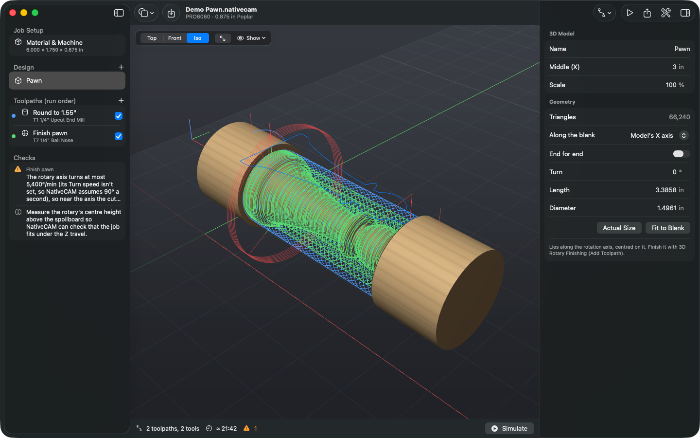

# Using NativeCAM

[← Back to the README](../README.md)

- [Workflow](#workflow)
- [Supported files](#supported-files)
- [Keyboard and mouse](#keyboard-and-mouse)
- [Toolpaths and features](#toolpaths-and-features)
- [Leads and corners](#leads-and-corners)
- [Rest machining](#rest-machining)
- [Feeds that follow the load](#feeds-that-follow-the-load)
- [V-carve inlays](#v-carve-inlays)
- [Chamfers, flutes and prisms](#chamfers-flutes-and-prisms)
- [Jobs bigger than the bed](#jobs-bigger-than-the-bed)
- [Rotary jobs](#rotary-jobs)
- [Templates](#templates)

## Workflow

| Step | Where |
|---|---|
| **1. Set up the job** | Select **Material & Machine** in the sidebar. Set the material size and thickness, XY and Z zero, heights, and your machine (pick a saved one or [set up a new one](machines.md#setting-up-a-machine)). |
| **2. Add artwork** | Use the shape button in the toolbar for rectangles, circles, ellipses, polygons, stars and text (any installed macOS font), or import a file with **⌘I** or by dropping it on the canvas. |
| **3. Pick bits** | Open the **Tool Library** (**⇧⌘T**) to add or edit bits: flat, ball, bull nose, V-bit, engraving, surfacing and drill, with full geometry and feeds and speeds. |
| **4. Create toolpaths** | Select vectors, then use the toolpath button in the toolbar or right-click them. Toolpaths run in sidebar order; drag to reorder, or choose **Toolpaths ▸ Optimize Run Order** for the fewest tool changes (**⌘Z** puts the old order back). For a job you cut again and again, add a set you saved earlier with **Toolpaths ▸ Apply Template**, and save this one with **Toolpaths ▸ Save Toolpaths as Template…** (see [Templates](#templates)). |
| **5. Review checks** | Warnings appear under **Checks** in the sidebar as you edit. |
| **6. Simulate** | **⌘R** plays the material-removal simulation; **⌘.** stops it. |
| **7. Export** | **⌘E** checks and saves the file for your controller (`.tap` for Mach4, `.nc` for Grbl, `.sbp` for ShopBot, and so on; one file per tool where the controller can't stop for a tool change). **File ▸ Export Air Cut…** (**⌥⌘E**) saves the same program with every Z raised, to run above the material first. **File ▸ Export Setup Sheet…** saves a printable page for the person at the machine. See [Export checks, air cuts and setup sheets](controllers.md#export-checks-air-cuts-and-setup-sheets). |

Load the file on your controller, zero X/Y, touch off Z and air-cut it before cutting material.

## Supported files

| Kind | Formats | Notes |
|---|---|---|
| Vectors | **DXF** | Lines, arcs, circles, polylines with bulges, splines, ellipses, blocks and inserts, `$INSUNITS`. POINT entities become drill marks. Loose segments are chained into closed loops, layer by layer. Layers are kept: a file with several comes in as one shape per layer, named *file – layer* and on that layer (a block's entities on layer 0 take the insert's layer; layer 0 itself is **Default**). |
| | **SVG** | Full path grammar, transforms, viewBox units. Layers are kept, as for DXF: Inkscape layers by their names, and in files from Illustrator, Affinity and most other programs the named groups straight under the root (Illustrator's layers). |
| | **PDF**, **Illustrator `.ai`** | PDF-compatible `.ai` files. Handles nested groups, page rotation and the crop box. Clipping masks trim what they cover, and hidden layers are left out, as a PDF viewer shows them. Visible layers are kept, as for DXF (one shape per layer). |
| 3D models | **STL** (binary/ASCII), **OBJ**, **3MF**, **USDZ/USD**, **PLY** | 3MF includes Bambu and Prusa multi-part files. Choose the up axis, flip, size, carve depth and how far below the surface the top sits. |
| G-code | **`.tap`**, **`.nc`**, **`.gcode`**, **`.ngc`**, **`.cnc`**, ShopBot **`.sbp`** | Opened for simulation only (**File ▸ Simulate G-code File…**, or drop on the canvas). Drilling cycles (`G73`, `G81`–`G83`, `G85`, `G86`, `G89`) are expanded into the moves the controller makes. So are tapping and boring cycles, read the way the project's controller runs them: `G74` and `G84` tapping, `G76` fine boring, `G87` back boring and `G88` boring with a stop to retract by hand for Avid Mach4; `G74`, `G76` and `G84` for Centroid; `G74` and `G84` for LinuxCNC. |
| Machines | Mach4 **`Machine.ini`**, Grbl **`$$`** output, **LinuxCNC** INI, **FluidNC** `config.yaml`, **Fusion 360** `.mch` | Speeds, accelerations, travel and spindle range for a machine. See [Importing controller settings](machines.md#importing-controller-settings). |
| Posts | Your own **Vectric `.pp`** | Writes G-code for a controller NativeCAM has no post for. See [Using your own Vectric post](controllers.md#using-your-own-vectric-post). |
| Tool libraries | **Fusion 360** `.tools` / `.json`, **Vectric** `.vtdb`, NativeCAM `.json` | **Tool Library ▸ ⋯ ▸ Import Tools…** lists the bits by the library's folders. Search, filter by type and tick the ones you want. Vendors such as Amana Tool publish their bits in these formats. Values a library leaves out (Vectric files have no cutting or shank lengths) are read from the bit's name where possible, otherwise filled conservatively and marked ⚠ (details in the tool's notes). Tapered ball nose, form, dovetail, roundover and thread bits are listed as not imported. Vectric's older `.tool` files aren't supported. |
| Projects | **`.nativecam`** | JSON document. Projects for any controller other than Avid's Mach4 profile, or with an imported post, are saved as format 2, and projects with rotary stock as format 3, format 4 when the blank is turned by hand, or format 5 when designs wrap around it or it has a spiral or a rounding toolpath. Projects with a V-carve start depth or an inlay plug are saved as format 6 (an inlay pocket on its own stays at its earlier format), projects with a 3D model on a rotary blank or a 3D rotary finishing toolpath as format 7, projects with a chamfer, fluting or prism toolpath as format 8, tiled jobs as format 9, and projects with waterline, steep-and-shallow or pencil 3D finishing, or a cross-hatched raster, as format 10. Older builds refuse to open a format they don't know rather than silently writing the wrong G-code. |

## Keyboard and mouse

| Action | How |
|---|---|
| Select | Click a vector's line (for text, click inside a letter). Shift- or ⌘-click to add or remove. |
| Marquee select | Drag on empty canvas in Top view |
| Move | Drag selected vectors, or nudge with the arrow keys (Shift moves 10×) |
| Orbit | Drag empty canvas in 3D views, or Option-drag anywhere. Trackpad rotate spins the view. |
| Pan / zoom | Two-finger scroll or right-drag / pinch or scroll wheel |
| Context menu | Right-click or Control-click a vector to add toolpaths, duplicate, center on material or change views |

| Shortcut | Command | | Shortcut | Command |
|---|---|---|---|---|
| ⌘I | Import | | ⌘1 / ⌘2 / ⌘3 | Top / Front / Iso view |
| ⌘E | Export G-code | | ⌘0 | Zoom to fit |
| ⌥⌘E | Export air cut | | ⌥⌘I | Show or hide inspector |
| ⌘R | Simulate | | ⇧⌘T | Tool library |
| ⌘. | Stop simulation | | ⌘D | Duplicate |
| ⇧⌘R | Recalculate all toolpaths | | | |

## Toolpaths and features

| Area | Details |
|---|---|
| Stock | Material size and thickness, XY zero at any corner or the centre, Z zero on the material top or the spoilboard, safe and plunge heights, park position. Inches or millimetres. Or a round or square [rotary blank](#rotary-jobs). |
| Depths | A profile's or pocket's cut depth and a drill's hole depth are **From top** (a plain depth below the material top), **Through** (the material's thickness plus a set amount into the spoilboard) or **Thickness −** (leaving a set amount above the material's bottom). The last two follow the thickness when you change it in Job Setup, and in a [template](#templates) applied to other material; the inspector shows which a depth is and what it cuts on this material. New profiles and drills cut **Through**, 0.02 in into the spoilboard. Projects with them open in older builds, which cut the depth for the thickness the project was saved with. |
| Profile | Inside, outside or on the line; climb or conventional; multi-pass; ramp entry; arc or line leads in and out; dogbone or T-bone corners; tabs; allowance; holes cut before outside profiles; [feeds that follow the load](#feeds-that-follow-the-load). See [Leads and corners](#leads-and-corners). |
| Pocket | Offset or raster clearing, islands, safe feed links between regions, dogbone or T-bone corners. Inner clearing rings get rounded corners (within a set tolerance, 0.25 mm by default); the wall pass stays exact. [Rest machining](#rest-machining): a larger end mill clears the pocket first, and the pocket's own bit cuts only the corners and narrow parts it can't reach, then the walls. With [feeds that follow the load](#feeds-that-follow-the-load) on, the first pass and the corners slow down. |
| Drill | Peck, chip-break and dwell. Canned cycles are expanded into plain moves. |
| V-carve | Maximal inscribed circles. **Start depth** carves as if the material top were lower (to carve inside an existing pocket, or for an inlay plug). **Flat depth** caps the carve, measured down from the start depth as in Vectric VCarve, so the deepest cut is start depth + flat depth. The flat bottom is cleared by an end mill you choose (cut first, and skipping depths an earlier pocket cleared) or, without one, by the V-bit itself, in passes close enough to leave ridges of about 0.1 mm. Multi-pass, counted down from the start depth. [Inlay](#v-carve-inlays) pockets and plugs. |
| Chamfer | A V-bit or engraving bit bevels the edges of closed shapes at its own angle, as Vectric's Chamfer toolpath does. **Side**: outside the shapes, inside them or both. **Vector is the**: top edge of the bevel (it slopes down away from the vector, Vectric's *Down*) or its bottom edge (it rises from the vector to the surface, Vectric's *Up*: the wall a profile on the same vectors leaves). **Width** and **Depth** are linked through the bit's angle. **Sharp corners** (on by default) keeps the bevel's corners crisp: the bit runs to a mitre round the outside of a corner and rises along the bisector into a valley, as a V-carve does. Start depth, multi-pass, climb or conventional. See [Chamfers, flutes and prisms](#chamfers-flutes-and-prisms). |
| Fluting | A ball nose, core box (a ball nose in the tool library) or V-bit cuts along open or closed vectors with its depth ramping in and out, as in Vectric's Fluting toolpath. **Ramp**: both ends, start, end or none; **ramp length** as a distance or a percentage of the longest it can be; **linear** or **smooth** (easing into full depth). Each pass follows the whole flute with its ramps scaled to its depth, so the last pass runs the full length. Works on wrapped rotary jobs: lines along the blank become flutes round a column. |
| Prism | A V-bit carves shapes as a raised bevel rising to a ridge along their middle, as Vectric's Prism Carving does. **Full prism** sets the depth from the widest part of the shapes and the bit's angle; a shallower depth leaves a flat top. Inside corners rise to the ridge along their valleys. |
| 3D roughing | Layered clearing with an end mill, leaving an allowance for finishing. Layer outlines follow the surface between grid samples instead of stepping cell by cell, so the machine doesn't crawl through stair-step corners. Machine inside the model outline, inside **selected vectors** such as the cut-out outline (chosen automatically when a cut-out surrounds the model, so scrap isn't machined), or across the whole material. |
| 3D finishing | Four strategies, all on an exact triangle drop-cutter, so steep walls aren't gouged, for every bit shape: ball, flat, bull nose, V-bit, engraving and drill (a V's point or tip flat, its flank and its shoulder, a bull nose's flat and corners). **Raster** passes follow the surface; **Cross-hatch** adds a second raster at the raster angle + 90° in the same toolpath, for slopes that run along the rows. **Waterline** cuts constant-Z loops round the model from the top down, a column of loops at a time; they lie flat, so they're fitted as arcs. **Steep and shallow** cuts waterline loops where the surface is steeper than the **Steep angle** (40° by default) and raster rows on the rest, each running an **Overlap** past the seam. The loops are stepover × tan(steep angle) apart in Z, so the scallop is the same either side of the seam (the inspector shows it). **Pencil** makes one pass along each concave crease, where the bit touches two faces at once (the foot of a wall, the bottom of a groove); run it with a smaller ball nose after the main finish. The last three work from a cutter-location height map of the exact drop-cutter, then find each loop point and crease exactly. **Smooth links** (on for new toolpaths) cut the raster in blocks, turn between rows on an arc and ramp into rows that start on the model, and bring each waterline loop in from its open side, so the bit comes down in the air instead of onto the model; links stay inside the boundary. Where the bit rolls over a wall's top edge and drops to the floor, the pass goes straight down at the foot of the wall rather than clipping the edge. Allowance is left square to the surface, except with a flat end mill, which adds it straight up. Shows scallop height. Same boundary choices as roughing. |
| Arc fitting | Line segments are re-fitted to arcs, helical ones included (for controllers that take arcs) |
| Links between cuts | **Minimum** (default): rise just above the remaining material plus a safe distance, feed straight across short stretches already cleared to depth, and rapid down to just above floors this job already cut. A rapid never moves sideways below the material top: over a floor cut deeper than the safe distance, the link goes over at the safe distance above the top and drops straight down. **Full** always returns to safe Z. Shapes marked as clamps raise an error if a toolpath cuts into them, and links cross them above their height. Profiles skip depths an earlier toolpath already cleared. |
| Cut order | Holes, profile loops and V-carve strokes are ordered by nearest neighbour and then improved by local search (2-opt, Or-opt); closed loops are entered wherever they're nearest the tool. Across toolpaths, **Optimize Run Order** finds the order with the fewest tool changes that keeps the work inside each part before its cut-out (a chamfer, flute or prism on a part's own outline counts as inside it, however wide its bit), roughing before finishing, and your order wherever toolpaths overlap. Toolpaths next to each other that clear with the same bit first (rest-machined pockets, V-carve flat clearing) do all that clearing before any of them changes to its own bit. |
| Job checks | Cuts into the spoilboard or a clamp, depth beyond flute length, toolpaths outside the work area, rapids through material, out-of-range feeds or RPM, chip loads too thin for the material (with a one-click recommended feed), judged by the feeds the toolpath actually cuts at: where it slows itself for a stretch at least four bit diameters long (near a rotary axis, or with [feeds that follow the load](#feeds-that-follow-the-load)), Checks says where, how slow, and the spindle speed that keeps the chip in range at that feed, a run order that cuts a part free too early, two different bits sharing one tool number (which would skip a tool change and cut with the wrong bit), a pocket's clearance tool that's no larger than its own or that reaches the whole pocket anyway, a V-carve inlay plug that won't seat in its pocket, a chamfer that the profile cutting the same shapes would cut away (or leave as a sharp lip), a chamfer, flute or prism deeper than the bit's V, a chamfer or prism without a V-bit and a flute cut with a flat end mill, and corner reliefs that would cut into a part another toolpath cuts. The exported file is checked too; see [Export checks](controllers.md#export-checks-air-cuts-and-setup-sheets). |
| Run-time estimate | See [Run-time estimates](machines.md#run-time-estimates). |
| Tools | Flat, ball, bull nose, V-bit, engraving (tip diameter), surfacing and drill. Flute length, shank, stickout, flute count and direction, feeds and speeds, chip-load calculator checked against chart chip loads for the material type, compression bits whose first pass clears the upcut length, live profile drawing, import from Fusion 360 and Vectric libraries. A new library starts with ten starter bits: 1/8", 1/4" and 1/2" end mills, 1/4" downcut and compression end mills, two V-bits, a ball nose, an engraver and a surfacing bit. Their feeds and speeds put the chip load inside the chart for plywood and hardwood, getting the thicker chip from a slower spindle so the feeds stay within 250 in/min. For softwood, MDF and particleboard, take the chip-load row's recommendation. Saved to `~/Library/Application Support/NativeCAM/tools.json`. A library you've saved is never replaced, so it doesn't get new starter bits by itself: **Tool Library ▸ ⋯ ▸ Add Missing Starter Tools** adds the ones it doesn't have (keeping their T numbers where they're free, never changing a tool you have, and leaving out a starter bit you already have as your own tool) and says what it added. **Reset to Starter Library…** replaces the whole library, your own and imported tools included, after asking; the old library is kept as `tools.json.bak` beside `tools.json`. |
| Simulator | A Metal-rendered heightmap carved by the true tool shape (flat, ball, bull nose, V), with through-cuts, a tool marker, play, pause, scrub and speed control, timed like the real job, and detection of rapids through material. Rotary jobs are carved face by face on a turning blank. It also simulates G-code and ShopBot files from other programs. |

## Leads and corners

**Leads** (Profile ▸ Leads) start and end each closed loop of an inside or outside profile with a short move in the waste, so the bit never plunges or stops against the finished edge.

- **Arc** comes onto the cut on a tangent arc (**Radius** and **Sweep**). **Line** comes in straight at an **Angle** to the cut (90° comes in square).
- **Lead out** leaves the loop the same way. **Overlap** runs the last lap a little past its start first, to hide the seam.
- With a plunge entry, the bit plunges at the far end of the lead, in the waste. With a ramp entry, the ramp runs down the lead and on along the wall. Between passes the tool feeds straight back to the lead's start at the depth it just cut, so a ramped cut never plunges.
- Each loop is entered where it's nearest the tool and a lead fits. Leads stay on the waste side, on the material, clear of clamps and clear of the parts other toolpaths cut (see below). They shrink, down to a quarter of the bit's radius, to fit small holes and tight gaps. A loop with no room for one is entered without a lead, and **Checks** says how many.
- When a profile starts below the top because an earlier toolpath cleared it (a finishing pass after roughing), leads only go where that toolpath cleared, so they may come out short.
- **Other toolpaths' parts.** Leads and corner reliefs keep clear of what every other toolpath leaves: the part inside an outside profile and the material round an inside one (each with its allowance), both walls of an **On** cut, a pocket's walls and islands, a V-carve's outline and the material round drilled holes. So parts nested close together can be cut by separate toolpaths (different depths or bits) in any order. Toolpaths turned off count too, since they're usually cut in another run. Material a toolpath cuts away itself doesn't count, so a finishing pass still leads in through its roughing pass's allowance.

**Corner reliefs** (Profile and Pocket ▸ Corners) cut just past each inside corner the bit can't reach, so square tenons, tabs and finger joints fit.

- **Dogbone** cuts into the corner along its bisector until the bit's edge touches the drawn corner. On a square corner that goes about 0.29 × the bit's radius past each wall.
- **T-bone** cuts past the corner along one wall, so the notch is only in the other wall. **T-bone side** puts it in the **Longer side** (the default), the **Shorter side**, or the sides along X or Y. T-bones suit slots about as wide as the bit, where dogbones would overlap.
- **Corners up to** is the widest corner that's relieved, measured across the cut-away area: a square corner is 90°. The default, 120°, includes hexagons. Flatter corners and faceted curves are left alone.
- Profiles relieve the inside corners on either side of the line: the corners of an inside cut, and the inside corners of an outside cut (finger joints, notches, the holes in a part). Pockets relieve the corners of the wall and the inside corners of islands. Corners rounded at least as much as the bit, and the pinch where an island comes closer to a wall than the bit is wide, are left alone.
- Allowance is left in the corner too. Very sharp corners get long reliefs that reach well into both walls, so check the preview.
- **Leave off reliefs that cut into other parts** (on by default): a relief whose bit would cut into a part another toolpath cuts, such as through a thin wall between two mortises in separate toolpaths, is left off, and **Checks** says how many and which toolpath. Turned off, the relief is cut anyway and Checks still warns. A relief that would cut into the toolpath's own nearby geometry is always left off.
- **Corner by corner:** with the toolpath selected, each relieved corner is circled on the canvas, at the bit's position at the end of the relief. Click a circle to step that corner through dogbone, T-bone into one side, T-bone into the other, and no relief. Right-click it to pick one, or **Use Toolpath Setting** to go back. Corners you've changed are drawn in the accent colour. A relief left off because it would cut into nearby geometry or another toolpath's part gets an orange cross, and one cut into another toolpath's part anyway an orange circle; right-click either to see why. The choice belongs to the corner of its shape, so it follows the shape when you move, turn or scale it. **Corners ▸ Reset** clears them all.

## Rest machining

**Pocket ▸ Rest machining ▸ Clear with a larger tool first** clears a pocket with a big end mill and sends the pocket's own, smaller bit only where the big one can't reach: the corners, slots narrower than the big bit and the gaps round islands. On a machine with manual tool changes that's one extra collet swap for much less time with the small bit, instead of pocketing everything with it.

- Turning it on picks the smallest end mill in the tool library at least half as big again as the pocket's bit (the 1/2" for a 1/4", the 1/4" for a 1/8"), or else the largest one that's still larger. With no larger end mill in the library the toggle stays off and says so; add one in the Tool Library.
- The **Larger tool** cuts first, with the pocket's strategy (offset or raster) and its own stepover, pass depth and feeds from the tool library. It leaves the allowance plus a tenth of the small bit's diameter (at most 0.01 in) on the walls, so the small bit cuts the whole wall and there's no step where the two bits meet.
- The pocket's own bit then clears what's left with offset rings, overlapping the big bit's cut a little so no slivers stay behind, and makes the final pass round the walls and islands, with any corner reliefs, at each of its pass depths. The result is the same pocket the small bit would cut on its own.
- The two bits are two toolpaths in the output, **Pocket – clearing** and **Pocket**, the clearing drawn in a paler shade of the toolpath's colour. The inspector's **Result** gives each one's time, and the setup sheet says what each bit cuts.
- Pockets next to each other in the toolpath list that clear with the same big bit clear all their pockets with it first, then finish them all with their own bits, so three pockets cleared with a 1/2" bit and finished with a 1/8" one load each bit once. **Optimize Run Order** brings such pockets together.
- **Checks** warns when the larger tool isn't larger than the pocket's, isn't a flat end mill, doesn't fit in the pocket (the small bit then clears it all), or reaches the whole pocket (a round pocket, say), where the big bit alone would do and save a tool change.
- Projects with rest machining open in older builds, which cut the pocket with its own bit alone.

## Feeds that follow the load

One feed for a whole toolpath has to suit its hardest cut: a pocket's first pass, a full-width slot through solid wood, the material an offset ring meets in each inside corner, a tight inside arc. Lowering the feed for those slows everything else and thins the chip everywhere, which burns wood. **Profile and Pocket ▸ Tool ▸ Adjust feeds for load** slows only the hard cuts instead. It's off unless you turn it on, for each toolpath.

- **What it measures.** At points every eighth of a diameter along the toolpath it works out how much of the bit's edge is in the wood, from what is still uncut there: what earlier toolpaths left, less what this one has already cut at that depth. Half the bit's width cutting is 90° of its edge; a full-width slot is 180°.
- **The usual cut.** Your feed is taken to be right for the toolpath's usual cut, the middle of what it measures: a pocket's offset rings, or a finishing pass's light cut. Only cuts harder than that slow down. A profile cutting a part out of solid wood is a full-width slot all the way round, its usual cut, so it keeps its feed.
- **How much slower.** Where more of the edge cuts than usual, the feed is lowered to keep the chip as thick as in the usual cut (below half the bit's width a light cut makes a thinner chip than the feed suggests). Past half its width the chip stops growing but the force on the bit keeps rising, so the feed comes down with the square root of the extra force: a full-width slot in a pocket cleared at 40% stepover runs at 70%. It never goes below 55%, nor where the chip would be more than 10% thinner than the chart's least for the bit in the job's material (20% for ball and bull noses, the same allowance the chip-load check makes before it warns): thinner chips rub and burn. When that floor stops a slowdown, **Checks** says so and suggests a lower spindle speed. The chip-load check reads the scheduled feeds too.
- **Inside arcs.** On a profile, where the wood is on an arc's outside only (finishing a hole whose core is gone, or a recess's rounded corners), the edge on the outside travels faster than the bit's centre, so the centre's feed is lowered to F × (R − r) / R, R being the wall's radius and r the bit's. Outside arcs are left alone, and so is a slot round an arc, where the thinner chip on the inside makes up for the thicker one outside. Arcs tighter than half the bit's radius count as corners. A pocket's rings slow only for their engagement, which already rises on a concave ring.
- **Few F words.** Feeds come in steps of 100, 85, 70, 55, 45, 35 and 25% of yours, each cut rounded down to a step (or up to one within 10%). A slowdown starts just before the hard cut; the feed comes back up only once the cut is clearly easier again, and never within half a diameter of the last change, so a short slowdown runs on a little. An arc keeps one feed, the slowest any point of it needs: F never changes inside an arc. Straight moves are split where their feed changes.
- **What it never does.** It never feeds faster than you set (a slowed cut is also kept within the machine's maximum), never moves the path, and doesn't change the spindle speed. Plunges and ramps steeper than 45° keep their own feeds.
- **What uses it.** The run-time estimate, the simulation's timing, the inspector's **Result** (the range of feeds) and the setup sheet (which marks a feed that varies) all follow the scheduled feeds, as the posted file does.
- It works with end mills, bull noses and surfacing bits, whose side cuts straight. With a ball nose or a V-bit the toggle says it doesn't apply. On a wrapped rotary job the moves are fed in inverse time (`G93`), so they keep the programmed feed and **Checks** says so.
- Projects with it on open in older builds, which cut at the feed you set throughout.

## V-carve inlays

A V-carve inlay is a plug of contrasting wood glued into a V-carved pocket, then planed flush. Both sides come from one design and one V-bit: the **pocket** (female) is carved into the main board, and the **plug** (male) carves away the wood *around* the mirrored design on a second board, so the design stands proud. Turned over and pressed in, the plug's sloped walls meet the pocket's all the way round. The settings follow Vectric's VCarve Inlay toolpath, so its tutorials and recipes carry over.

1. **Pocket.** Select the design, add a V-carve and set **Inlay** to **Pocket**. Give it a **Flat depth**, the pocket depth P (0.2 in is a common start), and an end mill under **Clear flat area with**. Narrow parts are carved as a plain V; wider parts get a flat floor at P.
2. **Plug.** Add a second V-carve on the *same* design, set **Inlay** to **Plug**, and use the same V-bit. Picking Plug copies the pocket's flat depth, V-bit and clearance tool. The plug is mirrored left to right inside the toolpath, about the centre of the design, so leave the design as drawn: the shapes on the canvas don't change.
   - **Pocket depth** (P): the pocket's flat depth. **Checks** warns when they differ.
   - **Glue gap** (G): the gap left between the plug's face and the pocket's floor. 0.02 in (0.5 mm) is typical.
   - **Surface clearance** (C): how far the plug board's carved floor stays above the pocket board's surface when the walls meet. It leaves room to clamp the plug in and is the waste you saw or plane off. The default is 1/16 in.
   - **Boundary**: where the carving round the design stops. **Margin** carves the **Boundary margin** past the design's outline. **Selected vector** carves inside a closed vector you select with the design for the plug toolpath (a rectangle the size of the plug board, say): the one that goes round all the others, shown as the **Boundary vector**. It's a choice rather than a guess because a design can have a shape round the rest of it too, like a frame.
   - The plug is carved from its **start depth** S = P − G down to S + C, both shown in the inspector. At depth S its walls lie exactly on the mirrored outline, and above that they lean in at the bit's angle, as the pocket's do. Flipped into the pocket, the walls meet when the plug's face is S deep, which leaves P − S = G under it.
3. **Cut them on separate boards.** Turn off **Include in output** on one side and export the other, then swap. **Checks** warns if both would be cut in one file on top of each other. Saw the plug free inside the carved band, glue it into the pocket face down, clamp, then plane or sand it flush.

Without a clearance tool the V-bit clears the flat areas itself, in rings close enough that the ridges between them stay under the glue gap. It's slower, so use an end mill for large areas. On an inlay, the V-bit also cleans up the corners and narrow places the end mill can't reach, so nothing stands proud of the pocket's floor or the plug's.

**Checks** warns when the plug won't seat: a different V-bit angle or tip from the pocket's, a pocket depth that doesn't match the pocket's flat depth (with the gap the plug would really get, or a warning that it bottoms out before its walls meet), no glue gap or one too small for the V-bit's clearing ridges, no surface clearance, a plug cut deeper than the bit's V is tall, or a V-bit with a flat tip (narrow parts of the plug then come out taller than the pocket's grooves). The setup sheet lists each inlay toolpath's side and depths.

**Start depth** on any V-carve carves as if the material top were lower. On a plug it's set by the pocket depth and glue gap. Elsewhere, use it to carve inside an existing pocket (enter the pocket's depth), or to drop an inlay pocket into a recess: **Flat depth** is then measured from the start depth, as in Vectric VCarve.

## Chamfers, flutes and prisms

Three toolpaths that follow the vectors with a shaped bit, in **Add Toolpath** with the shapes selected. Their settings follow Vectric's Chamfer, Fluting and Prism Carving toolpaths, so its tutorials carry over.

**Chamfer the top edge of a part you cut out.** Draw the part, add the **Profile** that cuts it out, then select the same shapes and add a **Chamfer**. Seeing the profile, the chamfer starts as **Side: Inside** with **Vector is the: Bottom edge**: the bevel rises from the part's outline, where the profile leaves its wall, into the part, so the part keeps the size you drew. Set the **Width** (or the **Depth**; with a 90° bit they're the same), keep **Sharp corners** on, and put the chamfer before the cut-out (**Optimize Run Order** does, and **Checks** warns otherwise). A hole the profile cuts gets its rim bevelled the same way, on the part's side.

- **Side** and **Vector is the** together give the four kinds Vectric offers. Top edge, outside: a raised part's top outline, the bevel sloping down outside it (cut the part out at least the bevel's width further out). Top edge, inside: a countersink round the top of a hole. Bottom edge, outside: the rim of a hole or pocket cut on the vector. Bottom edge, inside: a part's top edge, as above. **Both** bevels either side of the vector: a V-groove along a bottom edge, a sharp ridge along a top edge. The inspector says in a line what the choice does.
- **Checks** warns when the profile cutting the same shapes would cut the bevel away (it lies on the profile's waste side) or leave a sharp lip along the wall (a top-edge bevel on the part's side), and says what to set instead.
- Without **Sharp corners** the bit stays at depth all the way round: corners come out rounded, as a bearing-guided chamfer bit leaves them.

**Fluting.** Draw lines (or closed shapes) where the flutes go, select them and add **Fluting** with a ball nose or V-bit. Set the **Flute depth**, the **Ramp** (both ends, start, end or none), its length as a **Distance** or a **Percent** (100% ramps the whole flute with one ramp, or to its middle with two), and its shape. A flute ramped at one end starts at its vector's start point; one that's the same both ways is cut from whichever end is nearer. On a wrapped rotary job, lines drawn along X on the sheet become flutes along a column, cut round the blank with the A axis turning between them.

**Prism.** Select closed shapes (lettering, a star, a diamond) and add **Prism** with a V-bit. With **Full prism** on, the depth is just enough for the slopes to meet in a ridge at the widest part; turn it off to set a shallower depth and leave flat tops. The bit's tip runs round the outline, so its far side cuts past it too: clear round the prism with a pocket, or cut it out with a profile, as you would in Vectric.

The setup sheet lists each chamfer's width, depth and side, each fluting toolpath's depth and ramps, and each prism's depth.

## Jobs bigger than the bed

When the material is longer or wider than the machine reaches, NativeCAM cuts it in tiles: one file per tile, run one after another as the material moves. The settings follow Vectric's Toolpath Tiling Manager, so its tutorials carry over, and NativeCAM adds registration holes for dowels and a setup sheet page for each tile.

1. **Turn it on.** In **Job Setup ▸ Tiling**, turn on **Cut in tiles** and choose how the material moves:
   - **Feed-through in Y** (or **in X**), for a machine open at the front and back (or the sides): the board slides through one **tile length** at a time. Each tile is the board's full width, which has to fit the other axis's travel.
   - **Individual tiles**: tiles across and up, for separate boards, or a board moved both ways.

   **Tile length** (width and height for individual tiles) is how far the material moves between tiles. Automatic is the machine's travel less the overlap, the largest bit and a 1 in margin, rounded down to a whole inch (10 mm in millimetres). **Overlap** is how far each tile reaches past its tile lines; automatic is the largest bit's radius plus 1/8 in. **Short tile** puts the remainder tile last or first.
2. **Check the canvas.** Tile lines are yellow, with the overlap either side of each hatched in red. **Checks** says how many tiles and files the export makes, and flags a tile that reaches past the machine's travel or a board too wide to feed through.
3. **Registration holes** (feed-through only). Turn on **Registration holes** and NativeCAM drills dowel holes so each move lands exactly one tile on. Tile 1 drills two holes into the spoilboard just in front of the board, and two through the board exactly one tile length further on. Slide the board one tile and those holes sit over the spoilboard holes: drop a dowel through each, clamp, tap the dowels flush (or pull them), and run the next file. Each tile but the last drills the pair for the next.
   - **Dowel diameter** is the hole size, **In from the edges** how far the pair is in from each side of the board, and **Into the spoilboard** how deep they go below it.
   - **Bit**: automatic picks the job's largest straight bit that fits the hole, so there's usually no extra tool change. A bit the hole's size plunges in pecks; a smaller one bores the hole in rings, so no core is left standing in the spoilboard. The holes are drilled first in each tile.
   - Keep the holes in waste: **Checks** gives an error when one lands on the design, where a toolpath cuts, on a part or under a clamp, or too near the board's edge.
4. **Export.** **Export G-code** saves a file per tile, `Sign - tile 1 of 3.tap` and so on (and a file per tool in each tile when the controller can't stop for a tool change), with `Sign setup sheet.html` beside them. The setup sheet has a page for each tile: the file to run, how far to move the material and which way, where the dowels go and what the tile drills (in work coordinates), its share of the material, and a picture of it.
5. **Run it.** Each file is in its tile's own coordinates, so set the XY zero once, at the tile's corner (tile 1's is the material's corner unless the short tile comes first; the setup sheet says where), and keep it for every tile. Re-zero Z only if the board isn't flat.

**How cuts are split.** Each cut belongs to the tile whose share of the material it's in. A cut that crosses a tile line runs on into the overlap before it breaks, so it never breaks on the seam itself. Where a cut breaks, the tool lifts and the tile that cuts the rest comes back down onto the same point: straight down at the plunge rate, or ramping along the cut when the toolpath ramps in (and always for a surfacing bit). A toolpath that relies on another having cut first (a rest-machined pocket's larger bit, a V-carve's flat clearing, a 3D rough before its finish) runs on further at the tile lines, by both bits' radii, so the later bit never meets material the earlier one leaves for the next tile; Checks says if the overlap is too narrow for that. 3D and V-carve paths split the same way. The moves between cuts are worked out again from the material as the tiles really leave it.

**⌘R** simulates the tiles one after another with the material in place, so the finished part is the whole job. **Tiles** in the simulation bar jumps to the start of any tile. Rotary jobs can't be tiled.

## Rotary jobs

NativeCAM cuts rotary work two ways. **On faces** (indexed, 3+1), the blank turns to a fixed angle, the router cuts the face on top, then the blank turns to the next angle. **Wrapped around**, the design sheet wraps around a round blank, and the blank turns while the router cuts: text and patterns around a rolling pin, flutes, spirals. On either layout, **3D rotary finishing** turns a 3D model (a table leg, a baluster, a chess piece) all the way round as the blank turns. **File ▸ New Demo Rotary Project (3D)** opens a chess pawn ready to cut.

<table>
  <tr>
    <td width="50%"></td>
    <td width="50%"></td>
  </tr>
  <tr>
    <td align="center">A model on the blank, with its toolpaths</td>
    <td align="center">Finished in the simulation</td>
  </tr>
</table>

1. **Machine.** Turn on **Rotary axis** under **Material & Machine ▸ Rotary Axis**, or in the setup step of **Set Up a Machine…**. NativeCAM drives an A axis along X so far. Measure the **Centre height** (the chuck centre above the spoilboard) so the job can be checked against the Z travel. To check **Reversed**, jog A positive: the top of the blank should roll toward −Y. Get this right before a wrapped job, or wrapped designs come out mirrored. Set the **Turn speed** (degrees per minute; on Mach4, Configure ▸ Control ▸ Motors, the A motor's velocity) and the run-time estimate and the simulation time each turn with it; until then they assume 90° a second.
   - **Turn by hand.** For a machine that can't drive the axis (Grbl, FluidNC, Carbide Motion and Masso have no A axis in NativeCAM), or a hand-cranked indexer, turn on **Turn by hand**. Before each new angle the program lifts to safe Z, stops the spindle and pauses (`M0`) with a comment such as "Turn the blank to 90°, then Cycle Start"; Cycle Start (or Resume in your sender) starts the spindle again and carries on. Every file starts with a pause that asks for its first angle, so a job split into one file per tool never assumes where the last file left the blank. Angles count up as the top of the blank rolls toward −Y; if your indexer counts the other way, turn on **Reversed** and each pause asks for your indexer's reading. Each turn by hand counts as 30 seconds in the run-time estimate. Wrapped jobs need a driven axis.
2. **Blank.** Turn on **Material ▸ Rotary blank**, then set the shape (round or square bar), the diameter or the size across the faces, and the length. Then choose how designs sit on it under **Designs**:
   - **On faces:** the design sheet becomes one face of the blank: as wide as the blank is long, as high as its diameter, with the axis under its middle and the thickness down to the axis.
   - **Wrapped around** (a round blank, or a square bar with a Rounding toolpath first): the design sheet becomes the blank unrolled: as wide as the blank is long and once round it high (π × the diameter). The line across the middle of the sheet is the top of the blank at A0, and the sheet's top and bottom edges meet at the seam. Shapes that run past the seam carry on round, so a line drawn longer than the sheet is high becomes a spiral. Designs come out true to size at the **Wrap diameter**: the blank's diameter, or the finished size if it's turned down first.

   Width, height and thickness follow the blank, and safe Z rises to clear a square bar's corners as it turns.
3. **Zero.** Z zero is on the rotation axis and Y zero on its centreline (on Avid, Rotary tab ▸ Z Axis Touch and Y Axis Touch). X zero is the left end, the middle or the right end of the blank. On a square bar, A zero must put a face square to the spindle. Rotary jobs park over the middle of the blank.
4. **Toolpaths.**
   - **On faces:** profile, pocket, drill, V-carve, chamfer, fluting and prism toolpaths list the angles the blank turns to, in cutting order, under **Index Angles**, and cut the same shapes at each. **Spread evenly** fills in n faces 360°/n apart. A square bar only takes quarter turns (0°, 90°, 180° and 270°). The blank turns with the tool at safe Z. A V-carve with flat-area clearing clears every face first, then carves every face, so the job changes tools once rather than at each face. On a round blank, **Checks** warns when a cut reaches far enough from the top line of the face that the surface falls away under it; a V-carve there comes out shallower and narrower than drawn.
   - **Wrapped around:** profile (on the line for engraving), pocket, V-carve and drill toolpaths. Each shape is cut at the angle its height on the sheet gives, and holes are drilled straight in toward the axis. Pocket walls along the blank point at the axis rather than staying parallel, as with any wrapped pocket. Wrapped toolpaths go up to safe Z between cuts, and turns of more than 90° are split into pieces so a controller that takes the short way round still turns the right way. Where a cut round the blank would need it to turn faster than the rotary's **Turn speed**, its feed comes down to what the axis can keep, and **Checks** says how far.
   - **Spirals** (rope and barley twists): on a wrapped job, **Add Shape ▸ Spiral** adds lines that climb once around the blank per **Pitch** along it, with any number of **Starts** and a right- or left-hand **Twist**. They follow the sheet when the wrap diameter changes. Cut them on the line with a ball nose or V-bit.

   - **3D models** (either layout): an imported model (STL, OBJ, 3MF, USDZ) on a rotary blank lies along the rotation axis, centred on it, scaled to fit the blank and placed in its middle. Its outline on the sheet is the model seen from the side. In the inspector, **Along the blank** picks which of the model's own axes runs along the blank (its longest, to start with), **End for end** turns it round, **Turn** turns it about the axis (which side is on top at A0), and **Length**, **Diameter** and **Middle (X)** size and place it. **Fit to Blank** makes it as wide as the blank is round and no longer than the blank less half an inch at each end; **Actual Size** shows it as drawn. The 3D view shows the model on the blank.
   - **3D rotary finishing** (either layout): select the model, then **Add Toolpath ▸ 3D Rotary Finishing**. A ball nose follows the model all the way round with an exact drop-cutter (the model turned to each angle and the tool dropped onto it), so it never cuts into the model at the points it's dropped at, and a move whose middle would dip into it is split. **Pattern**: **Spiral** (one continuous helix along the blank, a stepover per turn, with a full turn at each end, so there's no seam), **Rings** (a turn at one station, then a step along the blank) or **Along X** (passes along the blank, stepping round by the stepover at the model's largest radius; often quicker when the rotary is slow). The inspector shows the stepover in millimetres or inches and the scallop it leaves. **Allowance** leaves material on the model. **Start** and **End** default to the model's ends, with the cutter kept inside the blank's. **Sample spacing** (along the blank) and **Angle step** (round it; by default the sample spacing at the model's largest radius) set how closely the tool is dropped. Where the model is deeper below the stock than the **Pass depth** (the bit's stepdown unless set), layers cut down to it first, each following the model no closer to the axis than its own radius and leaving out what would only cut air, at the **Layer stepover** (40% unless set); a Rounding first saves the layers from cutting a square bar's corners or a blank bigger than the model. The feed comes down where the rotary axis couldn't otherwise keep up: near the axis, a full-speed cut would need the blank to turn faster than its **Turn speed**, and **Checks** says how slow it gets (set the turn speed for a real figure). **Checks** also warns when the model doesn't fit the blank or is too close to its ends, when parts of it are hidden from a tool coming in toward the axis (undercuts) or the axis isn't inside it, when the collet could hit the blank (the bit's stickout against the deepest cut), when a pass is deeper than the flutes, and when it starts from a square bar with no Rounding first. Bull noses, V-bits, engraving bits and drills are followed just as exactly, each by its own shape; a flat end mill leaves material in hollows. The setup sheet lists the model each finish follows and how. Keep a short stub at each end of the model (the demo pawn has one) so the part stays held between the chuck and the tailstock; part it off by hand.
   - **Rounding** (either layout): **Add Toolpath ▸ Rounding** turns a square bar round, or a round blank down to a smaller diameter, in layers no deeper than the **Layer depth**. **Finished diameter** is the wrap diameter on a wrapped job and the blank's own (across the faces) otherwise. **Around** cuts each layer as a spiral along the blank; **Along** makes passes parallel to the axis, stepping round between them, which is often quicker when the rotary is slow and skips the faces of a square bar until the layers reach them. **Start** and **End** set how much of the blank it rounds; by default the cutter stays just inside its ends. Rounding needs no shapes and always runs first (**Optimize Run Order** puts it there). Like every toolpath that turns the blank as it cuts, its feed comes down where the cut would otherwise need the blank to turn faster than the rotary's **Turn speed** (90° a second until it's set), and **Checks** says how slow it gets: rounding a small blank at an end mill's full feed often does. When that makes the chip too thin for the material, the chip-load check says so too, with the spindle speed that would fix it (or that even the spindle's slowest won't).

   On a wrapped sheet a dashed green line marks the top of the blank at A0, and dashed orange lines along the top and bottom edges mark the seam.

   A rotary program turns the blank back to A0 at the end. After more than ten turns (a long rounding pass), it stops on the nearest whole turn instead of winding them all back, and says so at the end of the file: zero A (on Avid, Rotary tab ▸ Zero A) before the next job.

**Checks** lists anything the job can't cut. A wrapped design is exact only at the wrap diameter: deeper in, the same angle spans less, so a cut deeper than a tenth of the radius gets a warning with how much narrower it comes out at the bottom.

**Feeds on wrapped toolpaths.** When the blank turns during a cut, the right feed depends on how far the tool is from the axis. NativeCAM writes those moves in inverse-time mode (`G93`): each line's F is one over its time in minutes, worked out from the length of the path the tool tip traces. That's what Avid's own wrap posts do. Moves that don't turn the blank stay in `G94` with an ordinary feed, and `G94` is back on before every tool change and the program end. Controllers whose rotary feeds aren't documented and that don't take `G93` (Centroid and Buildbotics, so far) can't cut wrapped jobs. Mach4's `G93` hasn't been tested on a machine yet: before your first wrapped job, with the tool raised and no blank in the chuck, run `G21 G90`, then `G93 G01 A360 F10`, then `G94` from MDI. The turn should take exactly 6 seconds.

**⌘R** simulates the job on the blank itself. On faces it turns to each angle with the tool at safe Z, as the machine will, at the machine's turn speed, and slows down for each turn so you can follow it. Wrapped, the tool stays over the axis and the blank turns under it as it cuts, with the toolpaths wrapped round it; a wall cut straight along the blank (a flute's side) shows very slightly radial. The run-time estimate times wrapped moves by the path of the tool tip, as the `G93` feeds make them run, and the simulation plays at the estimate's pace, so it ends at the estimated time. Like the program, it turns the blank the short way to a toolpath that starts more than a turn from where the last one left it, and stops a long job on the nearest whole turn rather than winding back to A0. 3D rotary finishing simulates the same way, all the way round. Designs stay on the flat sheet. The setup sheet gives each angle in the run order, and on a blank turned by hand, a step for each pause.

## Templates

A template is a set of toolpaths saved with their tools and every setting, to add to another design: the signs, boxes, cutting boards and inlays you cut again and again. It works like Vectric's toolpath templates.

1. **Put each part's vectors on a layer.** Draw them on layers in your CAD or drawing program (`Cut Out`, `Pocket`, `V-Carve`, `Holes`): DXF, SVG and PDF files come in as one shape per layer, already on it. Or select shapes and type a name in the inspector's **Layer** field (or pick one of the design's layers from its menu); with several shapes selected, the field sets them all.
2. **Say how each toolpath finds its vectors.** The toolpath inspector's **Vectors** menu picks **Layer “Cut Out”**, a kind (**Text**, **Circles**, **3D models**, **Open vectors**, **Closed vectors** or **All vectors**), or **Chosen by hand**. A toolpath that finds its vectors by layer or kind picks them up again when you change a shape's layer, import vectors or choose **Toolpaths ▸ Recalculate All** (**⇧⌘R**); **Use Selected Shapes** makes it chosen by hand again. For one chosen by hand, the inspector says what a template will use instead: the layers its shapes are on when it has every shape on them, else a kind when it has every shape of that kind, else the vectors selected when the template is applied.
3. **Save.** **Toolpaths ▸ Save Toolpaths as Template…** saves the selected toolpaths (or all of them), in run order, as a `.nativecamtemplate` file in `~/Library/Application Support/NativeCAM/Templates/`. Leave **Include the job setup** on to save the material, its thickness, the XY and Z zero, the heights and the machine it's for. Corner overrides set on the canvas aren't saved: they belong to this design's shapes. A depth deeper than the material is saved as **Through**, so the template cuts through material of any thickness.
4. **Apply.** On another design, **Toolpaths ▸ Apply Template** lists the templates in that folder (**Choose…** opens one from anywhere, **Show Templates Folder** opens the folder in the Finder). A sheet shows what each toolpath finds before anything changes. Toolpaths go after the job's own, in the template's order. One whose layer has no vectors is still added, empty, and **Checks** says so: put vectors on the layer and choose **Recalculate All**, or select vectors and click **Use Selected Shapes**. Toolpaths saved to take the selection get the shapes selected when you chose the template. **⌘Z** takes the whole template off again.
5. **Check the tools.** Each tool is matched to the tool library by its geometry (shape, flute direction, diameter, and angle, tip or corner radius), so a template from another library uses your bit and your tool number with the template's feeds and speeds; the sheet says when they differ from your library's. A bit the library doesn't have keeps its number unless another bit has it, and the sheet offers to add it to the library, once.
6. **Job setup.** The template's job setup is used only if you turn on **Use the template's job setup** in the sheet, which lists what it changes. A change to the XY or Z zero is marked in orange: set up and touch off the machine to match. Off, the toolpaths cut this job's material: **Through** and **Thickness −** depths follow its thickness, and plain depths stay as saved. Applying a template never changes the machine; the sheet says when the template was made for another one.

Templates carry the project file format they need, and a template from a newer NativeCAM than yours is refused, as projects are. `nativecam-cli template save` and `template apply` do the same from the [command line](command-line.md#commands).
